# EasyParcel Accounting Tool — AutoCount Cloud Guide

Send your EasyParcel charges, refunds and top-ups, your store's sales and their payouts straight into AutoCount Cloud Accounting, so you no longer key them in by hand. This guide works for both **Malaysia (MYR)** and **Singapore (SGD)** accounts. Where the two are different, it says so.

The Accounting Tool belongs to your **organization** in EasyAccount, like CRM, WhatsApp Blaster and AI Agent. It shows every shipping account linked to your organization in one place, and everyone your organization gives Accounting access to works on the same connections.

> All screenshots in this guide use demo data. Your own screens show your organization, company name, account codes and amounts.

## Contents

1. [Before you start: your organization](#before-you-start-your-organization)
2. [Get your API key from AutoCount Cloud](#part-1--get-your-api-key-from-autocount-cloud)
3. [Connect AutoCount Cloud to EasyParcel](#part-2--connect-autocount-cloud-to-easyparcel)
4. [Set up your connection](#part-3--set-up-your-connection)
5. [Check your sync](#part-4--check-your-sync)
6. [Record your platform payouts](#part-5--record-your-platform-payouts)
7. [What gets sent to AutoCount Cloud](#what-gets-sent-to-autocount-cloud)
8. [Managing your connection](#managing-your-connection)
9. [Who can do what](#who-can-do-what)
10. [Malaysia and Singapore at a glance](#malaysia-and-singapore-at-a-glance)
11. [Troubleshooting and FAQ](#troubleshooting-and-faq)

---

## Before you start: your organization

**Your shipping account must be linked to your organization.** Shipping accounts are linked to an organization in EasyAccount, under **Manage organization**, by the account's owner. Share the account with organization products while you're there, so Accounting can see it. If you open Accounting from an account that isn't linked yet, you see **Link this account to your organization** with a button to EasyAccount.

**Your role decides what you can do.** In EasyAccount, under **Roles and Permissions → Accounting**, each person in your organization gets one of:

- **Admin**: connects your accounting software, enters keys, changes setup, sends documents and records payouts.
- **Viewer**: sees everything, and changes nothing. A blue strip at the top of every page says *You can view Accounting. Ask your organization owner or an admin to make changes.*

The organization's **owner** can always do everything. See [Who can do what](#who-can-do-what) for the full list.

> Accounting is open to invited organizations only for now. If you see *Accounting isn't available for your organization yet*, contact EasyParcel support.

---

## Part 1 — Get your API key from AutoCount Cloud

EasyParcel talks to AutoCount Cloud through AutoCount's own API, using three values from your account book: a **Key ID**, an **API Key** and your **Account Book Id**. You create the key once, inside AutoCount Cloud.

> **Note:** this guide is for **AutoCount Cloud Accounting**, the web version. AutoCount Accounting installed on a computer, and AutoCount On The Go, connect differently.

Before you start, make sure your account book has:

- a **supplier (creditor) for EasyParcel**, if this connection will post your EasyParcel costs, and
- the **expense accounts** you want your EasyParcel charges recorded in.

You choose them in Part 3. If they do not exist yet, create them first.

### Step 1: Open Settings

Sign in to AutoCount Cloud Accounting and open the account book EasyParcel should send your documents to. Click the **gear icon** at the top right, then **Settings**.

### Step 2: Create an API key

Click **API Keys → Create API Key**. Then click the **edit icon** on the new key to set what it may do.

### Step 3: Give the key only the permissions EasyParcel needs

Untick **All Permissions**. Then expand each group under **Permissions** and tick exactly these, and click **Save**:

**Always needed**

| Group | Permissions |
|---|---|
| CompanyProfile | `GetRecord` |
| Account | `GetRecords` |
| Creditor | `GetRecords`, `GetRecord` |
| Location | `GetRecords` |
| PaymentMethod | `GetRecords` |
| PurchaseInvoice | `GetRecords`, `CreateRecord` |
| PurchaseReturn | `GetRecords`, `CreateRecord` |
| JournalEntry | `GetRecords`, `CreateRecord` |
| KnockOffEntry | `OutstandingTransactions`, `CreateRecord` |

**Also needed if you send your own sales to AutoCount**

| Group | Permissions |
|---|---|
| Debtor | `GetRecords`, `GetRecord`, `CreateRecord` |
| Invoice | `GetRecords`, `CreateRecord` |
| CreditNote | `GetRecords`, `CreateRecord` |
| Creditor | `CreateRecord`, so EasyParcel can create a supplier for each platform's fees when you record a payout |

**Also needed if you take top-ups straight out of your bank account** (see Part 3, Step 2)

| Group | Permissions |
|---|---|
| Payment | `GetRecords`, `CreateRecord` |

> **Why not All Permissions?** EasyParcel never deletes, edits or voids anything in your book. Giving the key only what it needs keeps your book safe if the key is ever shared by mistake.

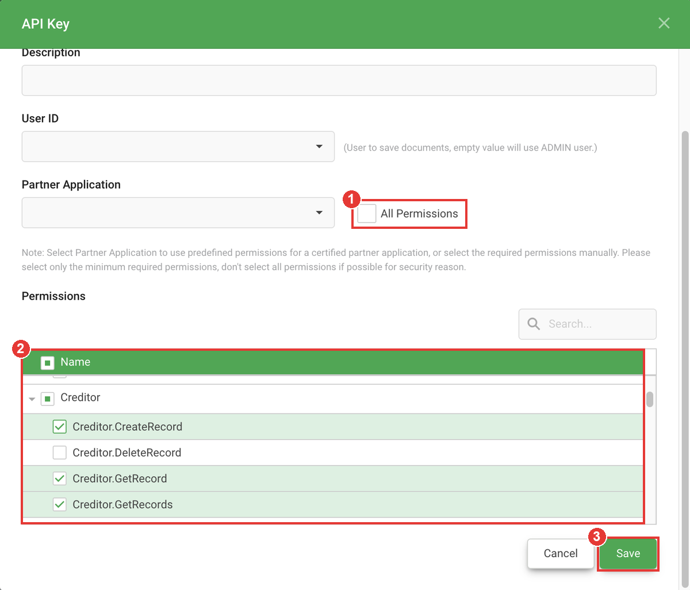

### Step 4: Copy the Key ID, API Key and Account Book Id

Back on the **API Keys** page, click the copy button beside each of these and keep them somewhere safe:

1. **Key ID**
2. **API Key** (click the eye icon to show it, or the copy button to copy it)
3. **Account Book Id**, at the top of the page

---

## Part 2 — Connect AutoCount Cloud to EasyParcel

### Step 1: Open the Accounting Tool

Log in to EasyParcel and open the **Products** menu (the grid icon), then choose **Accounting**. In another organization product, such as CRM, WhatsApp Blaster or AI Agent, the grid icon is at the bottom of the left menu.

Accounting opens for your organization. If you belong to several organizations, use **Switch organization** in the organization menu at the bottom of the left menu.

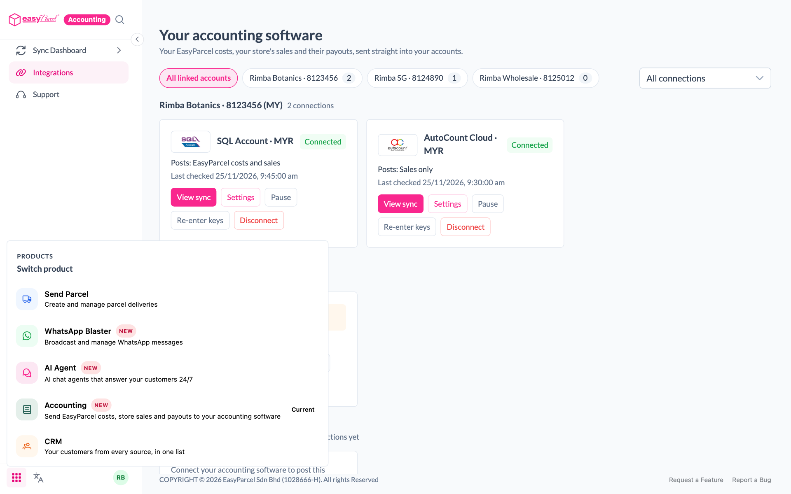

### Step 2: Find your shipping account on Integrations

The **Integrations** page lists every shipping account linked to your organization, each with the connections it already has.

- Use the buttons at the top to show **All linked accounts** or just one, and **All connections** to narrow it down further.
- A shipping account with no connection yet shows **Connect AutoCount Cloud**. Otherwise, click **Connect** on the **AutoCount Cloud** card under **Connect another**.

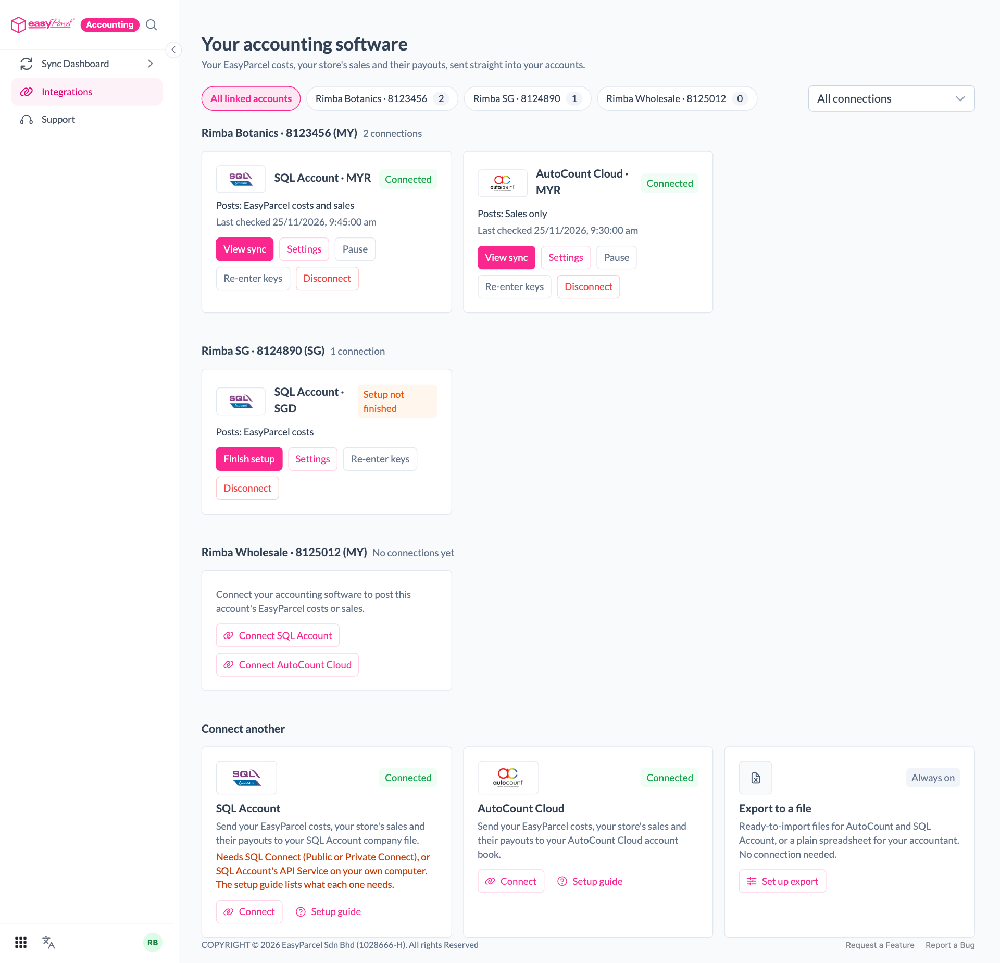

### Step 3: Choose the account and what this connection posts

1. **Which shipping account?** One connection posts for one shipping account. Pick the one whose EasyParcel costs or store sales you want in this AutoCount account book.
2. **What will this connection post?**

| Choice | What it posts |
|---|---|
| **EasyParcel costs only** | What EasyParcel charges you, your top-ups and refunds. Store sales aren't posted. You can switch sales on later |
| **Sales only** | Your store sales and their payouts. EasyParcel charges, top-ups and refunds aren't posted. Use this when your EasyParcel costs are recorded elsewhere, or this book belongs to another business, such as a sister company |
| **EasyParcel costs and sales** | Both. You set up the sales during setup |

> Whether a connection posts EasyParcel costs **can't be changed** after it is created. To change it, disconnect and connect again.

### Step 4: Enter your key

1. **Name this connection** — leave it as `AutoCount Cloud`, or give it a name you will recognise (useful if you keep more than one account book).
2. Paste your **Key ID**, **API key** and **Account book ID** from Part 1.
3. Click **Connect**.

The connection covers the wallet currency shown in the box: **MYR** for a Malaysia account, **SGD** for a Singapore account. Your account book must use the same currency.

> Not sure where the values are? Click **How do I get these keys?** in the box for the same steps as Part 1.

If this shipping account already has a connection in the same currency, the box warns you. Two connections that post the same account's **costs** into one book record every charge twice. Two that post the same account's **sales** split the sales between them, because each sale is posted only once.

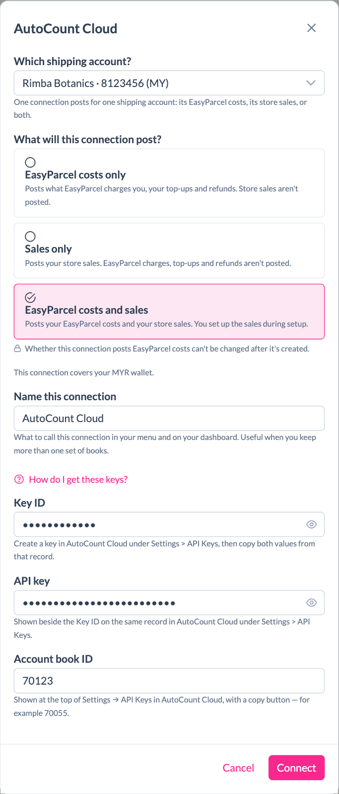

### Step 5: Check the company name, then continue

EasyParcel checks your key with AutoCount Cloud and shows which account book it connected to. Make sure it is the right company, then click **Continue setup**.

If it is the wrong company, click **Use different keys**.

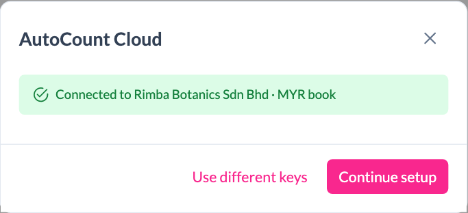

---

## Part 3 — Set up your connection

Setup has four short steps: **What to sync → Accounts → Tax → Schedule**. You can click **Save & finish later** at any time and come back from **Integrations → Finish setup**.

Only your organization's owner and admins can open setup. A Viewer who opens it is taken to the connection's **Sync Dashboard** instead.

### Step 1: What to sync

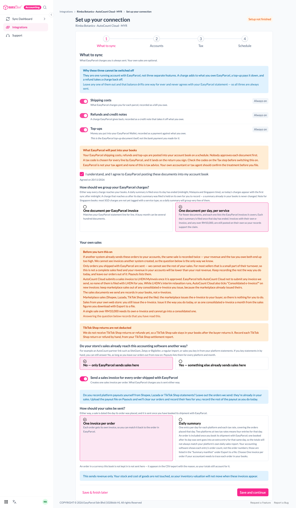

**Your EasyParcel costs** *(not on a Sales only connection)* — these three are always sent:

| Item | What it becomes in AutoCount Cloud |
|---|---|
| Shipping costs | A purchase invoice from EasyParcel |
| Refunds and credit notes | A purchase return that reduces what you owe EasyParcel |
| Top-ups | A payment to EasyParcel |

They can't be switched off. Together they keep your EasyParcel balance in AutoCount the same as your EasyParcel statement.

1. Tick **I understand, and I agree to EasyParcel posting these documents into my account book**. You can't switch the connection on without this.
2. **How should we group your EasyParcel charges?**
   - **One document per EasyParcel invoice** — matches your EasyParcel statement line by line. A busy month can mean several hundred documents.
   - **One document per day, per service** — far fewer documents. Each day's summary is sent after that day ends.

   > **Check your AutoCount plan.** AutoCount Cloud plans limit how many documents you can create. Once the limit is reached, AutoCount refuses new documents. If you ship a lot, choose **One document per day, per service**, or check your plan with AutoCount.

**Your own sales.** EasyParcel can send a sales invoice for every order you ship. On a **Sales only** connection this has to be on.

1. First answer **Do your store's sales already reach this accounting software another way?** If an AutoCount partner link (such as SiteGiant, Zetpy or BigSeller) or a regular import already puts your sales into AutoCount, choose **Yes**. Otherwise the same sales get recorded twice.

   If you key in your sales by hand from your platform statements, you can still answer **No**, as long as you leave EasyParcel's orders out from now on. [Payouts](Payouts.md#if-you-record-payouts-yourself) lists them for every platform and month.
2. Then switch **Send a sales invoice for every order shipped with EasyParcel** on or off.
3. Read the notices that appear. They explain, for example, that only orders shipped with EasyParcel are sent, and how the Malaysia e-Invoice works for these sales.
4. Click **Save and continue**.

> **Malaysia e-Invoice.** The sales documents EasyParcel sends are records in your books, not e-Invoices. For marketplace sales (Shopee, Lazada, TikTok Shop and the like), the marketplace issues the e-Invoice to your buyer. For sales from your own web store, you still issue the e-Invoice, the way you do today, or as one consolidated e-Invoice a month. A single sale over RM10,000 needs its own e-Invoice.

### Step 2: Accounts

Tell EasyParcel which account in your AutoCount chart each type of entry goes to, and the settings AutoCount needs on every document.

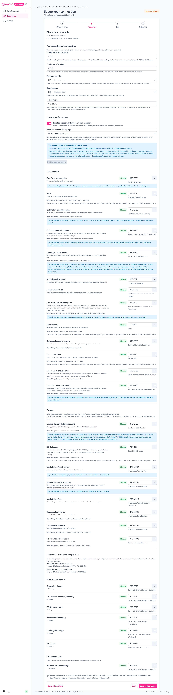

**Your accounting software settings** — AutoCount needs these on every document. Copy each one exactly as your book spells it:

| Setting | Where to find it in AutoCount Cloud |
|---|---|
| **Credit term for purchases** | Your Default Supplier credit term: **Settings → Accounting → Default Customer & Supplier**. Usually `C.O.D.` |
| **Credit term for sales** | Your Default Customer credit term, on the same screen. It sets the due date your own customers see |
| **Purchase location** / **Sales location** | Pick from the list. They come from **Master Data → Location**. Most books have one, called `HQ` |
| **Journal type** | Used for the opening balance, for top-ups that go to the holding account, and for payouts. Most books use `GENERAL` |

A Sales only connection asks only for the sales settings.

**How you pay for top-ups** *(costs connections)*

- **Take top-ups straight out of my bank account** — leave this on if you pay top-ups from your bank account. Turn it off if you already record these payments from your bank statement, or you pay by card or an online payment gateway. Otherwise every top-up is counted twice.
- When it is **on**, also choose the **Payment method for top-ups**. Each option shows the bank account it posts to: pick the one for the bank account you top up from. If none points at it, create a payment method for that bank account in AutoCount first.

**Main accounts and the rest**

- Click **Fill in suggested codes** to fill every empty row with a suggested code, then check each one.
- Each row has a drop-down that lists your own AutoCount chart of accounts. You can also type a code.
- **EasyParcel as a supplier** must be a **creditor** in AutoCount, not a GL account. The drop-down lists your creditors for this row.
- **If an account does not exist yet**, create it in AutoCount first, then come back and pick it.
- Rows marked **When this applies** are only needed if you use that feature, for example Cash on Delivery or Instant Pay.

If you send your sales, two more sections appear:

- **Payouts** — the accounts used when you record a platform payout: **Marketplace Fees Clearing**, **Marketplace fees**, optionally **Marketplace Seller Balances** and a seller balance per platform, and your **Bank account** (or **Bank clearing account**) if it isn't already asked under **Main accounts**. If the journal type isn't asked above, it is asked here as **Journal type for payouts**. The platform payout accounts are optional here, so you can leave them for later. See [Payouts](Payouts.md#before-your-first-payout).
- **Marketplace customers, one per shop** — if you sell through more than one shop on the same platform. Each shop is paid out separately, so each shop's sales go to its own customer in your book. EasyParcel creates it the first time that shop's sale posts.

If you take COD orders and send your sales, also map the **Cash on delivery holding account**, **EasyParcel as a supplier** and **COD charges** (on a Sales only connection they are in the **Payouts** section). EasyParcel uses them to record your COD payouts automatically.

Click **Save and continue**.

### Step 3: Tax

This step is different for Malaysia and Singapore.

AutoCount Cloud can't tell EasyParcel which tax codes your book has. If a tax code does not exist in your book, you only find out when the first document using it is refused, so check the codes below exist before your first sync.

#### Malaysia (SST)

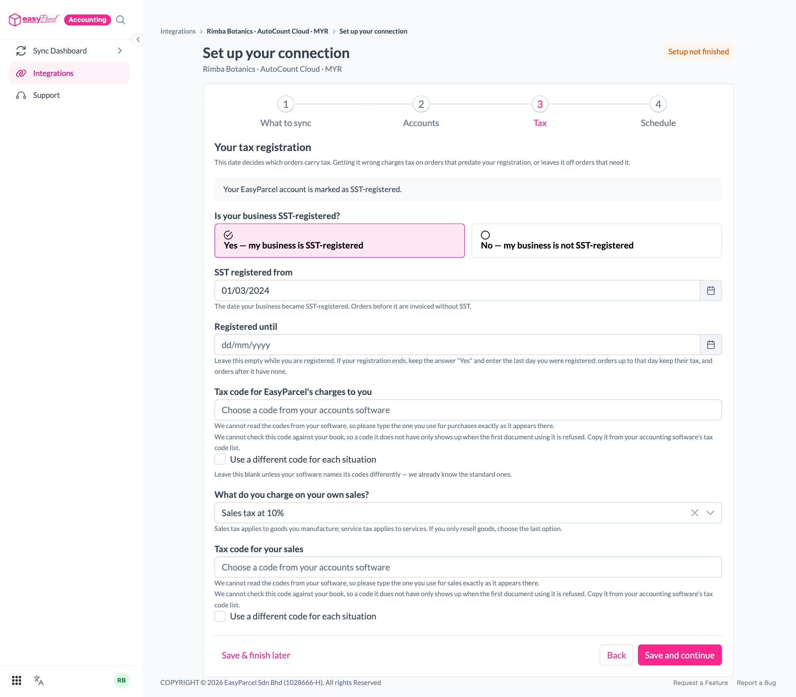

1. **Is your business SST-registered?** Choose **Yes** or **No**. If your EasyParcel account already has an SST number, Yes is selected for you.
2. If Yes, enter **SST registered from**: the date your business became SST-registered.
3. **Registered until** — leave this empty while you are registered. If your registration ends, keep the answer **Yes** and enter the last day you were registered: orders up to that day keep their tax, and orders after it have none.
4. **Tax code for EasyParcel's charges to you** — leave this blank unless your AutoCount uses its own names for tax codes. EasyParcel uses AutoCount's standard SST codes (`PS-6`, `PS-8` for purchases, `SV-6`, `SV-8`, `S-5`, `S-10` for sales). AutoCount creates them when you run its **Malaysia SST** setup.

> SST you pay EasyParcel can't be claimed back, so it stays part of the delivery cost.

#### Singapore (GST)

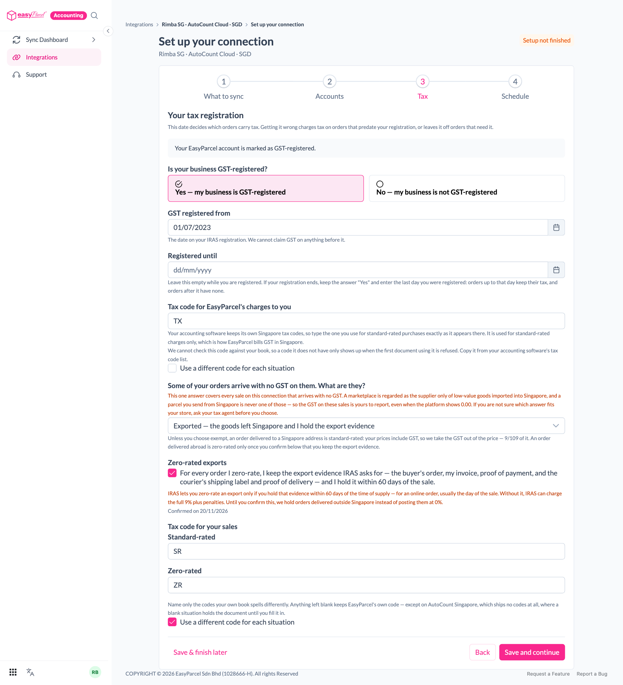

1. **Is your business GST-registered?** Choose **Yes** or **No**.
2. If Yes, enter **GST registered from**: the date on your IRAS registration. GST can't be claimed on anything before it.
3. **Registered until** — leave this empty while you are registered. If your registration ends, enter the last day you were registered.
4. **Tax code for EasyParcel's charges to you** *(costs connections)* — type the code your AutoCount uses for **standard-rated purchases**, exactly as it appears in your tax code list. Payouts also use it when you claim GST on a platform's fees.

If you send your own sales to AutoCount, also answer:

5. **Some of your orders arrive with no GST on them. What are they?** Choose the answer that fits your store. If you are not sure, ask your tax agent before you choose.
6. **Zero-rated exports** — tick this only if you keep the export evidence IRAS asks for (the buyer's order, your invoice, proof of payment, the courier's shipping label and proof of delivery) within 60 days of the sale. Until you tick it, orders delivered outside Singapore are held instead of being sent at 0%.
7. **Tax code for your sales** — type your AutoCount code for **Standard-rated** sales, and for the kind of no-GST sale you chose in question 5 (**Zero-rated**, **Exempt — Regulation 33**, **Exempt — not Regulation 33** or **Deemed supply**). Only the codes your answers need are asked.

> **Fill in your tax codes for Singapore.** AutoCount Singapore doesn't come with standard tax codes, so EasyParcel can't guess them. A sale that needs a code you left blank is held until you fill it in.

> **Singapore prepaid credit.** In Singapore, EasyParcel charges GST when you **top up**, not on each shipment. To claim that GST, map a **Prepaid shipping credit** account in Step 2. Each top-up is then sent as a purchase invoice with the GST, and each shipment is paid out of that prepaid credit, so your EasyParcel bills show as paid in AutoCount.

#### A Sales only connection

A Sales only connection first asks **Whose SST (or GST) registration do these sales use?**

- **The shipping account's registration** — the usual answer.
- **This account book's own registration** — when this book belongs to a different business, such as a sister company. Your answers on this step then apply to this connection only.

A Sales only connection in Singapore isn't asked for a purchase tax code, so its payouts post the platform's fees without claiming GST. Claim that GST from the platform's tax invoice yourself.

Click **Save and continue**.

### Step 4: Schedule, then run your first sync

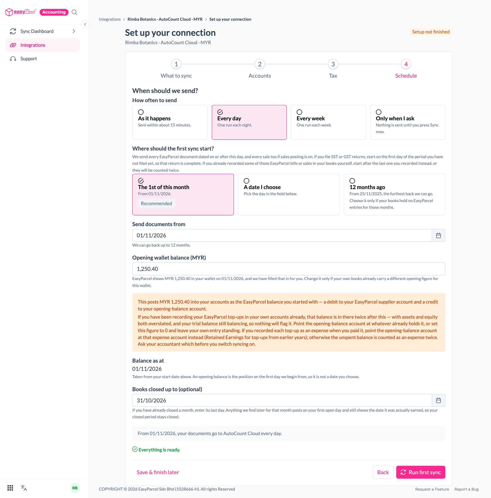

1. **How often to send**
   - **As it happens** — sent within about 15 minutes
   - **Every day** — one run each night
   - **Every week** — one run each week
   - **Only when I ask** — nothing is sent until you click **Sync now**
2. **Where should the first sync start?**
   - **The 1st of this month** (recommended)
   - **A date I choose**
   - **12 months ago**, the furthest back EasyParcel can go

   If you file SST or GST returns, start on the first day of the period you have **not** filed yet. If you already keyed in some EasyParcel bills or sales by hand, start **after** the last one you recorded. Otherwise they are counted twice.

   The start date must fall inside a **financial year that is open in AutoCount**. AutoCount refuses documents dated outside it.
3. **Opening wallet balance** *(costs connections)* — if this box appears, enter how much was in your EasyParcel wallet on the start date.
4. **Books closed up to (optional)** — if you have already closed a month in AutoCount, enter its last day. Anything EasyParcel finds later for that month is posted on your first open day instead.

   To reopen a closed period, move the date back or clear it, and say why under **Why are you reopening a closed period?** Every change is kept, with who made it and why, under **Changes to "Books closed up to"**.
5. **This account book keeps its figures in MYR** (or SGD) — this tick appears only if AutoCount didn't tell EasyParcel the book's currency. Check the book's base currency first: in a book kept in another currency, every amount would be recorded at the wrong value.
6. When you see **Everything is ready**, click **Run first sync**.

If anything is missing, a checklist appears above the button. It shows what to fix, with a link back to the right step.

> **A large first sync takes a while.** AutoCount Cloud accepts about 100 requests a minute, so a first sync going back several months may take some time. EasyParcel paces itself automatically. You don't need to do anything.

---

## Part 4 — Check your sync

### Sync Dashboard

Each connection has its own **Sync Dashboard**. With more than one connection, they are listed under **Sync Dashboard** in the left menu, each with the number of documents that need your attention.

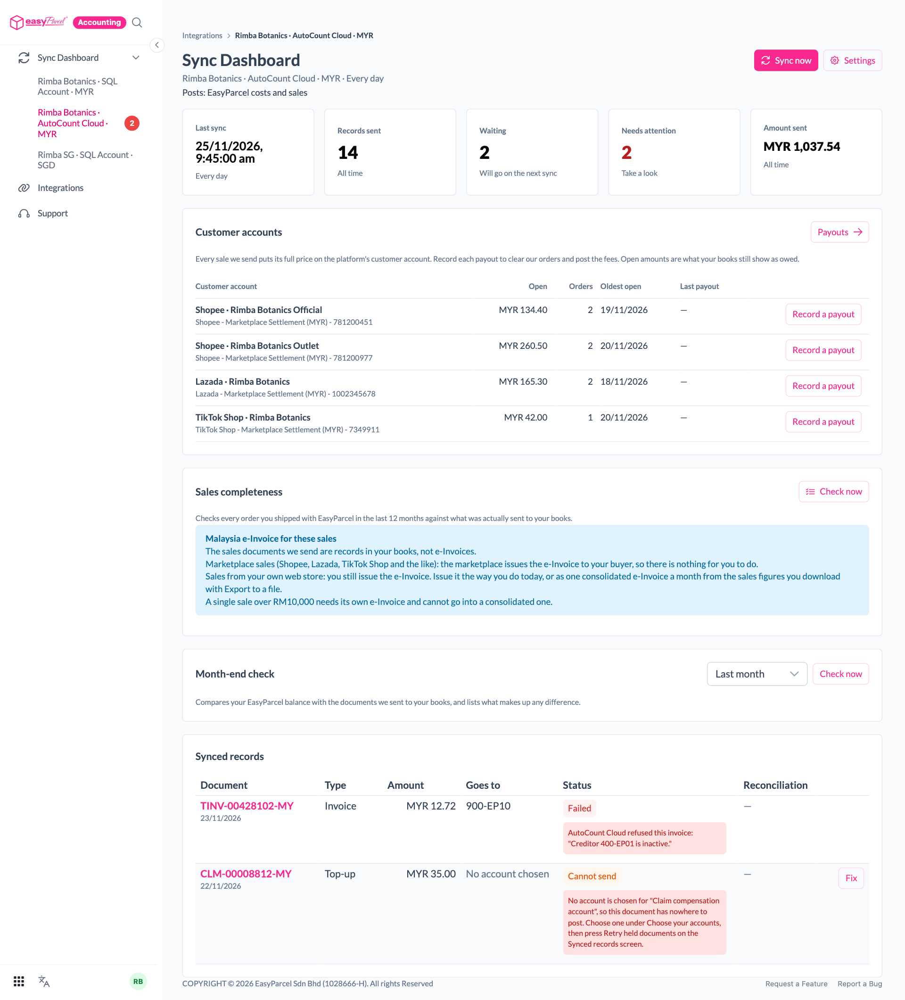

| Box | Meaning |
|---|---|
| **Last sync** | When EasyParcel last sent documents |
| **Records sent** | Documents now in AutoCount Cloud |
| **Waiting** | Documents that go on the next sync |
| **Needs attention** | Documents you need to look at |
| **Amount sent** | Total value sent so far |

- **Sync now** sends waiting documents straight away.
- **Settings** opens your setup again.
- **Month-end check** *(costs connections)* compares your EasyParcel balance with what was sent to AutoCount Cloud and lists anything that makes up a difference. Pick a month and click **Check now**. Only the owner or an admin can sign a period as closed.
- **Customer accounts** *(when you send sales)* shows what each shop's customer account still holds for EasyParcel's orders. See [Part 5](#part-5--record-your-platform-payouts).
- **Sales completeness** *(when you send sales)* checks every order you shipped with EasyParcel in the last 12 months against what was sent to your books, and says why any order wasn't sent. Click **Check now**.

### Synced records

Click any box on the dashboard (**Records sent**, **Waiting** or **Needs attention**) to open the full list.

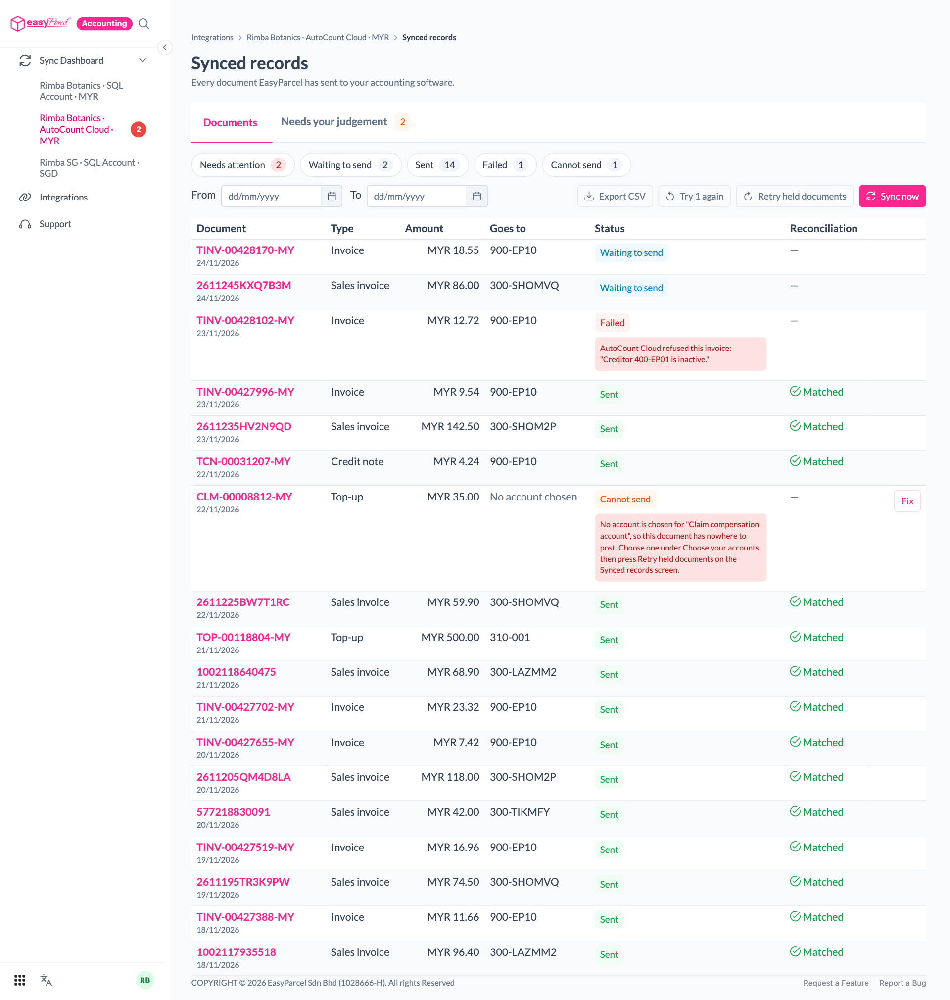

What each status means:

| Status | What it means | What to do |
|---|---|---|
| **Sent** | It is in AutoCount Cloud | Nothing |
| **Waiting for invoice number** | The EasyParcel invoice is not ready yet | Nothing. It is sent automatically when ready |
| **Waiting to send** / **Sending** | It is on its way | Nothing |
| **Failed** | AutoCount did not accept it. The reason is shown under the status | Fix the reason, then click **Try again** |
| **Needs checking** | It was sent, but AutoCount did not reply in time | Search AutoCount Cloud for the reference shown **before** doing anything. Do **not** key it in by hand. It may already be there |
| **Cannot send** | Something must change first. The reason is shown on the row | Follow the reason shown |
| **Journal needed** | EasyParcel never sends this one | Post the journal described in AutoCount Cloud, then mark it done |
| **Not sent by design** | It is deliberately not sent | Nothing |

A sale already posted by another connection of the same shipping account shows **Already posted by** that connection. Each sale is posted only once, so this copy is not sent.

The **Needs your judgement** tab is for your own sales, if you send them. An item appears here when something happens to an order after its invoice was sent: its figures change, the buyer returns it, or its parcel comes back undelivered. Check whether AutoCount needs a credit note, then answer **I corrected it** or **No change needed**.

**Export CSV** downloads the list as a spreadsheet.

---

## Part 5 — Record your platform payouts

When you send your sales, each sale puts its full price on the platform's customer account. When Shopee, Lazada, TikTok Shop or Shopify pays you, upload their payout file on the connection's **Payouts** page. EasyParcel clears its orders off the customer account, records the fees the platform took, and shows which part of the payout isn't ours, so you record only that part yourself.

Open it from the **Customer accounts** card on the Sync Dashboard. EasyParcel COD payouts are recorded automatically.

The full steps are in the **[Payouts guide](Payouts.md)**.

---

## What gets sent to AutoCount Cloud

| From EasyParcel | Becomes in AutoCount Cloud |
|---|---|
| Shipping and other charges | Purchase Invoice (creditor: EasyParcel) |
| Refunds and credits from EasyParcel | Purchase Return |
| Wallet top-ups, and money paid into your wallet | Journal Entry, or a Cash Book payment if you take top-ups straight out of your bank account |
| Wallet withdrawals | Journal Entry, or a Cash Book receipt if you take top-ups straight out of your bank account |
| Opening wallet balance (once, on the start date) | Journal Entry |
| **Singapore with prepaid credit:** each charge and refund | Also a Journal Entry that pays it out of your prepaid credit, matched to the invoice so it shows **Full Payment** |
| **Optional:** your sales | Invoice (one customer per marketplace, or per shop when a platform has several of yours, created for you) |
| **Optional:** refunds on your sales | Credit Note |
| **Optional:** a platform payout you record | Journal Entries knocked off against the invoices, and a Purchase Invoice from the platform for its fees, paid by a Journal Entry. See [Payouts](Payouts.md#what-gets-posted) |
| **Optional:** an EasyParcel COD payout | A Journal Entry knocked off against the COD sales, and a Purchase Invoice from EasyParcel for the COD charges, paid by a Journal Entry |

A **Sales only** connection sends only the sales, refund, payout and COD rows.

Documents carry the EasyParcel reference, so you can search for them in AutoCount Cloud. A purchase invoice keeps the EasyParcel invoice number in **Supplier Invoice No.**

---

## Managing your connection

Go to **Integrations** to see your connection cards. Each card shows the shipping account it belongs to and what it **Posts**: EasyParcel costs, sales, or both.

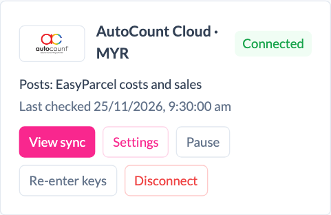

| Button | What it does |
|---|---|
| **View sync** | Opens the Sync Dashboard |
| **Settings** | Change any setup answer: what to sync, accounts, tax or schedule |
| **Pause** | Stops sending for now. Nothing is lost, and documents wait until you resume |
| **Re-enter keys** | Enter a new key, for example after you deleted the old one in AutoCount. It replaces the old key and does not create a second connection |
| **Disconnect** | Stops sending. Anything already sent stays in AutoCount Cloud |

A Viewer sees **View sync** only.

---

## Who can do what

What a person can do comes from their **Accounting role in your organization**, set in EasyAccount.

| Action | Owner and Admin | Viewer |
|---|---|---|
| See Integrations, Sync Dashboards, Synced records and Payouts | ✅ | ✅ |
| Run a month-end check, download files and lists | ✅ | ✅ |
| Connect, re-enter keys, change setup, pause, disconnect | ✅ | — |
| Sync now, Try again, answer Needs your judgement | ✅ | — |
| Sign a month-end close, record and post payouts | ✅ | — |

People with no Accounting role can't open Accounting. They see *Your role doesn't include Accounting*.

**EasyParcel support** can open your Accounting to help you. Anything that is a statement about your own tax and books, such as agreeing to the cost posting, signing a period, answering a sales question or posting a payout, is left for your owner or an admin.

---

## Malaysia and Singapore at a glance

| | Malaysia | Singapore |
|---|---|---|
| Currency | MYR | SGD |
| Tax | SST | GST |
| Tax step asks | SST-registered? Registered from and until dates | GST-registered? Registered from and until dates |
| Tax on EasyParcel charges | Charged on each shipment. Not claimable, so it stays part of the cost | Charged on each top-up. Claimed as input tax if you are GST-registered |
| Extra account to map | None | **Prepaid shipping credit**, to claim GST on top-ups |
| EasyParcel bills in AutoCount | Stay open (see FAQ) | Paid out of your prepaid credit and shown as **Full Payment** |
| Tax on platform fees in a payout | Posted with no tax code | Claimed if you tick that you hold the platform's tax invoice (costs and sales connections only) |
| Daily summary | Groups charges by service | Most SGD charges are not yet tagged with a service, so a daily summary groups very few of them |

Everything else is the same for both.

---

## Troubleshooting and FAQ

**It says "Link this account to your organization".**
Accounting belongs to your organization. The shipping account's owner links it in EasyAccount, under **Manage organization**, and shares it with organization products. Then open Accounting again from the **Products** menu.

**It says "You're not a member of this organization".**
Only members of an organization can open its Accounting. Ask the organization's owner to invite you in EasyAccount, or switch to an organization you belong to.

**I can see everything, but there are no buttons to change anything.**
You have the **Viewer** role. Ask your organization's owner or an admin to make the change, or to give you the Admin role in EasyAccount.

**Connect says my key is wrong.**
Check all three values: the **Key ID**, the **API key** and the **Account book ID**. A wrong account book is refused exactly like a wrong key. If all three are right, create a new API key under **Settings → API Keys** and enter it again.

**Documents show "Failed" and the reason mentions permission or 403.**
The key is missing one of the permissions in Part 1, Step 3. In AutoCount Cloud, open **Settings → API Keys**, click the edit icon on the key, tick the missing permissions and click **Save**. Then click **Try again** on the failed documents.

**A payout says AutoCount refused to let the key create a creditor.**
The key is missing **Creditor `CreateRecord`**, which EasyParcel needs to create a supplier for the platform's fees, for example *Shopee - Marketplace Fees (MYR)*. Tick it on the key, or create a creditor with exactly that name in that currency yourself. Then click **Try again** on the payout.

**AutoCount stopped accepting documents part-way through a sync.**
Your AutoCount plan has probably reached its document limit. Check your plan with AutoCount. Once you can add documents again, click **Try again** on the failed documents. Nothing was created for them, so nothing is sent twice.

**AutoCount says a location or credit term does not exist.**
Open **Settings → Accounts** in EasyParcel and check **Your accounting software settings**. Each value must match your book exactly, for example `C.O.D.` with the dots.

**AutoCount says the document date is not valid.**
The date falls outside a financial year that is open in AutoCount. Open that year in AutoCount, or move the start date in **Settings → Schedule**.

**AutoCount says an account or creditor does not exist.**
Create it in AutoCount Cloud, then pick it in **Settings → Accounts**.

**My EasyParcel purchase invoices all show as unpaid (Malaysia).**
That is expected. You already paid them from your EasyParcel wallet, and your top-ups are recorded against the EasyParcel creditor, so the balance you owe EasyParcel is correct. AutoCount just doesn't link each top-up to the bills it paid for. Look at the EasyParcel creditor's **balance**, not at each invoice's status.

**My sales invoices show as unpaid.**
Your buyers paid the marketplace, and the marketplace pays you later. Record the marketplace's payout on the **Payouts** page: it pays off EasyParcel's invoices on that marketplace's customer and records the fees. See the [Payouts guide](Payouts.md).

**Will EasyParcel bills appear twice?**
Only if you also keyed them in by hand, or two connections post the same shipping account's costs into the same book. Set the start date to the day after the last EasyParcel bill you recorded yourself, and keep one costs connection per book.

**Will my sales appear twice?**
If something else already sends your sales to AutoCount (an AutoCount partner link or a regular import), keep **Send a sales invoice for every order** switched off. If you record payouts from your platform statements yourself, leave EasyParcel's orders out: **Payouts → Download orders we posted** lists them.

**I want my sales in a different company's book from my EasyParcel costs.**
Connect that company's AutoCount account book as **Sales only**, and choose **This account book's own registration** on the Tax step if it is a different business.

**Can I change what a connection posts?**
You can switch sales on or off in **Settings**. Whether it posts EasyParcel costs is fixed when it is created: to change that, disconnect it and connect again.

**Can I change my answers later?**
Yes. Go to **Integrations → Settings** on your connection card.

**I already closed last month in AutoCount.**
Enter that month's last day in **Books closed up to** on the Schedule step. Late documents for a closed month are posted on your first open day and still show the date they belong to.

**Does disconnecting delete anything from AutoCount Cloud?**
No. Everything already sent stays in AutoCount Cloud. You can also delete the EasyParcel API key in AutoCount afterwards.

---

## Need help?

Click **Support** in the left menu of the Accounting Tool, or WhatsApp us at **+604-2023160**.
