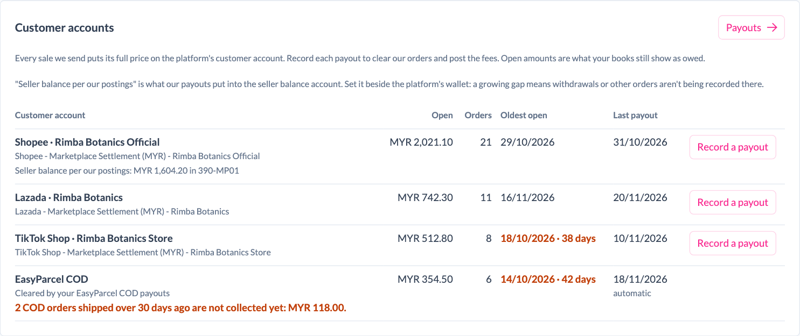
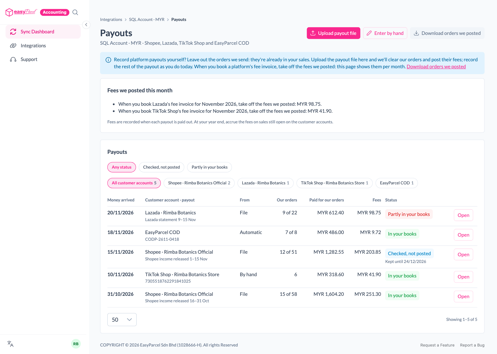
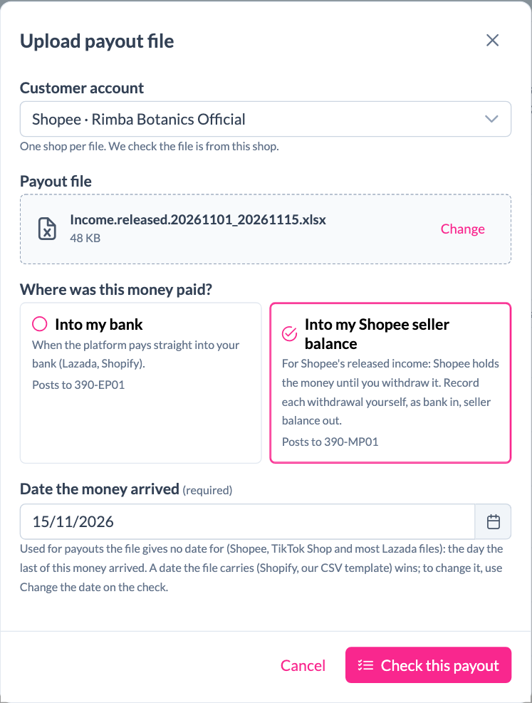
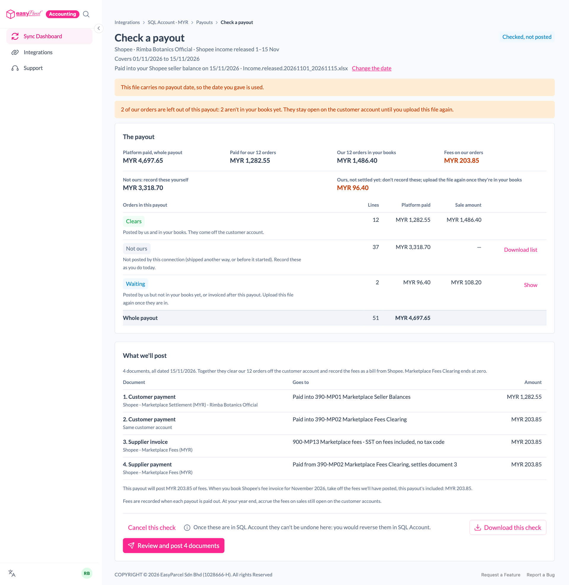
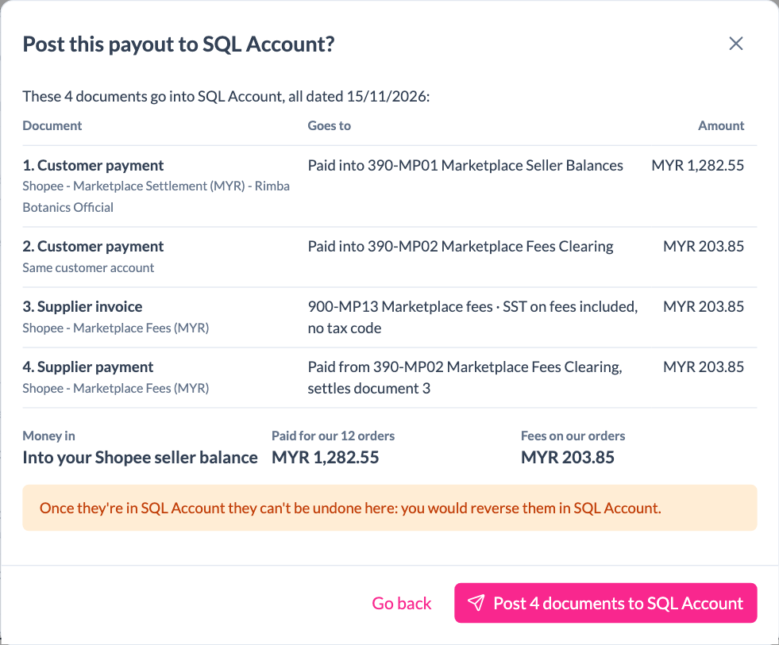
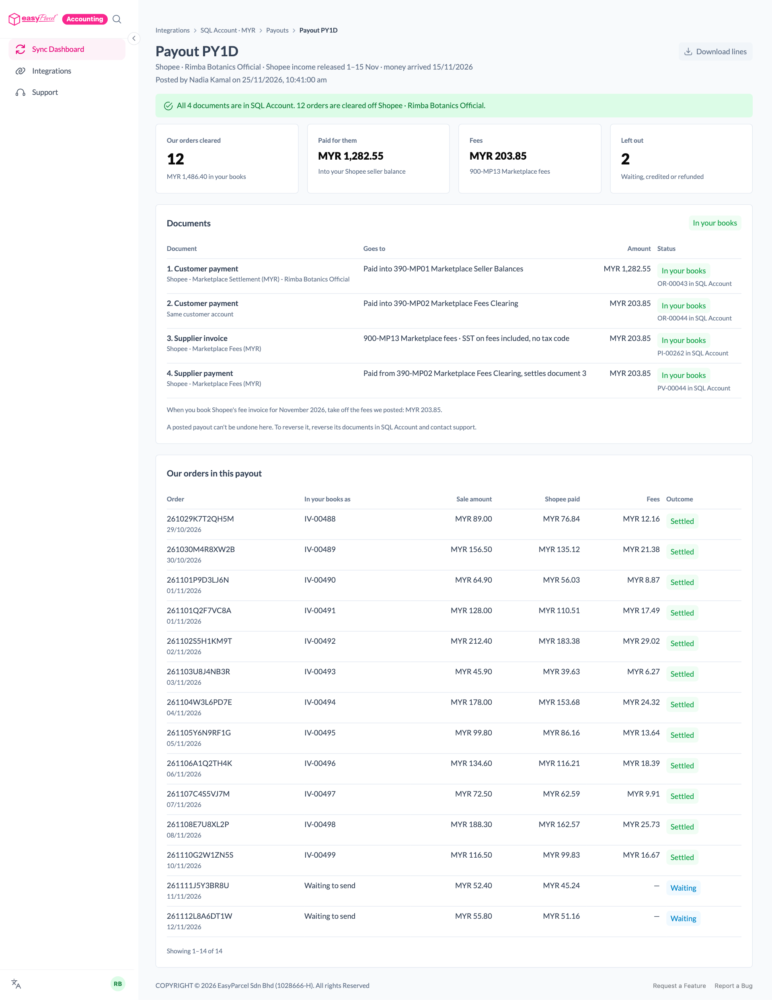

# EasyParcel Accounting Tool — Payouts

When a connection sends your **store sales** to SQL Account or AutoCount Cloud, each sale puts its full price on the platform's **customer account** in your book. Shopee, Lazada, TikTok Shop and Shopify then pay you less than that, because they take their fees first, and each payout also pays for orders you didn't ship with EasyParcel.

**Payouts** records that money for you. You upload the payout file the platform gives you, and EasyParcel:

1. **clears our orders** off the customer account,
2. **records the fees** the platform took, and
3. **shows what isn't ours**, so you record only that part yourself and nothing is counted twice.

Cash on delivery (COD) payouts from EasyParcel are recorded automatically. See [EasyParcel COD payouts](#easyparcel-cod-payouts).

This guide works for **SQL Account** and **AutoCount Cloud**, and for **Malaysia (MYR)** and **Singapore (SGD)** books. Where they are different, it says so.

> All screenshots in this guide use demo data. Your own screens show your shops, orders and amounts.

## Contents

1. [Before your first payout](#before-your-first-payout)
2. [Open Payouts](#open-payouts)
3. [Which file to download from your platform](#which-file-to-download-from-your-platform)
4. [Upload a payout file](#upload-a-payout-file)
5. [Read the check](#read-the-check)
6. [Post the payout](#post-the-payout)
7. [Enter a payout by hand](#enter-a-payout-by-hand)
8. [If you record payouts yourself](#if-you-record-payouts-yourself)
9. [EasyParcel COD payouts](#easyparcel-cod-payouts)
10. [What gets posted](#what-gets-posted)
11. [Who can do what](#who-can-do-what)
12. [Troubleshooting and FAQ](#troubleshooting-and-faq)

---

## Before your first payout

Payouts appear on a connection that **posts sales**: one set up as **Sales only** or **EasyParcel costs and sales**, with **Send a sales invoice for every order shipped with EasyParcel** switched on.

Then choose the payout accounts. Open the connection's **Settings → Choose your accounts** and fill in the **Payouts** section. EasyParcel suggests a code for each one; create any that don't exist in your book yet.

| Account | What it is for | Create it as |
|---|---|---|
| **Marketplace Fees Clearing** | Each payout passes its fees through here, so it ends at **zero** | Current Asset, never a Bank or Cash account |
| **Marketplace fees** | The commission, transaction, service and shipping fees the platforms take from your payouts | Expense |
| **Bank account** or **Bank clearing account** | Where a payout goes when you record it as paid **into your bank**. Which one is asked depends on **Take top-ups straight out of my bank account** | Your bank account, or the clearing account your bank feed uses |
| **Marketplace Seller Balances** *(optional)* | Where Shopee, Lazada or TikTok Shop money waits before you withdraw it to your bank | Current Asset, never a Bank or Cash account |
| **Shopee / Lazada / TikTok Shop seller balance** *(optional)* | One seller balance per platform, so each matches that platform's wallet. Leave blank to use Marketplace Seller Balances | Current Asset |

**AutoCount Cloud only:** **Journal type for payouts**. Leave it blank to use `GENERAL`, which most books have.

You can leave these for later. If a payout needs an account you haven't chosen, the check tells you which one, with a link to **Settings**.

> **The platform as a supplier.** The fees post as a bill from the platform. The first time a platform's fees post, EasyParcel creates a supplier for it in your book, for example *Shopee - Marketplace Fees (MYR)*. On AutoCount Cloud, your API key needs the **Creditor `CreateRecord`** permission for this. If you made your key before 25 November 2026, add it now: in AutoCount Cloud open **Settings → API Keys**, click the edit icon on the key, tick **Creditor › CreateRecord** and click **Save**.

---

## Open Payouts

1. Open the connection's **Sync Dashboard**.
2. Find the **Customer accounts** card. It lists one customer account for each shop, with:
   - **Open**: what your books still show as owed for our orders
   - **Orders**: how many of our orders are still open
   - **Oldest open**: the date of the oldest open order. Once it is more than 28 days old, it also shows how many days ago that was
   - **Last payout**: when you last recorded one
3. Click **Record a payout** on a shop's row to upload its file straight away, or click **Payouts** at the top of the card.

The **Payouts** page has three buttons at the top:

| Button | What it does |
|---|---|
| **Upload payout file** | Read the platform's payout file and check it against our orders. See [Upload a payout file](#upload-a-payout-file) |
| **Enter by hand** | Record a payout without a file. See [Enter a payout by hand](#enter-a-payout-by-hand) |
| **Download orders we posted** | A list of our orders, for when you record a payout yourself. See [If you record payouts yourself](#if-you-record-payouts-yourself) |

Below them:

- **Fees we posted this month**, per platform. When you book a platform's own fee invoice for the month, take off the fees shown here, because they are already in your books.
- **Payouts**, the list of every payout recorded on this connection. Filter it by status or by customer account.

### Payout statuses

| Status | What it means |
|---|---|
| **Checked, not posted** | The file was checked, and nothing is in your books yet. Open it to post it. A check is kept for 30 days |
| **Expired** | The check is more than 30 days old. Upload the file again |
| **Sending** | Its documents are on their way to your accounting software |
| **In your books** | Every document is in your accounting software |
| **Partly in your books** | One document was refused. Open it to see why, fix it, then click **Try again** |
| **Cancelled** | Cancelled before anything reached your books. Its orders can be matched again |
| **Reversed in your books** | Reversed in your accounting software, with EasyParcel support's help |
| **Handled in your software** | You marked it as handled in your accounting software |

---

## Which file to download from your platform

| Platform | Where to download it |
|---|---|
| **Shopee** | **Finance › My Income › Income Details › Released** tab. Pick the dates and click **Export** (on some screens **Download**). Then open the report list beside it and click **Download** (an .xlsx file). |
| **Lazada** | **Finance › My Income › Income Overview**. Under **Income Report**, pick the week or month (**More** for older ones), then **Download › Transactions Details** (excel or csv). Not the export on **My Balance**: that is your wallet history, not your sales. |
| **TikTok Shop** | **Finance › Transactions** (on newer menus, **Finance › Withdrawals**) › **Settled** tab › **Export**. Pick up to 90 days, then download the .xlsx from the export history. |
| **Shopify Payments** | **Finance › Payouts**. For one payout, click it, then the export icon › **Export payout transactions**. For several, click **View transactions › Export › Items by date** and choose a CSV file. Shopify emails you the file; if it comes as a .zip, unzip it and upload the .csv inside. Not the **Export** button on the Payouts page itself: that file has one row per payout and no orders. |
| **Shopify in Malaysia, and any other platform** | Put the payout into **our CSV template** |

Upload the file **as you downloaded it**. Opening it in Excel and saving it again can change long order numbers, and the upload then refuses those rows.

### Our CSV template

The links **Download our CSV template** and **Download the template's guide** appear in the **Upload payout file** window when you pick a shop whose platform needs the template, or when a file can't be read. Before your first payout, they are also on the Payouts page.

- One row per order.
- Every row of one payout carries the same **Payout reference**.
- **Payout date** reads `18/11/2026` or `2026-11-18`.
- **Fees** and **Refund** are positive numbers.
- **Line type** is `order` (the default), `refund`, `adjustment`, `charge` or `compensation`.

---

## Upload a payout file

Click **Upload payout file**.

1. **Customer account**: pick the shop. **One shop per file.** EasyParcel checks the file is from this shop.
2. **Payout file**: drop the file in, or click **Choose a file**. CSV and Excel files up to 10 MB.
3. **Where was this money paid?**
   - **Into my bank**: the platform paid straight into your bank account, as Shopify does.
   - **Into my *platform* seller balance** (Shopee, Lazada and TikTok Shop only): the platform holds the money until you withdraw it. Record each withdrawal yourself, as bank in, seller balance out. This is already picked for these three platforms.
4. **Date the money arrived**: the day the last of this money arrived. It is used when the file gives no date, as Shopee, TikTok Shop and most Lazada files don't. A date the file carries (Shopify, our CSV template) is used instead. Shopify's date is the day Shopify **sent** the payout. It usually reaches your bank 1 to 3 business days later, so your bank statement shows it a little after the entry.
5. Click **Check this payout**.

EasyParcel reads the file and matches every line to the orders this connection sent. Nothing goes into your books yet.

- A Shopee, Lazada or TikTok Shop file is **one payout** for the dates you chose.
- A Shopify file or our CSV template can hold **several payouts**, and each one gets its own check.
- A payout in a currency your book doesn't keep is **left out**, and the check says so. Record it as you do today.

---

## Read the check

The check shows what the payout paid for, and exactly what will go into your books.

### The payout

| Figure | What it means |
|---|---|
| **Platform paid, whole payout** | Everything in the file |
| **Paid for our orders** | The part that pays for orders this connection sent |
| **Our orders in your books** | What those orders are in your books for |
| **Fees on our orders** | The difference: what the platform kept |
| **Not ours: record these yourself** | Orders this connection didn't send, and lines with no order (ads, adjustments, penalties). Record them as you do today |
| **Ours, not settled yet** | Our orders that can't be cleared yet. Don't record these. Upload the file again once they're in your books |

### Orders in this payout

Every line is sorted into a group, and each group says what to do:

| Group | What it means | What to do |
|---|---|---|
| **Clears** | Our orders, in your books | Nothing. They come off the customer account |
| **Not ours** | Not posted by this connection (shipped another way, or before it started) | Record them as you do today |
| **Other platform charges** | Lines with no order: ads, adjustments, penalties | Record them as you do today |
| **Compensation** | Money that isn't a sale, such as a lost-parcel claim | Record it as other income |
| **Waiting** | Our orders that aren't in your books yet, or whose invoice is dated after the money arrived | Upload the file again once they're in |
| **Already settled** | An earlier payout already cleared them | Nothing |
| **Fee corrections** | A fee taken back later on an order an earlier payout cleared | Nothing. It goes into this payout's fees |
| **Credited in your books** | We filed a credit note, but the platform paid for the order | If the credit note was wrong, correct it in your accounting software, then mark the order handled |
| **Refunded in this payout** | The platform refunded the buyer, but your books still hold the full sale | Answer the return in **Synced records › Needs your judgement** and upload again, or raise the credit note yourself and mark the order handled |
| **Partly refunded** / **Refunded after it was cleared** | The platform refunded all or part of an order | Key in the entries shown, then mark the order handled. A refund is never booked as fees |
| **Posted to another customer account** | We posted these sales on another shop's customer account | Check this file on that account instead. Don't record them again |
| **Other currency** | Not in this connection's currency | Record them as you do today |

**Mark as handled** takes an order off the customer account when you have dealt with it in your accounting software yourself. Say what you did; the note is kept.

### What we'll post

This lists every document, its account and its amount, all dated the day the money arrived. For a normal payout there are four:

1. A **customer payment** that clears our orders, paid into your bank or seller balance.
2. A **customer payment** for the fees, paid into **Marketplace Fees Clearing**.
3. A **supplier invoice** from the platform for the fees, to **Marketplace fees**.
4. A **supplier payment** to the platform, paid from **Marketplace Fees Clearing**.

So Marketplace Fees Clearing ends at zero, and the customer account drops by exactly what our orders were in your books for.

### Check before you post

- **Paid differently than the fees explain.** For some orders, what the platform paid plus its fees doesn't come to what your books hold (by more than 1.00 or 1%), or the platform paid more than your books hold. The difference posts as fees, so look at each one, then tick **I've checked the orders…**
- **A file that crosses a month end.** Everything in one payout is dated on one day. To keep each month's fees in that month, upload one file per month.
- **The wrong date?** Click **Change the date**, pick the day the money arrived and choose the same file again. The payout is checked again under the new date.
- **Download this check** saves the whole check as a file for your records.
- **Cancel this check** throws it away. Nothing from it is in your books, and its orders can be matched again.

---

## Post the payout

1. Click **Review and post *n* documents**.
2. Read the documents listed, then click **Post *n* documents to** SQL Account or AutoCount Cloud.

The payout page updates as each document goes in. When it shows **In your books**, each document carries its number in your accounting software, and our orders are cleared off the customer account.

> **A posted payout can't be undone here.** To reverse one, reverse its documents in your accounting software and contact support. While none of its documents is in your books yet, you can still click **Cancel this payout**.

If a document is refused, the payout shows **Partly in your books** and the reason your accounting software gave. Fix it there (for example, create the missing account), then click **Try again**. The documents already in your books are not sent twice.

---

## Enter a payout by hand

Use this when you have no file, for example a payout from a platform we don't read yet. Click **Enter by hand**.

1. **Customer account**: pick the shop.
2. **Payout reference**: as the platform prints it. Each reference can be used once per customer account.
3. **Which of our orders does it pay for?**
   - **Tick orders**: search by order number and tick each one, or
   - **Every open order up to a date**.
4. **What *platform* paid for these orders**: only the part of the payout for these orders, from the platform's statement. **Not the bank total.**
5. **Where was this money paid?** and **Date the money arrived**, as for an upload.
6. Click **Check this payout**, then post it as above.

The fees are worked out as what the ticked orders are in your books for, less what you keyed in.

---

## If you record payouts yourself

You may already record platform payouts from your Shopee, Lazada or TikTok Shop statements. You can keep doing that. **Leave out the orders EasyParcel posted**, because they're already in your sales.

Click **Download orders we posted**, pick the **platform and shop** and the **month** (by order date), and download a CSV. For each order it lists the platform order number, order date, our number, its number in your accounting software, the amount, tax, status, and the payout that cleared it.

The easier way: upload the payout file anyway. EasyParcel clears our orders and posts their fees, and you record only the lines marked **Not ours**.

> **Booking a platform's fee invoice?** Take off the fees EasyParcel already posted for that month. The Payouts page shows them under **Fees we posted this month**.

### Seller balances

If you record Shopee, Lazada or TikTok Shop payouts into a seller balance:

- record **every withdrawal in full** as bank in, seller balance out, and
- record the orders EasyParcel doesn't send into the **same** seller balance account.

Each seller balance then matches the platform's wallet. The **Customer accounts** card shows **Seller balance per our postings** beside each platform, to compare with the wallet. A growing gap means withdrawals or other orders aren't being recorded there.

---

## EasyParcel COD payouts

If you sell with cash on delivery, there is nothing to upload. Each **EasyParcel COD payout** is recorded automatically, and shows on the Payouts page with **From: Automatic**.

- The money collected clears the COD sales it paid for, through your **Cash on delivery holding account** (COD Clearing).
- The COD charges EasyParcel takes off each payout post as a bill from EasyParcel, to your **COD charges** account, paid from COD Clearing.

So COD Clearing reads zero for the orders a payout paid. Anything left in it is COD money for orders this connection doesn't post.

The payout page tells you about any difference:

- **Collected more than the sale**: record it as delivery or other income, from COD Clearing.
- **Collected less than the sale**: chase it or write it off.
- **Not collected yet**: the **Customer accounts** card lists COD orders shipped a while ago and not collected yet.

To use this, map **Cash on delivery holding account**, **EasyParcel as a supplier** and **COD charges** under **Choose your accounts**. Until they are mapped, COD receipts wait in **Synced records**.

---

## What gets posted

| Document | SQL Account | AutoCount Cloud |
|---|---|---|
| Payment that clears our orders | Customer Payment | Journal Entry, knocked off against the sales invoices |
| Payment for the fees | Customer Payment, into Marketplace Fees Clearing | Journal Entry, knocked off against the sales invoices |
| The platform's fees | Purchase Invoice (supplier: the platform) | Purchase Invoice (creditor: the platform) |
| Paying the fees | Supplier Payment, from Marketplace Fees Clearing | Journal Entry, from Marketplace Fees Clearing |
| **EasyParcel COD payout** | Customer Payment, plus a Purchase Invoice and Supplier Payment for the COD charges | Journal Entry, plus a Purchase Invoice and Journal Entry for the COD charges |

Every document carries a reference starting **PY** (platform payouts) or **PC** (EasyParcel COD payouts), so you can search for it.

### Tax on the fees

- **Malaysia:** the fees post as one amount with no tax code.
- **Singapore, GST-registered:** if you hold the platform's tax invoice for these fees, tick **I hold *platform*'s tax invoice for these fees** before you post. The fee bill then claims the GST on your standard-rated purchase tax code. Unticked, the fees post with no tax code and you claim the GST from the platform's tax invoice yourself. The check shows the fees and GST posted so far this month, to tie to the platform's tax invoice.

The tick is offered only when the payout file prints the GST on the fees, and your book has a standard-rated purchase tax code for the fee bill. A **Sales only** AutoCount Cloud book in Singapore has none, so there you always claim the GST from the platform's tax invoice yourself.

### At your year end

Fees are recorded when each payout is paid out. At your year end, accrue the fees on sales still open on the customer accounts.

---

## Who can do what

| Action | Owner and Admin | Viewer |
|---|---|---|
| See customer accounts, payouts and checks | ✅ | ✅ |
| Download orders we posted, download a check | ✅ | ✅ |
| Upload a file, enter a payout by hand | ✅ | — |
| Post, cancel, change the date, mark as handled | ✅ | — |

Posting a payout records money your business received, so only your organization's **owner** or an **admin** can do it. EasyParcel support can check a payout to help you, but can't post it for you.

---

## Troubleshooting and FAQ

**"This file is from shop *X*."**
Each shop has its own customer account. Pick the shop the file is from, or upload the right shop's file.

**"This is a *Lazada* file."**
The file is from a different platform from the customer account you picked. Pick that platform's customer account.

**"This file is missing columns we need."**
Download the file again from your platform, without changing it, or use our CSV template. If your Seller Center is set to another language, switch it to English, then download the file again.

**"This is Lazada's My Balance export", "This is Lazada's Order Overview" or "This is Shopify's payouts summary".**
That's another download from the same platform. Download the file the message names: see [Which file to download from your platform](#which-file-to-download-from-your-platform).

**"The order number was changed by Excel."**
Excel turns long order numbers into numbers like `5.8E+17`. Download the file again and upload it without opening it in Excel.

**Most of my orders show as "Waiting".**
Their sales invoices aren't in your books yet, or are dated after the money arrived. Wait for the next sync, check the **Date the money arrived**, then upload the file again.

**Everything shows as "Not ours".**
None of these orders were posted by this connection: they were shipped another way, or before the connection started. Record this payout as you do today.

**"This payout is held."**
The payout takes back more than it pays for our orders, or an invoice has less open in your accounting software than the payout would clear (perhaps part of it was already paid there). Record this payout as you do today, or check those invoices first.

**"*Date* is in a period you've closed."**
Payouts are never moved to another date. Use a later date, or reopen the period under **Books closed up to**.

**My platform's fee invoice shows more fees than EasyParcel posted.**
That's expected. EasyParcel posts only the fees on its own orders. Book the platform's invoice less **Fees we posted this month**.

**A platform bills me from outside Malaysia.**
You issue the self-billed e-Invoice and declare any imported service tax yourself.

**TikTok Shop returns.**
EasyParcel doesn't receive TikTok Shop returns or refunds yet. Record each TikTok Shop return or refund by hand, from your TikTok Shop settlement report.

**Can I post a payout twice by mistake?**
No. A payout reference can be posted once per customer account, and an order cleared by one payout can't be cleared by another.

---

## Need help?

Click **Support** in the left menu of the Accounting Tool, or WhatsApp us at **+604-2023160**.
