# EasyParcel Accounting Tool — SQL Account Guide

Send your EasyParcel charges, refunds and top-ups, your store's sales and their payouts straight into SQL Account, so you no longer key them in by hand. This guide works for both **Malaysia (MYR)** and **Singapore (SGD)** accounts. Where the two are different, it says so.

The Accounting Tool belongs to your **organization** in EasyAccount, like CRM, WhatsApp Blaster and AI Agent. It shows every shipping account linked to your organization in one place, and everyone your organization gives Accounting access to works on the same connections.

> All screenshots in this guide use demo data. Your own screens show your organization, company name, account codes and amounts.

## Contents

1. [Before you start: your organization](#before-you-start-your-organization)
2. [Get your API keys from SQL Account](#part-1--get-your-api-keys-from-sql-account)
3. [Connect SQL Account to EasyParcel](#part-2--connect-sql-account-to-easyparcel)
4. [Set up your connection](#part-3--set-up-your-connection)
5. [Check your sync](#part-4--check-your-sync)
6. [Record your platform payouts](#part-5--record-your-platform-payouts)
7. [What gets sent to SQL Account](#what-gets-sent-to-sql-account)
8. [Managing your connection](#managing-your-connection)
9. [Who can do what](#who-can-do-what)
10. [Malaysia and Singapore at a glance](#malaysia-and-singapore-at-a-glance)
11. [Troubleshooting and FAQ](#troubleshooting-and-faq)

---

## Before you start: your organization

**Your shipping account must be linked to your organization.** Shipping accounts are linked to an organization in EasyAccount, under **Manage organization**, by the account's owner. Share the account with organization products while you're there, so Accounting can see it. If you open Accounting from an account that isn't linked yet, you see **Link this account to your organization** with a button to EasyAccount.

**Your role decides what you can do.** In EasyAccount, under **Roles and Permissions → Accounting**, each person in your organization gets one of:

- **Admin**: connects your accounting software, enters keys, changes setup, sends documents and records payouts.
- **Viewer**: sees everything, and changes nothing. A blue strip at the top of every page says *You can view Accounting. Ask your organization owner or an admin to make changes.*

The organization's **owner** can always do everything. See [Who can do what](#who-can-do-what) for the full list.

> Accounting is open to invited organizations only for now. If you see *Accounting isn't available for your organization yet*, contact EasyParcel support.

---

## Part 1 — Get your API keys from SQL Account

EasyParcel talks to SQL Account through SQL Account's own API, using two keys: an **Access Key** and a **Secret Key**. You create them once, inside SQL Account.

> **Note:** your SQL Account needs **SQL Connect** (Public or Private Connect) or SQL Account's **API Service** for this to work. If you are not sure whether you have it, ask your SQL Account dealer.

### Step 1: Open Maintain User

In SQL Account, go to **Tools → Maintain User…**

### Step 2: Create a user just for EasyParcel

Click **New** and create a user for EasyParcel only (for example, code `EASYPARCEL`).

> **Why a separate user?** Generating API keys switches off that user's normal login. Don't use your own login or one your staff use.

### Step 3: Open API Secret Key

With the new user open, click **More → API Secret Key**.

### Step 4: Generate the key

Click **Generate API Secret Key**.

### Step 5: Copy both keys

Copy the **Access Key** and the **Secret Key**, and keep them somewhere safe.

- Copy the Access Key **in full**, including the part before `.sql.my`.
- The Secret Key is shown **only once**. If you lose it, click **Revoke** and generate a new pair.

### Step 6: Test the connection

Click **Test Connection**. When it shows **OK**, the keys are ready to use.

---

## Part 2 — Connect SQL Account to EasyParcel

### Step 1: Open the Accounting Tool

Log in to EasyParcel and open the **Products** menu (the grid icon), then choose **Accounting**. In another organization product, such as CRM, WhatsApp Blaster or AI Agent, the grid icon is at the bottom of the left menu.

Accounting opens for your organization. If you belong to several organizations, use **Switch organization** in the organization menu at the bottom of the left menu.

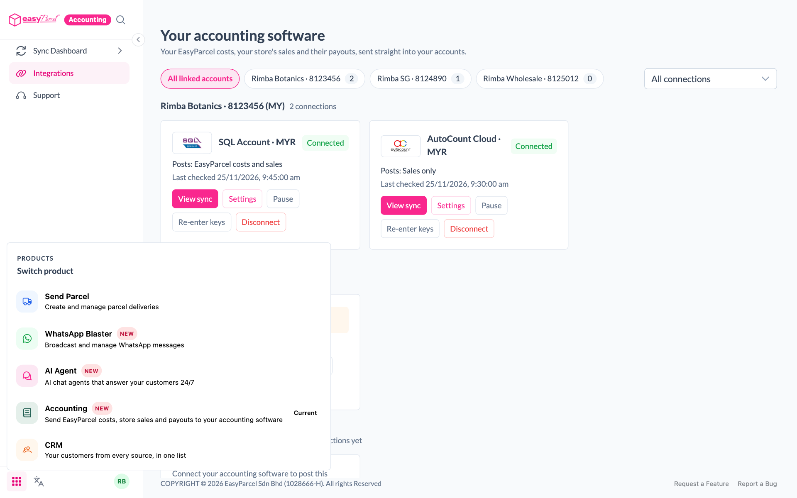

### Step 2: Find your shipping account on Integrations

The **Integrations** page lists every shipping account linked to your organization, each with the connections it already has.

- Use the buttons at the top to show **All linked accounts** or just one, and **All connections** to narrow it down further.
- A shipping account with no connection yet shows **Connect SQL Account**. Otherwise, click **Connect** on the **SQL Account** card under **Connect another**.

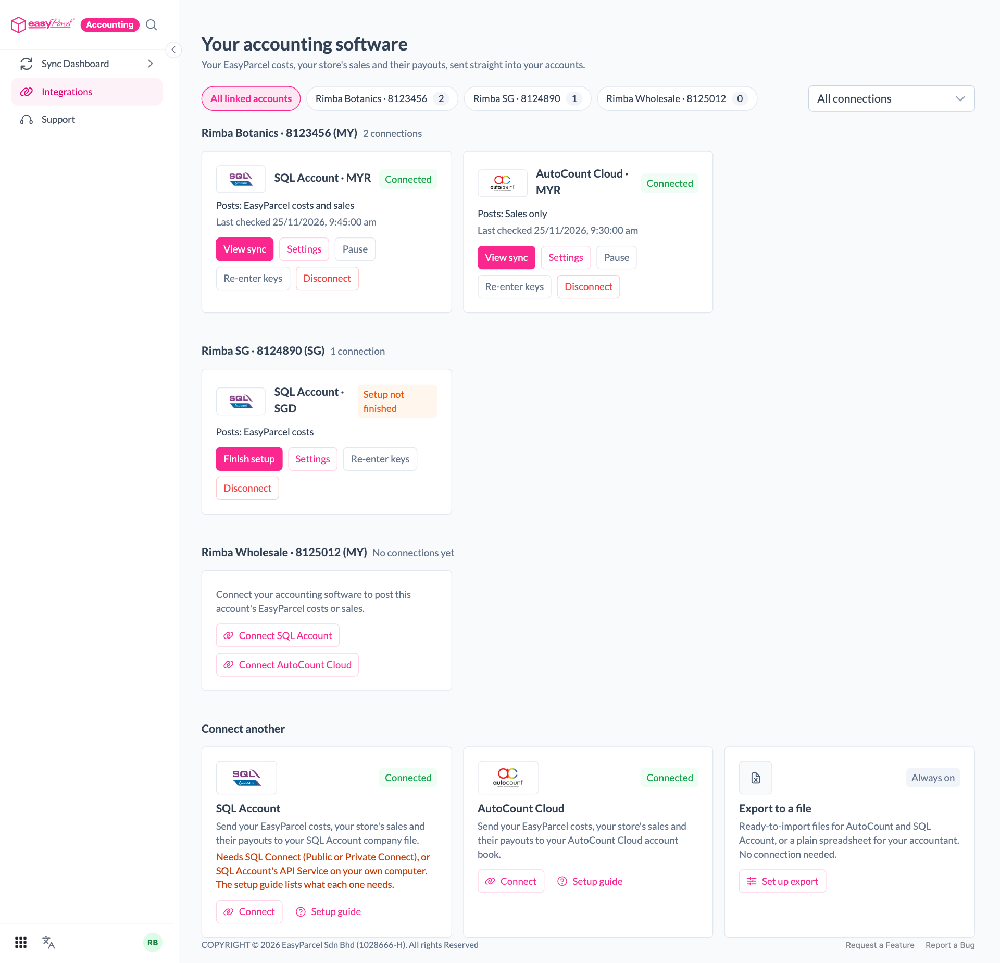

### Step 3: Choose the account and what this connection posts

1. **Which shipping account?** One connection posts for one shipping account. Pick the one whose EasyParcel costs or store sales you want in this SQL Account book.
2. **What will this connection post?**

| Choice | What it posts |
|---|---|
| **EasyParcel costs only** | What EasyParcel charges you, your top-ups and refunds. Store sales aren't posted. You can switch sales on later |
| **Sales only** | Your store sales and their payouts. EasyParcel charges, top-ups and refunds aren't posted. Use this when your EasyParcel costs are recorded elsewhere, or this book belongs to another business, such as a sister company |
| **EasyParcel costs and sales** | Both. You set up the sales during setup |

> Whether a connection posts EasyParcel costs **can't be changed** after it is created. To change it, disconnect and connect again.

### Step 4: Enter your keys

1. **Name this connection** — leave it as `SQL Account`, or give it a name you will recognise (useful if you keep more than one set of books).
2. Paste your **Access Key** and **Secret Key** from Part 1.
3. Click **Connect**.

The connection covers the wallet currency shown in the box: **MYR** for a Malaysia account, **SGD** for a Singapore account.

> Not sure where the keys are? Click **How do I get these keys?** in the box for the same steps as Part 1.

If this shipping account already has a connection in the same currency, the box warns you. Two connections that post the same account's **costs** into one book record every charge twice. Two that post the same account's **sales** split the sales between them, because each sale is posted only once.

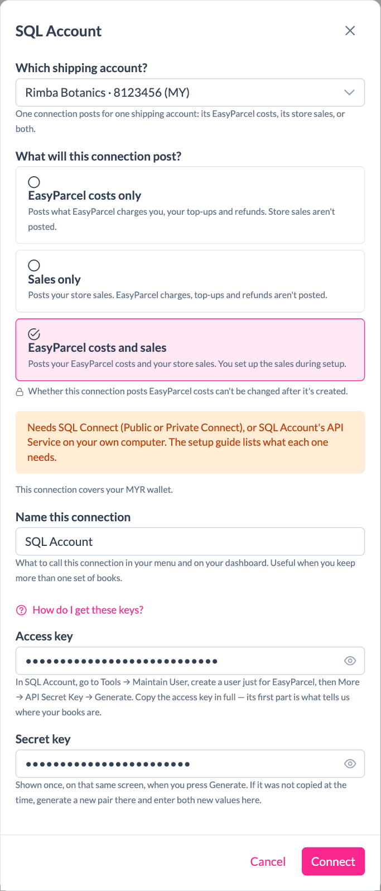

### Step 5: Check the company name, then continue

EasyParcel checks your keys with SQL Account and shows which company book it connected to. Make sure it is the right company, then click **Continue setup**.

If it is the wrong company, click **Use different keys**.

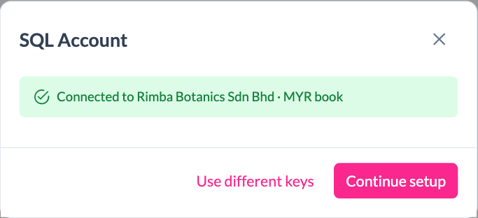

---

## Part 3 — Set up your connection

Setup has four short steps: **What to sync → Accounts → Tax → Schedule**. You can click **Save & finish later** at any time and come back from **Integrations → Finish setup**.

Only your organization's owner and admins can open setup. A Viewer who opens it is taken to the connection's **Sync Dashboard** instead.

### Step 1: What to sync

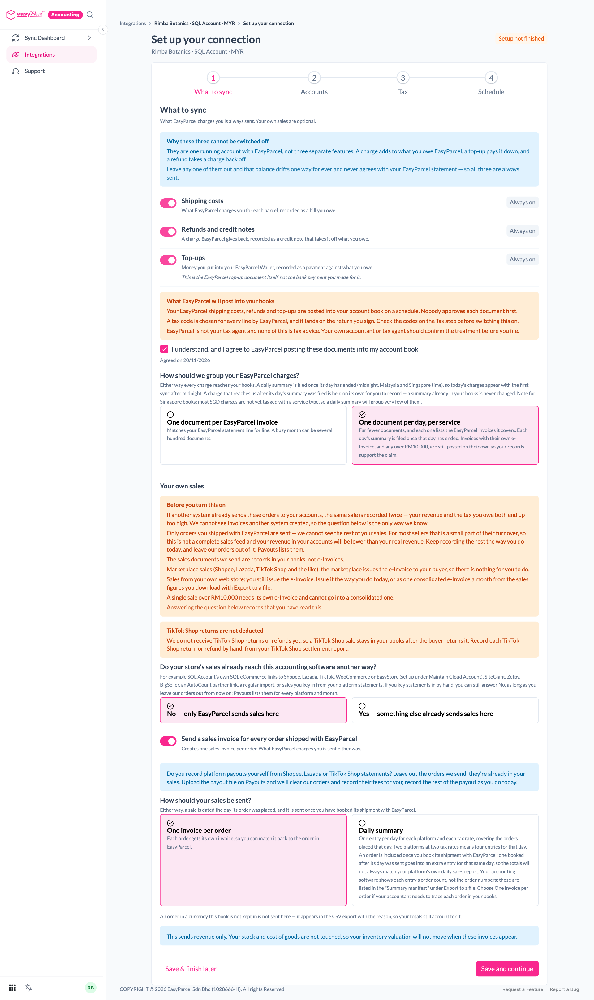

**Your EasyParcel costs** *(not on a Sales only connection)* — these three are always sent:

| Item | What it becomes in SQL Account |
|---|---|
| Shipping costs | A bill from EasyParcel |
| Refunds and credit notes | A credit note that reduces what you owe EasyParcel |
| Top-ups | A payment to EasyParcel |

They can't be switched off. Together they keep your EasyParcel balance in SQL Account the same as your EasyParcel statement.

1. Tick **I understand, and I agree to EasyParcel posting these documents into my account book**. You can't switch the connection on without this.
2. **How should we group your EasyParcel charges?**
   - **One document per EasyParcel invoice** — matches your EasyParcel statement line by line. A busy month can mean several hundred documents.
   - **One document per day, per service** — far fewer documents. Each day's summary is sent after that day ends.

**Your own sales.** EasyParcel can send a sales invoice for every order you ship. On a **Sales only** connection this has to be on.

1. First answer **Do your store's sales already reach this accounting software another way?** If SQL eCommerce, SiteGiant, a marketplace link or a regular import already puts your sales into SQL Account, choose **Yes**. Otherwise the same sales get recorded twice.

   If you key in your sales by hand from your platform statements, you can still answer **No**, as long as you leave EasyParcel's orders out from now on. [Payouts](Payouts.md#if-you-record-payouts-yourself) lists them for every platform and month.
2. Then switch **Send a sales invoice for every order shipped with EasyParcel** on or off.
3. Read the notices that appear. They explain, for example, that only orders shipped with EasyParcel are sent, and how the Malaysia e-Invoice works for these sales.
4. Click **Save and continue**.

> **Malaysia e-Invoice.** The sales documents EasyParcel sends are records in your books, not e-Invoices. For marketplace sales (Shopee, Lazada, TikTok Shop and the like), the marketplace issues the e-Invoice to your buyer. For sales from your own web store, you still issue the e-Invoice, the way you do today, or as one consolidated e-Invoice a month. A single sale over RM10,000 needs its own e-Invoice.

### Step 2: Accounts

Tell EasyParcel which account in your SQL Account chart each type of entry goes to.

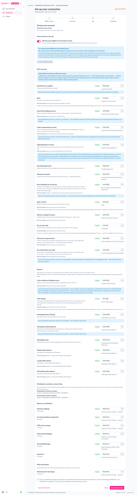

- Click **Fill in suggested codes** to fill every empty row with a suggested code, then check each one.
- Each row has a drop-down that lists your own SQL Account chart of accounts. You can also type a code.
- **Take top-ups straight out of my bank account** *(costs connections)* — leave this on if you pay top-ups from your bank account. Turn it off if you already record these payments from your bank statement, or you pay by card or an online payment gateway. Otherwise every top-up is counted twice.
- **If an account does not exist yet**, create it in SQL Account first: open **Maintain Account**, click the account group named on the row (for example *Current Asset* or *Capital*), then click **New**. Then come back and pick it.
- Rows marked **When this applies** are only needed if you use that feature, for example Cash on Delivery or Instant Pay.

If you send your sales, two more sections appear:

- **Payouts** — the accounts used when you record a platform payout: **Marketplace Fees Clearing**, **Marketplace fees**, optionally **Marketplace Seller Balances** and a seller balance per platform, and your **Bank account** (or **Bank clearing account**) if it isn't already asked under **Main accounts**. The platform payout accounts are optional here, so you can leave them for later. See [Payouts](Payouts.md#before-your-first-payout).
- **Marketplace customers, one per shop** — if you sell through more than one shop on the same platform. Each shop is paid out separately, so each shop's sales go to its own customer in your book. EasyParcel creates it the first time that shop's sale posts.

If you take COD orders and send your sales, also map the **Cash on delivery holding account**, **EasyParcel as a supplier** and **COD charges** (on a Sales only connection they are in the **Payouts** section). EasyParcel uses them to record your COD payouts automatically.

Click **Save and continue**.

### Step 3: Tax

This step is different for Malaysia and Singapore.

#### Malaysia (SST)

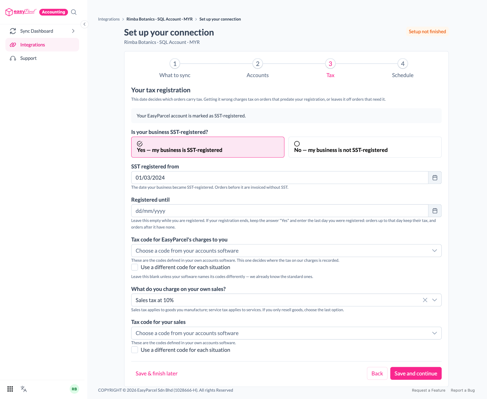

1. **Is your business SST-registered?** Choose **Yes** or **No**. If your EasyParcel account already has an SST number, Yes is selected for you.
2. If Yes, enter **SST registered from**: the date your business became SST-registered.
3. **Registered until** — leave this empty while you are registered. If your registration ends, keep the answer **Yes** and enter the last day you were registered: orders up to that day keep their tax, and orders after it have none.
4. **Tax code for EasyParcel's charges to you** — leave this blank unless your SQL Account uses its own names for tax codes. EasyParcel already knows the standard ones.

> SST you pay EasyParcel can't be claimed back, so it stays part of the delivery cost.

#### Singapore (GST)

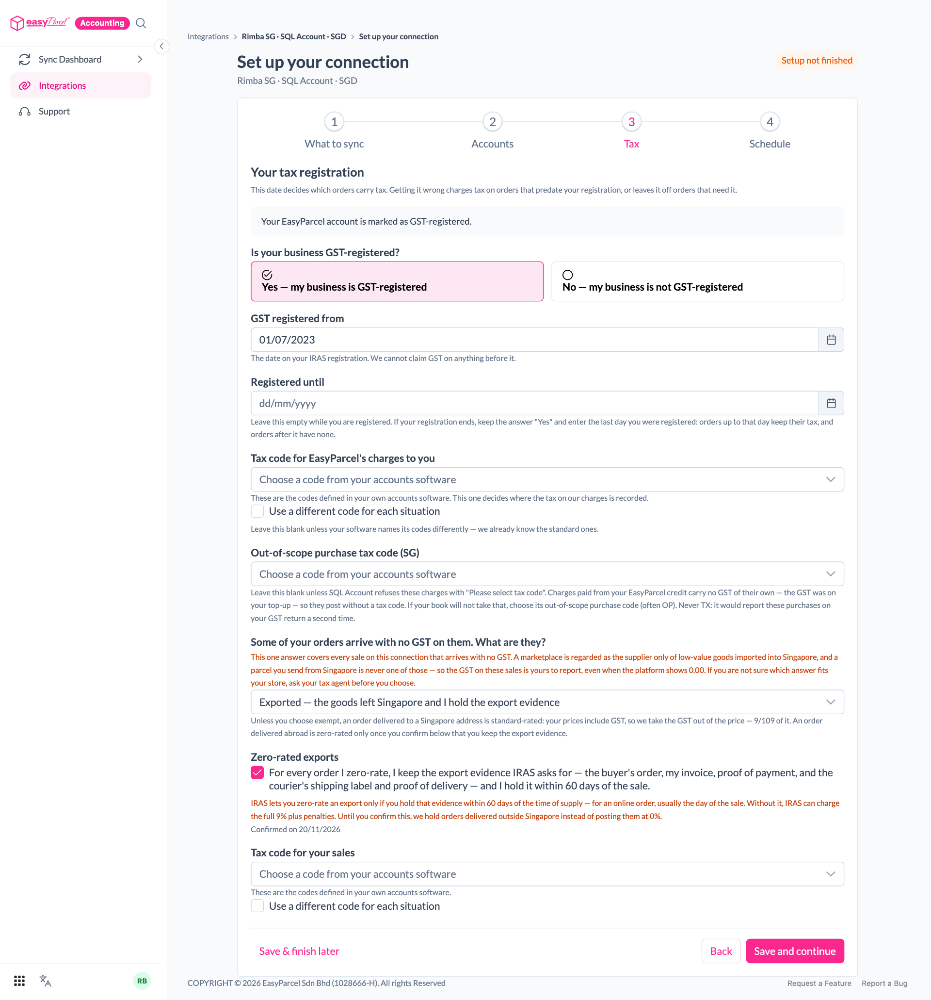

1. **Is your business GST-registered?** Choose **Yes** or **No**.
2. If Yes, enter **GST registered from**: the date on your IRAS registration.
3. **Registered until** — leave this empty while you are registered. If your registration ends, enter the last day you were registered.
4. **Tax code for EasyParcel's charges to you** — leave this blank unless your SQL Account uses its own names for tax codes.
5. **Out-of-scope purchase tax code (SG)** — leave this blank. Only fill it in if SQL Account rejects documents with *"Please select tax code"*. Then choose your out-of-scope purchase code (often `OP`). **Never choose `TX`.** It would report these purchases on your GST return twice.

#### A Sales only connection

A Sales only connection first asks **Whose SST (or GST) registration do these sales use?**

- **The shipping account's registration** — the usual answer.
- **This account book's own registration** — when this book belongs to a different business, such as a sister company. Your answers on this step then apply to this connection only.

Click **Save and continue**.

### Step 4: Schedule, then run your first sync

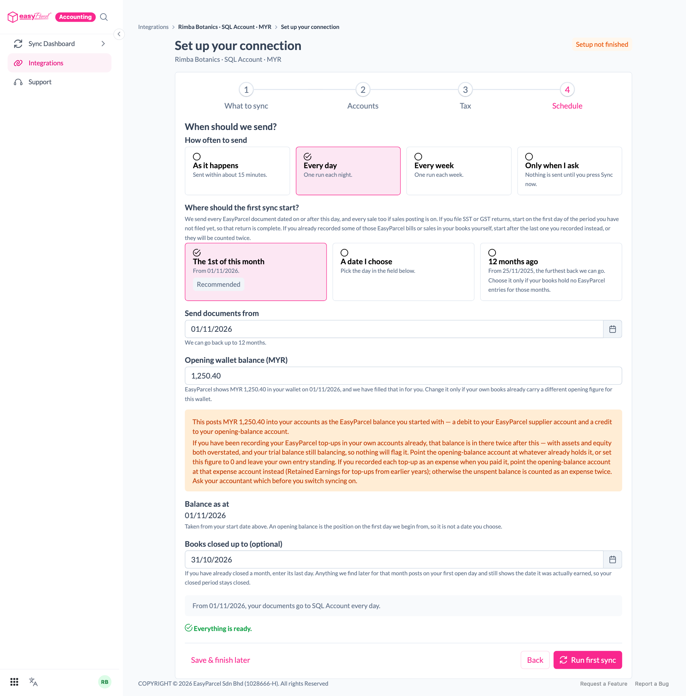

1. **How often to send**
   - **As it happens** — sent within about 15 minutes
   - **Every day** — one run each night
   - **Every week** — one run each week
   - **Only when I ask** — nothing is sent until you click **Sync now**
2. **Where should the first sync start?**
   - **The 1st of this month** (recommended)
   - **A date I choose**
   - **12 months ago**, the furthest back EasyParcel can go

   If you file SST or GST returns, start on the first day of the period you have **not** filed yet. If you already keyed in some EasyParcel bills or sales by hand, start **after** the last one you recorded. Otherwise they are counted twice.
3. **Opening wallet balance** *(costs connections)* — if this box appears, enter how much was in your EasyParcel wallet on the start date.
4. **Books closed up to (optional)** — if you have already closed a month in SQL Account, enter its last day. Anything EasyParcel finds later for that month is posted on your first open day instead.

   To reopen a closed period, move the date back or clear it, and say why under **Why are you reopening a closed period?** Every change is kept, with who made it and why, under **Changes to "Books closed up to"**.
5. **This account book keeps its figures in MYR** (or SGD) — this tick appears only if SQL Account didn't tell EasyParcel the book's currency. Check the book's base currency first: in a book kept in another currency, every amount would be recorded at the wrong value.
6. When you see **Everything is ready**, click **Run first sync**.

If anything is missing, a checklist appears above the button. It shows what to fix, with a link back to the right step.

---

## Part 4 — Check your sync

### Sync Dashboard

Each connection has its own **Sync Dashboard**. With more than one connection, they are listed under **Sync Dashboard** in the left menu, each with the number of documents that need your attention.

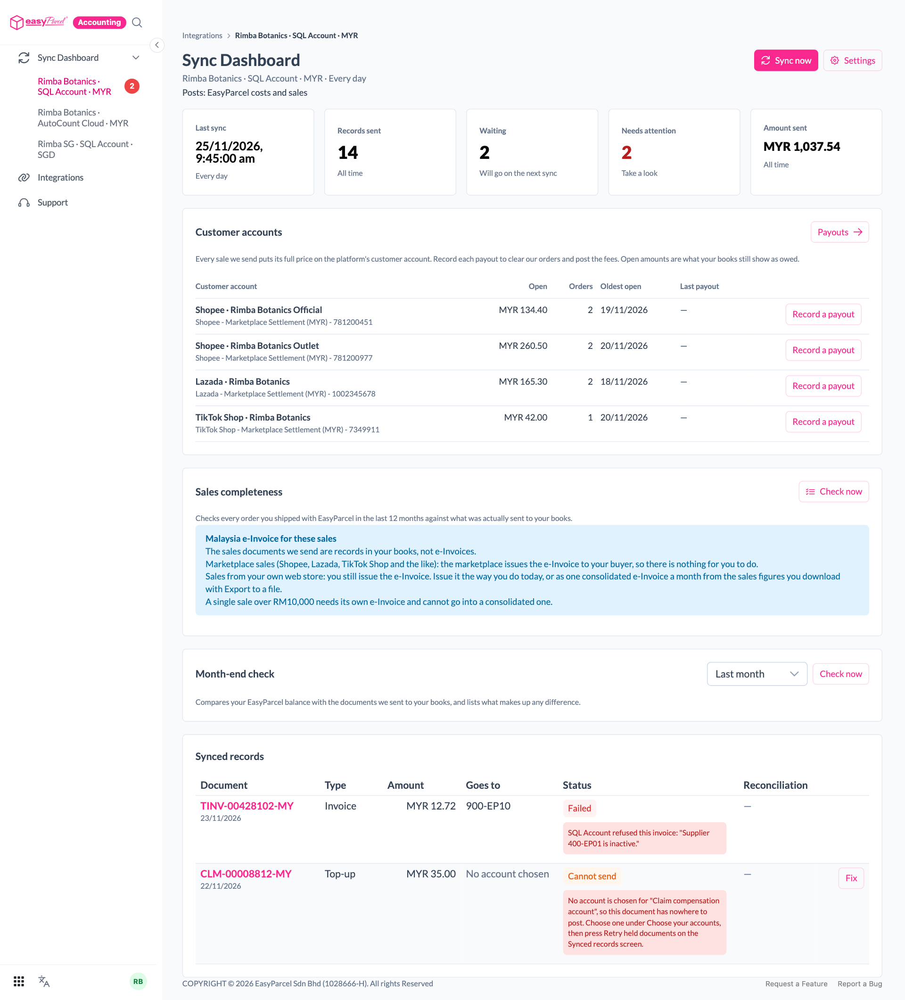

| Box | Meaning |
|---|---|
| **Last sync** | When EasyParcel last sent documents |
| **Records sent** | Documents now in SQL Account |
| **Waiting** | Documents that go on the next sync |
| **Needs attention** | Documents you need to look at |
| **Amount sent** | Total value sent so far |

- **Sync now** sends waiting documents straight away.
- **Settings** opens your setup again.
- **Month-end check** *(costs connections)* compares your EasyParcel balance with what was sent to SQL Account and lists anything that makes up a difference. Pick a month and click **Check now**. Only the owner or an admin can sign a period as closed.
- **Customer accounts** *(when you send sales)* shows what each shop's customer account still holds for EasyParcel's orders. See [Part 5](#part-5--record-your-platform-payouts).
- **Sales completeness** *(when you send sales)* checks every order you shipped with EasyParcel in the last 12 months against what was sent to your books, and says why any order wasn't sent. Click **Check now**.

### Synced records

Click any box on the dashboard (**Records sent**, **Waiting** or **Needs attention**) to open the full list.

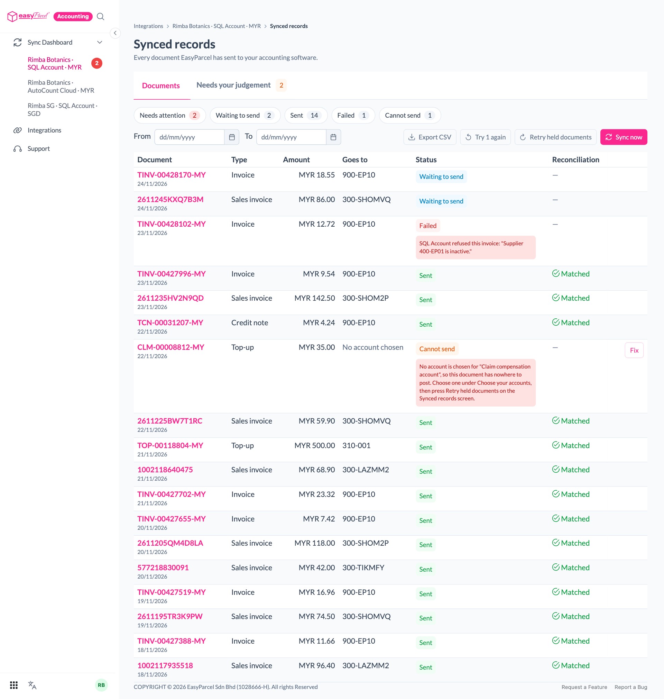

What each status means:

| Status | What it means | What to do |
|---|---|---|
| **Sent** | It is in SQL Account | Nothing |
| **Waiting for invoice number** | The EasyParcel invoice is not ready yet | Nothing. It is sent automatically when ready |
| **Waiting to send** / **Sending** | It is on its way | Nothing |
| **Failed** | SQL Account did not accept it. The reason is shown under the status | Fix the reason, then click **Try again** |
| **Needs checking** | It was sent, but SQL Account did not reply in time | Search SQL Account for the reference shown **before** doing anything. Do **not** key it in by hand. It may already be there |
| **Cannot send** | Something must change first. The reason is shown on the row | Follow the reason shown |
| **Journal needed** | EasyParcel never sends this one | Post the journal described in SQL Account, then mark it done |
| **Not sent by design** | It is deliberately not sent | Nothing |

A sale already posted by another connection of the same shipping account shows **Already posted by** that connection. Each sale is posted only once, so this copy is not sent.

The **Needs your judgement** tab is for your own sales, if you send them. An item appears here when something happens to an order after its invoice was sent: its figures change, the buyer returns it, or its parcel comes back undelivered. Check whether SQL Account needs a credit note, then answer **I corrected it** or **No change needed**.

**Export CSV** downloads the list as a spreadsheet.

---

## Part 5 — Record your platform payouts

When you send your sales, each sale puts its full price on the platform's customer account. When Shopee, Lazada, TikTok Shop or Shopify pays you, upload their payout file on the connection's **Payouts** page. EasyParcel clears its orders off the customer account, records the fees the platform took, and shows which part of the payout isn't ours, so you record only that part yourself.

Open it from the **Customer accounts** card on the Sync Dashboard. EasyParcel COD payouts are recorded automatically.

The full steps are in the **[Payouts guide](Payouts.md)**.

---

## What gets sent to SQL Account

| From EasyParcel | Becomes in SQL Account |
|---|---|
| Shipping and other charges | Purchase Invoice (supplier: EasyParcel) |
| Refunds and credits from EasyParcel | Supplier Credit Note |
| Wallet top-ups, and money paid into your wallet | Supplier Payment |
| Wallet withdrawals | Supplier Refund |
| Opening wallet balance (once, on the start date) | Journal Entry |
| **Optional:** your sales | Customer Invoice (one customer per marketplace, or per shop when a platform has several of yours, created for you) |
| **Optional:** refunds on your sales | Customer Credit Note |
| **Optional:** a platform payout you record | Customer Payments that clear the invoices, and a Purchase Invoice and Supplier Payment for the platform's fees. See [Payouts](Payouts.md#what-gets-posted) |
| **Optional:** an EasyParcel COD payout | Customer Payment that clears the COD sales, and a Purchase Invoice and Supplier Payment for the COD charges |

A **Sales only** connection sends only the sales, refund, payout and COD rows.

Documents carry the EasyParcel reference, so you can search for them in SQL Account.

---

## Managing your connection

Go to **Integrations** to see your connection cards. Each card shows the shipping account it belongs to and what it **Posts**: EasyParcel costs, sales, or both.

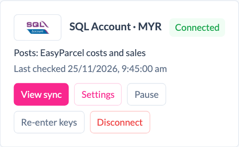

| Button | What it does |
|---|---|
| **View sync** | Opens the Sync Dashboard |
| **Settings** | Change any setup answer: what to sync, accounts, tax or schedule |
| **Pause** | Stops sending for now. Nothing is lost, and documents wait until you resume |
| **Re-enter keys** | Enter new keys, for example after you revoked them in SQL Account. It replaces the old keys and does not create a second connection |
| **Disconnect** | Stops sending. Anything already sent stays in SQL Account |

A Viewer sees **View sync** only.

---

## Who can do what

What a person can do comes from their **Accounting role in your organization**, set in EasyAccount.

| Action | Owner and Admin | Viewer |
|---|---|---|
| See Integrations, Sync Dashboards, Synced records and Payouts | ✅ | ✅ |
| Run a month-end check, download files and lists | ✅ | ✅ |
| Connect, re-enter keys, change setup, pause, disconnect | ✅ | — |
| Sync now, Try again, answer Needs your judgement | ✅ | — |
| Sign a month-end close, record and post payouts | ✅ | — |

People with no Accounting role can't open Accounting. They see *Your role doesn't include Accounting*.

**EasyParcel support** can open your Accounting to help you. Anything that is a statement about your own tax and books, such as agreeing to the cost posting, signing a period, answering a sales question or posting a payout, is left for your owner or an admin.

---

## Malaysia and Singapore at a glance

| | Malaysia | Singapore |
|---|---|---|
| Currency | MYR | SGD |
| Tax | SST | GST |
| Tax step asks | SST-registered? Registered from and until dates | GST-registered? Registered from and until dates, and an optional out-of-scope purchase code |
| Tax on EasyParcel charges | Not claimable, so it stays part of the cost | Claimed as input tax if you are GST-registered |
| Tax on platform fees in a payout | Posted with no tax code | Claimed if you tick that you hold the platform's tax invoice |
| Daily summary | Groups charges by service | Most SGD charges are not yet tagged with a service, so a daily summary groups very few of them |

Everything else is the same for both.

---

## Troubleshooting and FAQ

**It says "Link this account to your organization".**
Accounting belongs to your organization. The shipping account's owner links it in EasyAccount, under **Manage organization**, and shares it with organization products. Then open Accounting again from the **Products** menu.

**It says "You're not a member of this organization".**
Only members of an organization can open its Accounting. Ask the organization's owner to invite you in EasyAccount, or switch to an organization you belong to.

**I can see everything, but there are no buttons to change anything.**
You have the **Viewer** role. Ask your organization's owner or an admin to make the change, or to give you the Admin role in EasyAccount.

**Connect says my keys are wrong.**
Copy the Access Key **in full**, including the part before `.sql.my`. If you no longer have the Secret Key, go back to SQL Account, click **Revoke**, generate a new pair and enter both new keys.

**It connected to the wrong company.**
Click **Use different keys**. Generate keys for a user in the right company's book in SQL Account.

**Documents show "Failed — SQL Account could not be reached".**
Your SQL Connect or SQL Account API Service was offline. Make sure it is running. EasyParcel tries again automatically on the next sync, or you can click **Try again**.

**SQL Account says an account code does not exist.**
Create the account in SQL Account (**Maintain Account → choose the group → New**), then pick it in **Settings → Accounts**.

**Will EasyParcel bills appear twice?**
Only if you also keyed them in by hand, or two connections post the same shipping account's costs into the same book. Set the start date to the day after the last EasyParcel bill you recorded yourself, and keep one costs connection per book.

**Will my sales appear twice?**
If something else already sends your sales to SQL Account (SQL eCommerce, SiteGiant, a marketplace link or a regular import), keep **Send a sales invoice for every order** switched off. If you record payouts from your platform statements yourself, leave EasyParcel's orders out: **Payouts → Download orders we posted** lists them.

**My sales invoices show as unpaid.**
Record the platform's payout on the **Payouts** page. It clears EasyParcel's orders off the customer account. See the [Payouts guide](Payouts.md).

**I want my sales in a different company's book from my EasyParcel costs.**
Connect that company's SQL Account book as **Sales only**, and choose **This account book's own registration** on the Tax step if it is a different business.

**Can I change what a connection posts?**
You can switch sales on or off in **Settings**. Whether it posts EasyParcel costs is fixed when it is created: to change that, disconnect it and connect again.

**Can I change my answers later?**
Yes. Go to **Integrations → Settings** on your connection card.

**I already closed last month in SQL Account.**
Enter that month's last day in **Books closed up to** on the Schedule step. Late documents for a closed month are posted on your first open day and still show the date they belong to.

**Does disconnecting delete anything from SQL Account?**
No. Everything already sent stays in SQL Account.

---

## Need help?

Click **Support** in the left menu of the Accounting Tool, or WhatsApp us at **+604-2023160**.
