# EasyParcel CRM — User Guide

CRM (Customer Relationship Management) builds one list of your **organization's** customers from the sources you turn on: the **Address Book** and **shipments** of each shipping account linked to your organization, their stores' orders in **Imported Orders**, your **WhatsApp** chats and your **AI Agent** chats and leads. Use it to see who buys from you again, who has gone quiet and who your best customers are, and to follow up with them. You can also add, import and edit customers yourself.

CRM belongs to your organization in EasyAccount, like WhatsApp Blaster and AI Agent. Everyone your organization gives CRM access to works on the same list.

> All screenshots in this guide use demo data. Your own screens show your organization, customers and amounts.

## Contents

1. [Open CRM and switch it on](#part-1--open-crm-and-switch-it-on)
2. [Data Sources](#part-2--data-sources)
3. [The Dashboard](#part-3--the-dashboard)
4. [The Customers page](#part-4--the-customers-page)
5. [A customer's profile](#part-5--a-customers-profile)
6. [Add, edit, merge and split customers](#part-6--add-edit-merge-and-split-customers)
7. [Segments and tags](#part-7--segments-and-tags)
8. [Import customers](#part-8--import-customers)
9. [Activity Log and Settings](#part-9--activity-log-and-settings)
10. [Where your customers come from](#where-your-customers-come-from)
11. [Who can do what](#who-can-do-what)
12. [Your customers' privacy](#your-customers-privacy)
13. [Troubleshooting and FAQ](#troubleshooting-and-faq)

---

## Part 1 — Open CRM and switch it on

### Step 1: Open CRM

In any EasyParcel+ product, such as WhatsApp Blaster or AI Agent, click the **product** button (the grid icon) at the bottom of the left menu. Under **Switch product**, choose **CRM**. CRM opens for the organization you're working in. If you belong to several organizations, switch organization first.

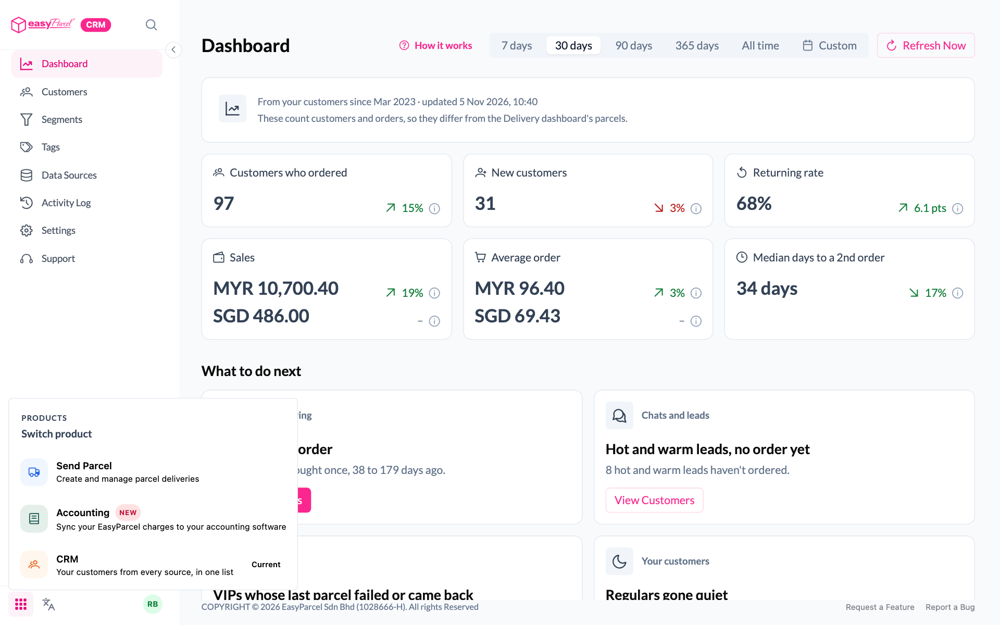

### Step 2: Switch on CRM

The first time CRM is opened for an organization, it shows what CRM does and a **Switch On CRM** button.

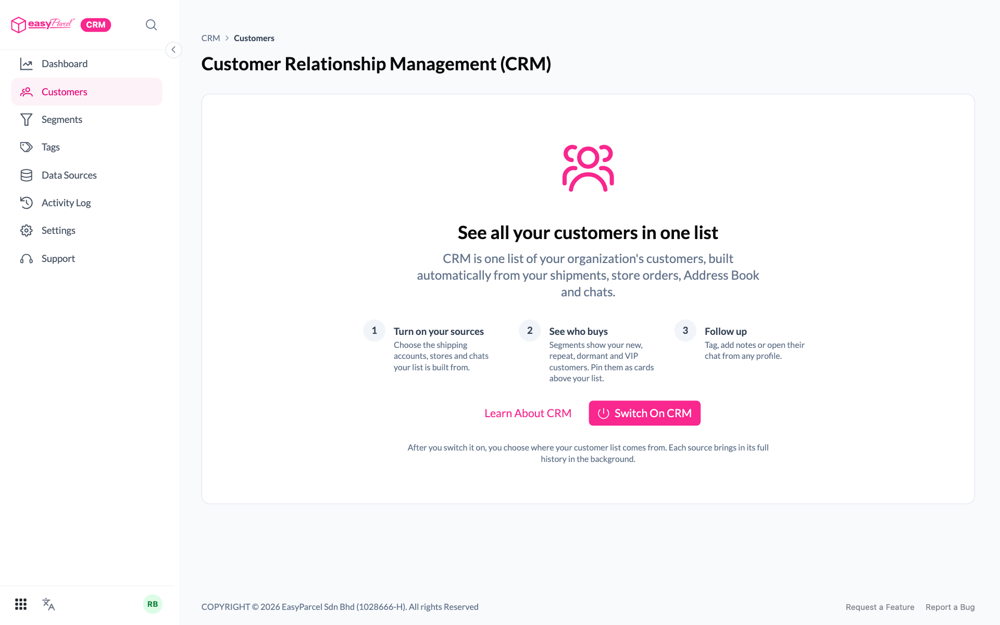

Only the **organization owner** can switch CRM on. Everyone else sees *Ask your organization owner to switch on CRM*, and can use CRM as soon as the owner has.

1. Click **Switch On CRM**.
2. Read the terms. They explain where your customer list is kept, who can see it, what CRM keeps from chats, and your responsibilities for your customers' data.
3. Tick **I've read these terms, and I'm responsible for using my customers' data lawfully.**
4. Click **Agree & Switch On**.

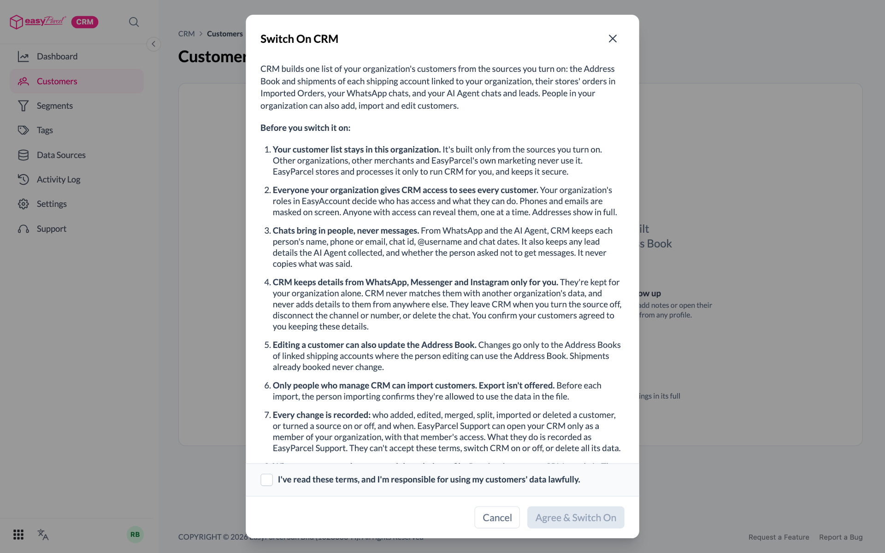

### Step 3: Choose your data sources

Your customer list starts empty. Go to **Data Sources** and turn on the sources you want. See [Part 2](#part-2--data-sources).

---

## Part 2 — Data Sources

**Data Sources** decides where your customer list comes from. Each source has its own switch.

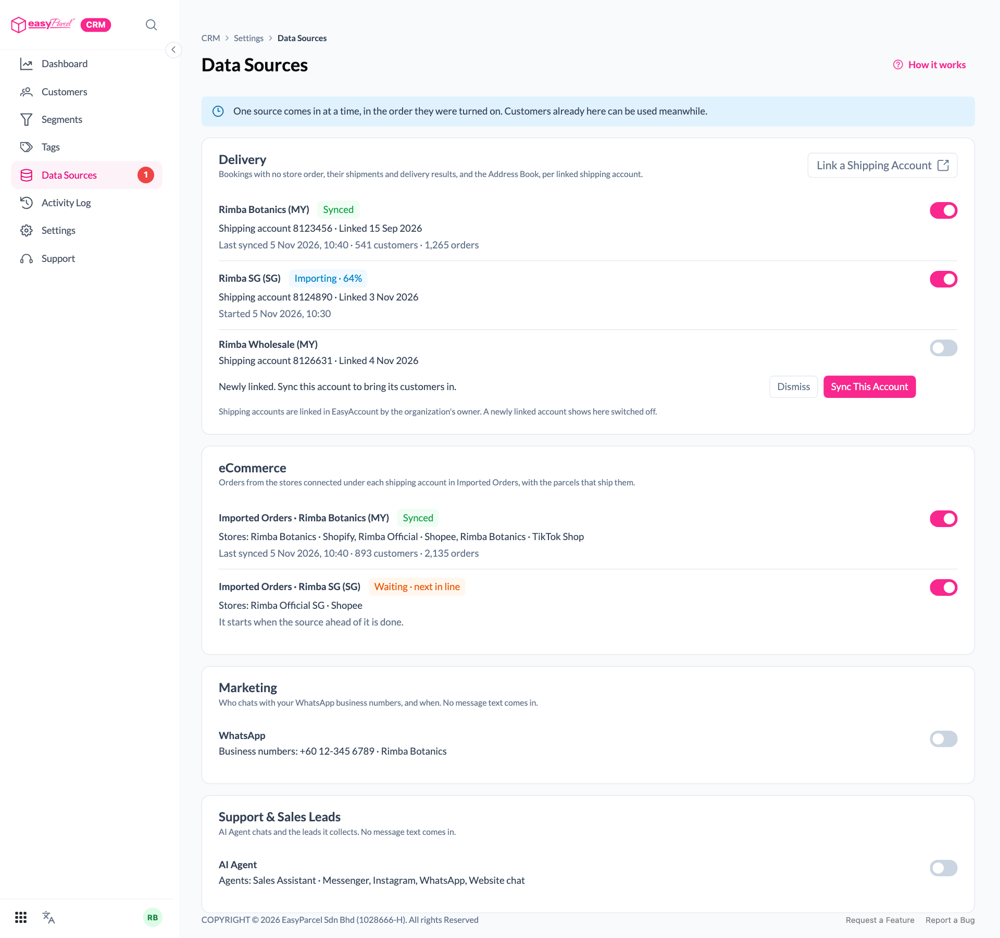

| Group | Sources | What comes in |
|---|---|---|
| **Delivery** | One per linked shipping account | Bookings, their shipments and delivery results, and the account's Address Book |
| **eCommerce** | One per linked shipping account | Orders from the stores connected under that account in Imported Orders, with the parcels that ship them |
| **Marketing** | WhatsApp | Who chats with your WhatsApp business numbers, and when. No message text comes in. |
| **Support & Sales Leads** | AI Agent | AI Agent chats and the leads it collects. No message text comes in. |

**Turning a source on**

- Switch it on. It brings in its **full history** in the background.
- **One source comes in at a time**, in the order they were turned on. A source waiting its turn says **Waiting**; the one coming in says **Importing** with how far it has got. Customers already in your list can be used meanwhile.
- When it's done it says **Synced**, and from then on it adds new orders and chats **within about 15 minutes**.

**A newly linked shipping account**

Shipping accounts are linked to your organization in EasyAccount, by the organization's owner. A newly linked account shows here switched off, marked **Newly linked**. Click **Sync This Account** to bring its customers in: its Delivery source comes in first, then its store orders. Click **Link a Shipping Account** to open EasyAccount.

> If a linked shipping account isn't shared with organization products, CRM can't see it. The organization's owner can turn sharing on in EasyAccount.

**Turning a source off**

Switch it off. CRM first shows how many customers **leave** and how many **stay**:

- Customers who came **only** from this source leave CRM, with their tags and notes.
- Customers another source also holds stay, with their tags and notes, and lose only what came from this source.

Tick **I understand** and click **Turn Off**. You can turn it on again at any time: its customers come back, but the tags and notes of those who left don't.

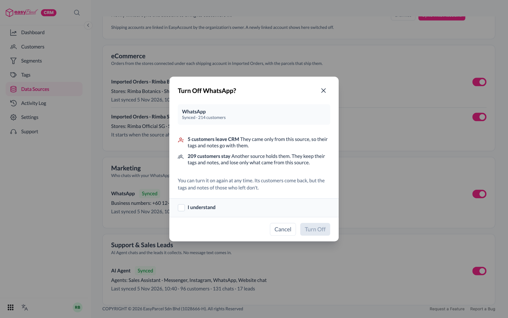

> Before you turn **WhatsApp** on, check how many chats your business numbers hold: every person who has chatted with you becomes a customer.

The organization owner and admins can turn sources on and off. Everyone else sees the page read-only.

---

## Part 3 — The Dashboard

CRM opens on the **Dashboard**. It shows how many of your customers order, come back and where they come from, for the period you pick.

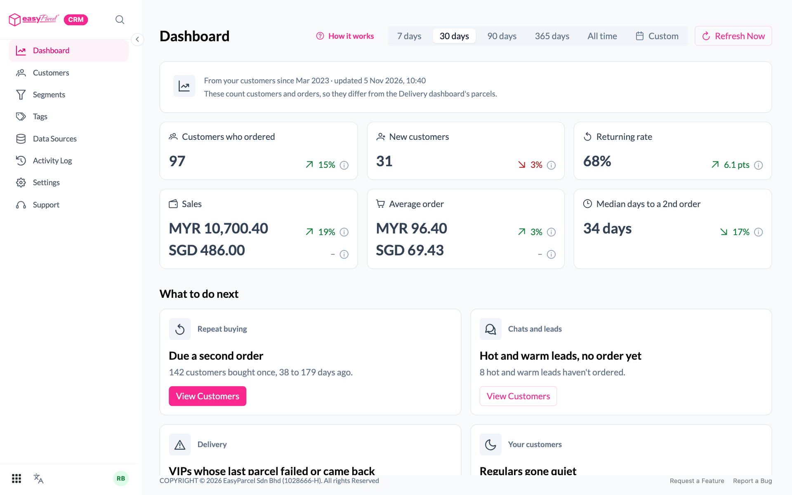

- **Pick a period** at the top: the last 7, 30, 90 or 365 days, all time, or a custom range. Each figure is compared with the period of the same length before it.
- **The tiles:** Customers who ordered, New customers, Returning rate, Sales, Average order and Median days to a 2nd order.
- **What to do next** suggests who to follow up: customers due a second order, hot and warm leads with no order yet, VIPs whose last parcel failed or came back, regulars gone quiet, and possible duplicates to check.
- **Click a bar, row or card** to see those customers in your list, ready to save as a segment.
- **Refresh Now** fetches new shipments, orders and chats now, instead of waiting for the next update.

Further down:

| Section | What it shows |
|---|---|
| **Your customers** | New and returning customers over time, and how often they've ordered |
| **Repeat buying** | Days from the 1st to the 2nd order, and how many reached a 2nd and a 3rd order |
| **Where customers come from** | Customers by source, with each source's share, repeat rate and spend, and the customers on 2 or more sources |
| **Delivery by customer type** | Delivery results for new, repeat and VIP customers' parcels, and the COD return rate |
| **Chats and leads** | AI Agent leads by quality, per agent and channel, and how many ordered within 30 days |
| **Segments** | Your saved segments and how many customers each holds |
| **Where customers are** | Customers who ordered in the period, by their main address |

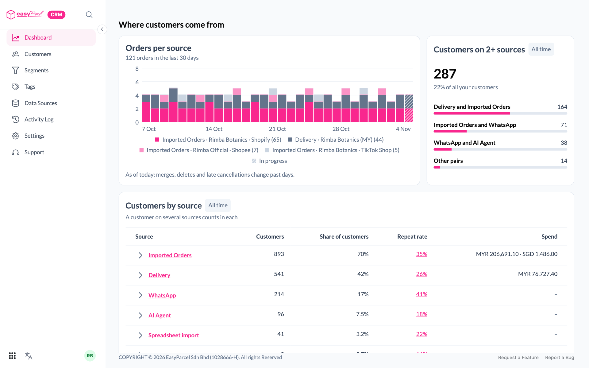

> The Dashboard counts **customers and orders**, so its numbers differ from the Delivery dashboard's, which counts parcels. **Sales are shown per currency**, never added across currencies.

---

## Part 4 — The Customers page

The **Customers** page is your list of everyone CRM holds for your organization.

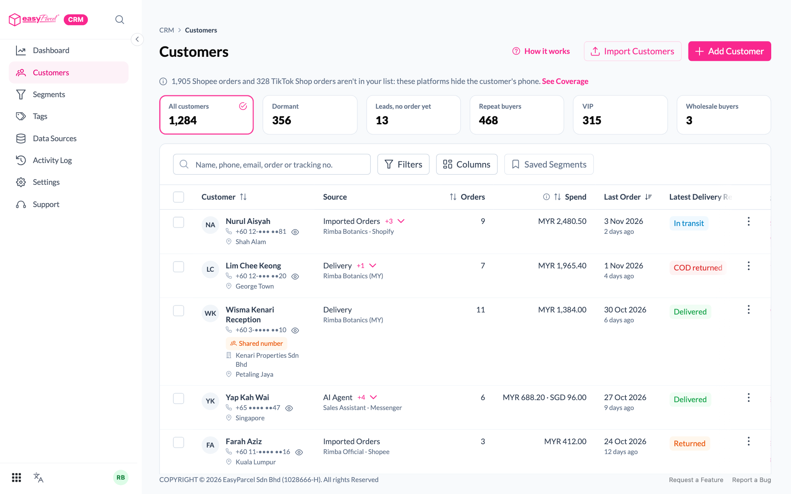

| Part of the page | What it does |
|---|---|
| **How it works** | A short explanation of the page. Every CRM page has one. |
| **Import Customers** | Add customers from a file. See [Part 8](#part-8--import-customers). |
| **Add Customer** | Add one customer by hand. See [Part 6](#part-6--add-edit-merge-and-split-customers). |
| **Coverage line** | Tells you how many store orders aren't in your list, and why. Click **See Coverage** for the details. |
| **Segment cards** | **All customers**, then each **pinned** segment with its count. Click a card to show only those customers. See [Part 7](#part-7--segments-and-tags). |
| **Search**, **Filters**, **Saved Segments**, **Columns** | Find the customers you want, and choose what the list shows. |
| **The list** | Each customer's source, orders, spend, last order, latest delivery result and tags. Click a column header to sort by it. |

### Each row in the list

- **Name and phone.** Phones and emails are masked, for example `+60 12-••• ••81`. Click the **eye** icon to show one.
- **Source:** where the customer **came from** (their first source), for example *Imported Orders · Rimba Botanics · Shopify*, with **+1**, **+2** when they're on more sources. Click the number to see **All sources**.
- **Chat-only customers** have no phone or email yet, only a chat, for example *Instagram · @demo.shop*.
- **Shared number:** this phone was used with many different names, as an office front desk or a reseller's agent would. It is still one customer, so check the name on each order.
- **No orders yet:** a saved receiver, a chat, a lead or a customer you added who hasn't ordered yet.
- **⋮ (More actions):** view the profile, copy the phone, and more.

### Choose your columns

Click **Columns** to pick what the list shows: Source, All sources, Company, Email, Location, Customer since, Orders, Spend, Last order, Latest delivery result, Lead quality and Tags. **Customer** is always shown. Your choice is saved for you only. **Reset to Default** puts the default columns back.

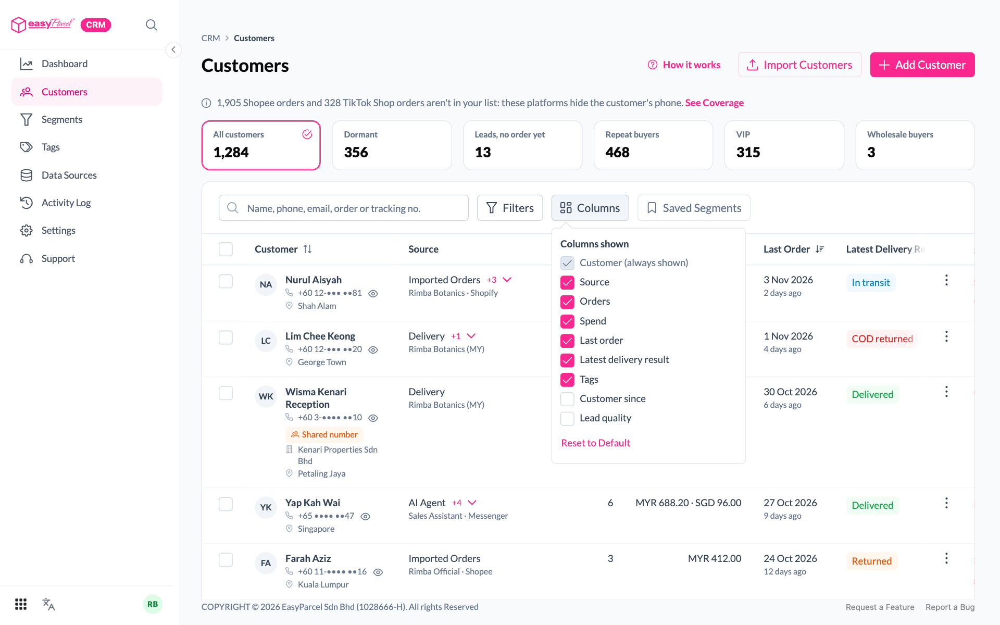

### Search

Type in the search box to find a customer by **name, phone, email, chat username, order number or tracking number**. The row says what matched, for example *Matches tracking no.*

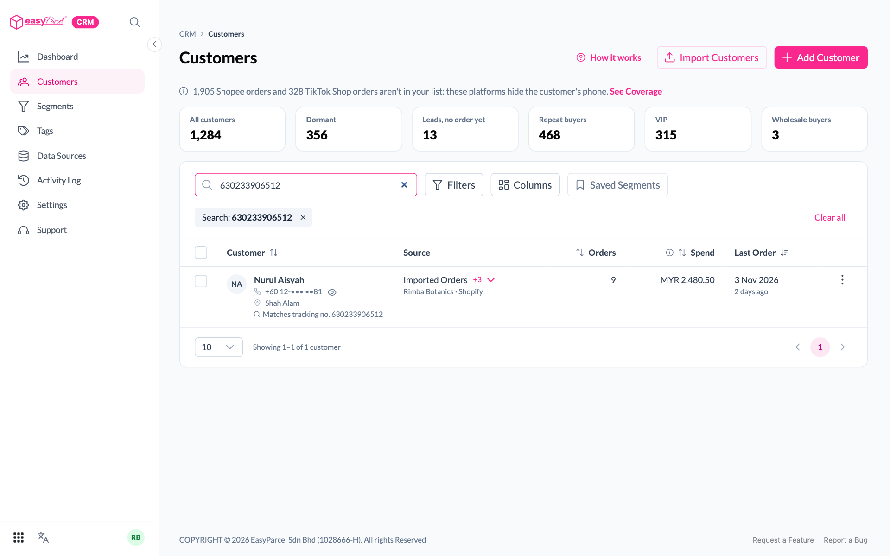

### Filters

Click **Filters**, choose what you need, then click **Apply Filters**. **Reset All** clears them.

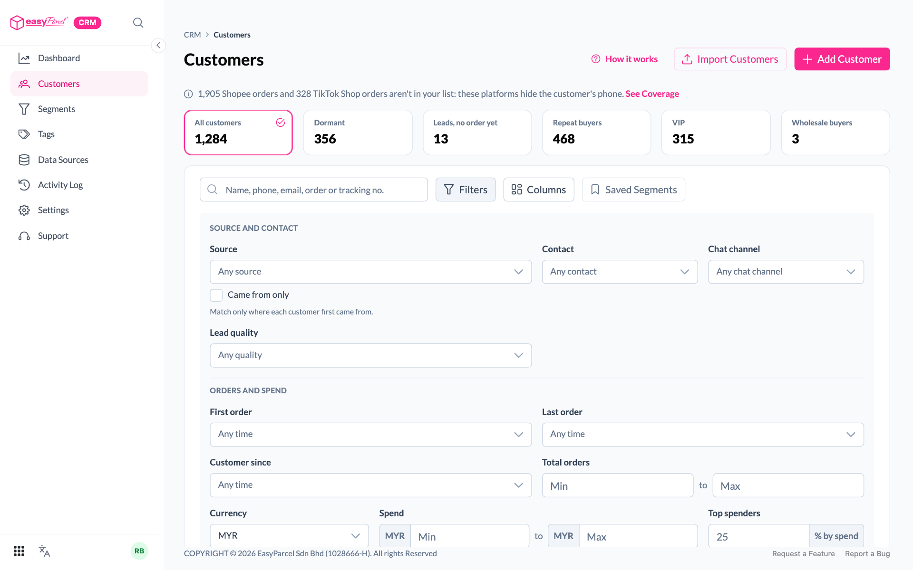

| Group | Filters |
|---|---|
| **Source and contact** | **Source** (pick one or more; tick **Came from only** to match only where each customer first came from), **Contact** (phone, email or chat only), **Chat channel**, **Lead quality** (Hot, Warm, Cold) |
| **Orders and spend** | **Last order**, **First order**, **Customer since**, **Total orders**, **Spend** in one currency, **Top spenders** (your top % by spend in that currency), **Latest delivery result** |
| **Tags** | **Tags** (any of the tags you pick) and **Without tags** |
| **Location** | **Country**, **State** and **Postcode**, by each customer's main address. Postcode matches the start, so `119` finds `11950`. Separate several with commas. |

Each filter you use shows as a chip above the list. Click **×** on a chip to remove it, or **Clear all** to remove them all.

> **Spend is never converted between currencies.** A spend filter takes a currency, and customers are ranked by spend within one currency.

### Why some store orders aren't in your list

CRM joins an order to a customer **by phone**, and a chat by phone, email or chat id. Shopee, Lazada, TikTok Shop and Amazon hide the buyer's phone on most of their orders, so those orders can't join anyone. They are left out and counted, so you always know how many.

Click **See Coverage** to see, for each source, how many of its orders are in your list and why the rest were left out, and how many **chat-only customers** you have.

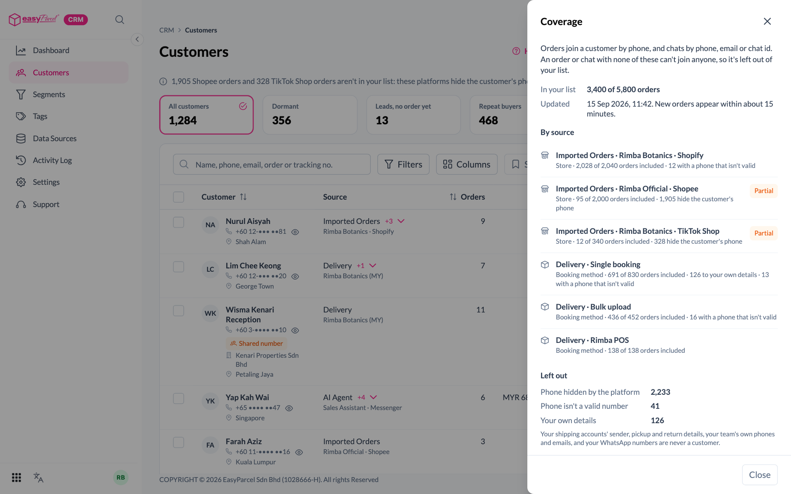

> Your organization's own phones and emails, the saved sender, pickup and return addresses of your linked shipping accounts, and your team members' phones are never counted as a customer. Everyone else you ship to or chat with is.

### Possible duplicates

CRM merges two profiles on its own only when a new order or chat proves they're one person: it carries the phone of one and the email or chat id of the other, who was known only by that. The Activity Log records it as *Merged a customer automatically*.

Anything less certain is left to you. When two profiles look like the same person (the **same email**, the **same name and address**, or the **same name with phones one digit apart**), CRM lists them under **Possible duplicates**. Open them from the Dashboard's **What to do next**, or with the Possible duplicates filter.

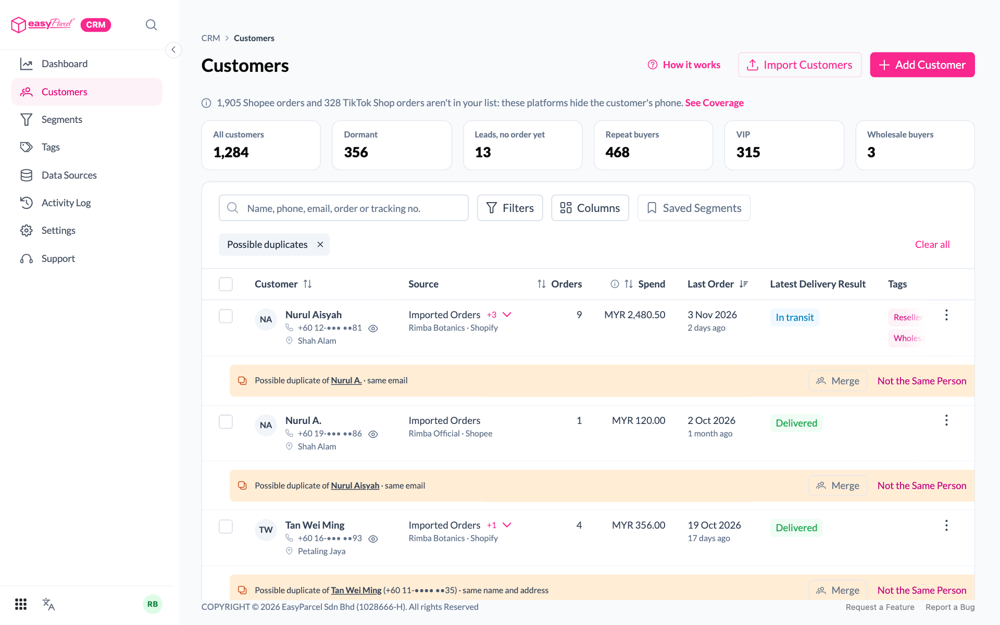

For each pair, click **Merge** to combine them (see [Merge customers](#merge-customers)), or **Not the Same Person** so the pair isn't suggested again.

### Save a segment

A **segment** saves the filters and sort you are using, so everyone in your organization can open the same list again in one click. Its count is always up to date.

1. Pick your filters.
2. Click **Saved Segments**, then **Save as Segment** (or click **Save as Segment** beside **Clear all**).
3. **Create Segment** opens with your filters as its conditions, and shows how many customers match. Give it a **Name**, change the conditions if you like, and click **Save Segment**.

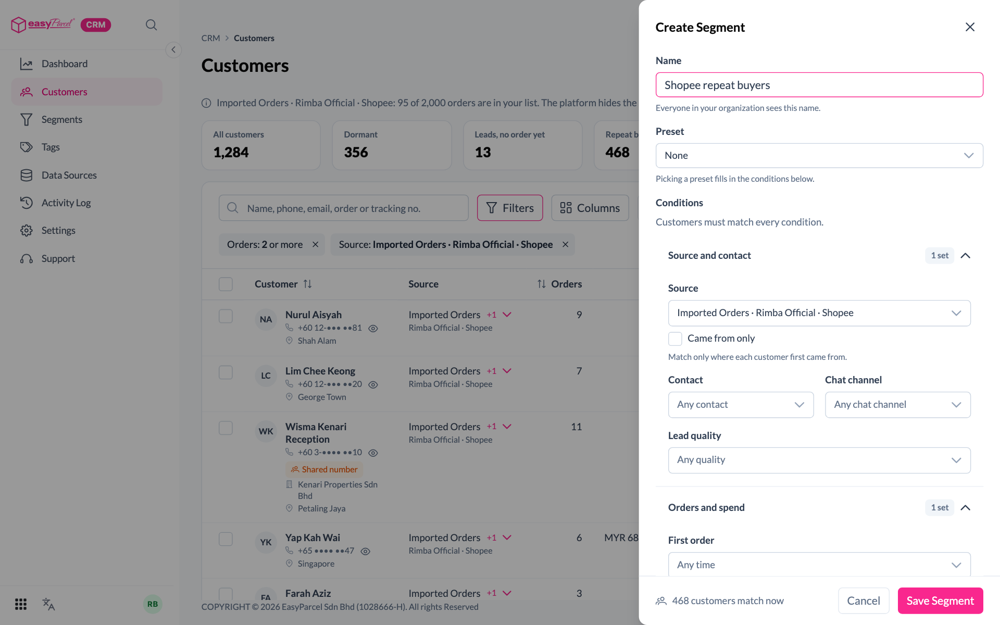

To open a saved segment, click **Saved Segments** and pick it. Use the **⋮** beside a segment to **Rename** it, **Update to Current Filters** or **Delete** it. You can also create segments from a preset on the **Segments** page: see [Part 7](#part-7--segments-and-tags).

### Work on many customers at once

Tick the box beside each customer you want, or the box in the header to select the whole page (then **Select All** to include every page). A bar appears with:

- **Add Tags** and **Remove Tags**
- **Merge** (when two or more customers are selected; see [Part 6](#part-6--add-edit-merge-and-split-customers))
- **Clear** to unselect

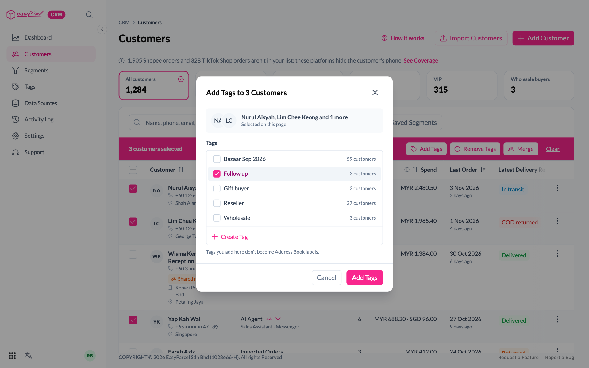

> Tags you add in CRM don't become Address Book labels.

---

## Part 5 — A customer's profile

Click a customer's name to open their profile.

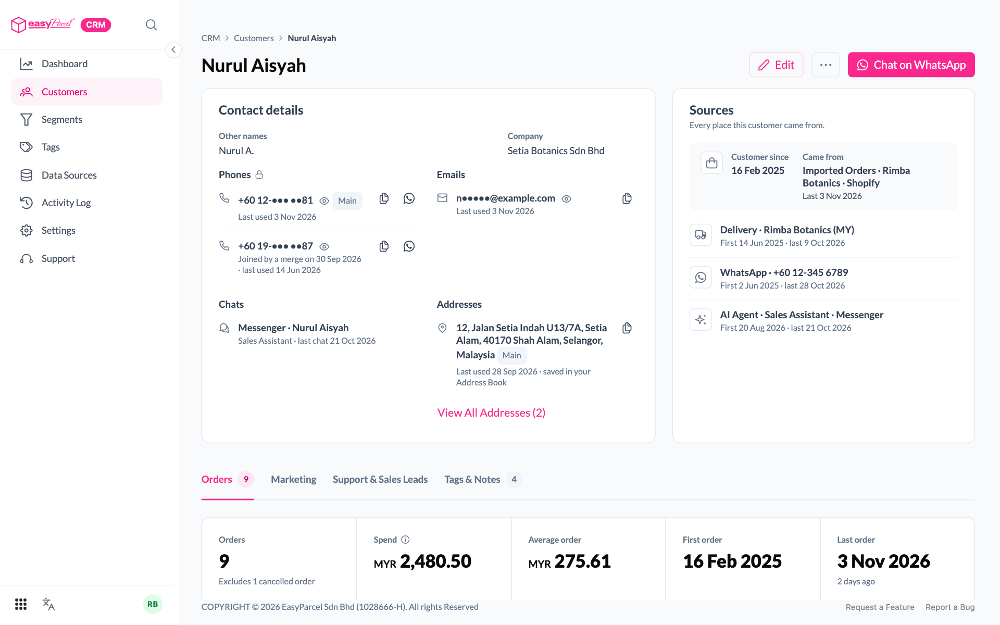

At the top:

- **Edit** to change their details.
- **⋯ (More)** for Merge, Split Customer, View Activity, Report a Problem and Delete Customer.
- **Chat on WhatsApp** opens a WhatsApp chat with the customer's main phone.

On the left:

| Section | What it shows |
|---|---|
| **Customer since** | The date of their earliest source: their first order, shipment or chat, or when they were added or imported |
| **Sources** | Every place this customer came from, **Came from** first, with the first and last date for each |
| **Contact details** | Every phone, email, address and chat they have used, main one first, with when each was last used and in which shipping account's Address Book. Use the **copy** icon to copy one, or the **WhatsApp** icon beside a phone to chat. |
| **Key numbers** | Orders, spend, average order, first and last order. Spend is shown per currency. Cancelled orders aren't counted; when a customer has some, **Orders** says how many it leaves out. |
| **Delivery results** | Their parcels by result: **Delivered**, **In transit**, **Returned**, **COD returned** and **Cancelled**, plus how many parcels had a **failed attempt** |

> **Phones can't be edited.** A phone is what identifies a customer. If someone changes their number, add a customer with the new number, then merge the two.

The tabs on the right show what each kind of source knows about the customer. A tab shows only when it has something.

### Orders tab

Every order this customer has made, newest first, cancelled ones included. Click **>** on an order to see its parcels: the courier, tracking number, delivery result, any failed attempts, and the name, phone and address it was shipped to.

- **Search:** type part of an **order number**, **shipment number** (`ES-…`) or **tracking number** to find an order.
- **Delivery result:** show only the orders with a Delivered, In transit, Returned, COD returned or Cancelled parcel, or a failed attempt.
- **Source** and **Shipment:** show only one shipping account, store or booking method, or only orders that have (or don't have yet) a shipment.

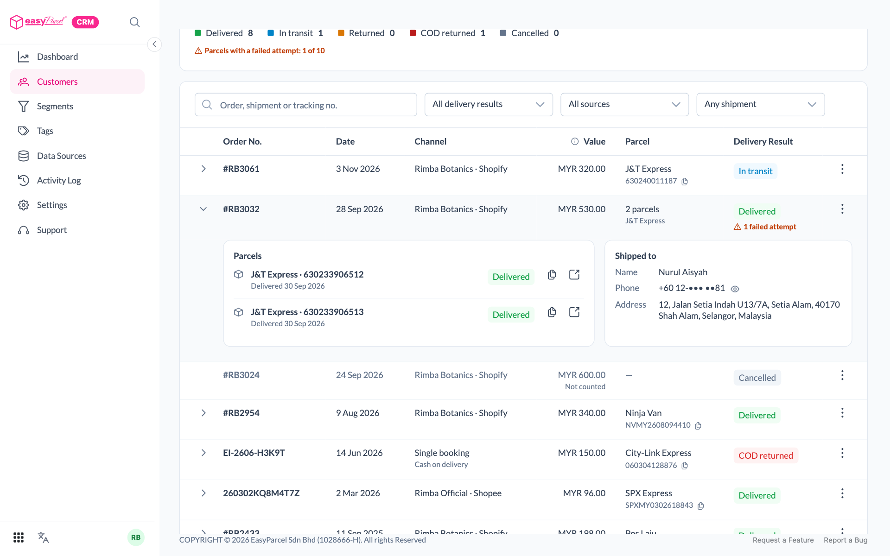

- A **cancelled** order says **Not counted** and **Cancelled** as its delivery result. It doesn't add to the customer's orders or spend.
- A **failed attempt** is a delivery try that didn't reach the customer, for example nobody was home. The parcel may still be delivered later, so it is shown beside the result.
- A few couriers don't report failed attempts. Their parcels say **Not reported**.
- Click the **open** icon on a parcel to go to its shipment.

### Marketing tab

The customer's **WhatsApp** chats with each of your business numbers: the first and last chat, and whether they asked not to get messages (**STOP**). Messages stay in WhatsApp: click **Open Chat** to go there.

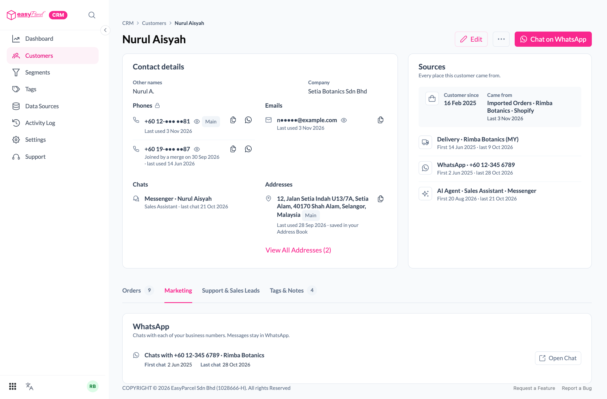

### Support & Sales Leads tab

The customer's **AI Agent** chats, per agent and channel, and the **lead** the AI Agent collected: its quality (Hot, Warm, Cold), status, product interest and company. Messages stay in AI Agent.

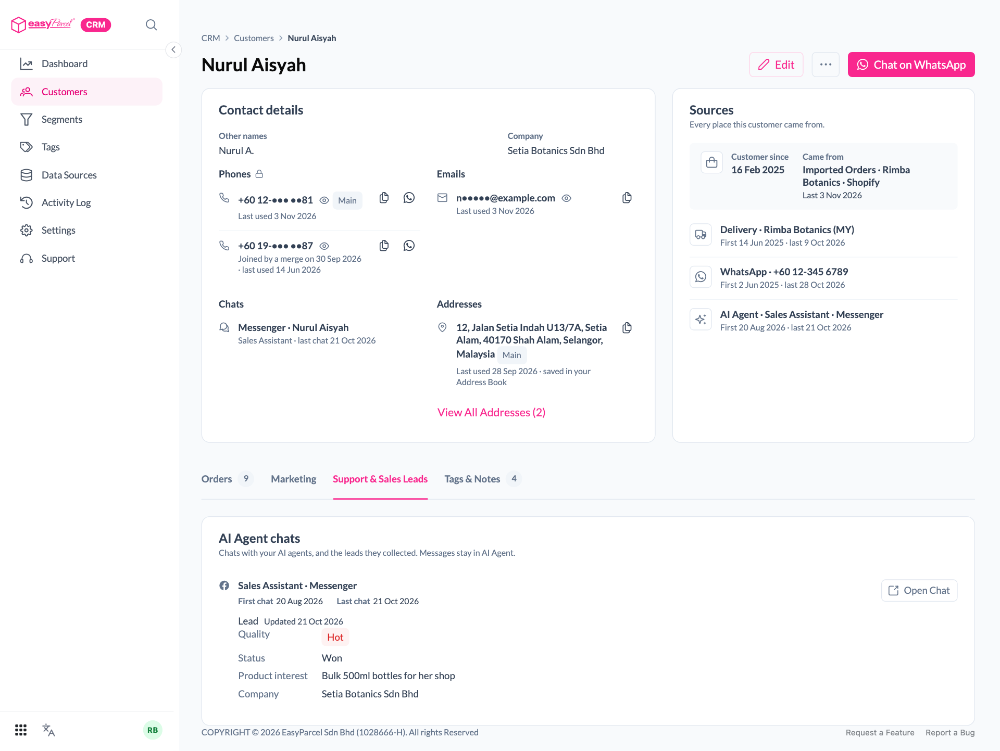

### Tags & Notes tab

- **Tags:** click **Add Tag** to put a tag on this customer, or **×** to take one off.
- **Notes:** type a note and click **Add Note**. Each note shows who wrote it and when. Only people in your organization with CRM access see notes. Click the **bin** icon to delete one.

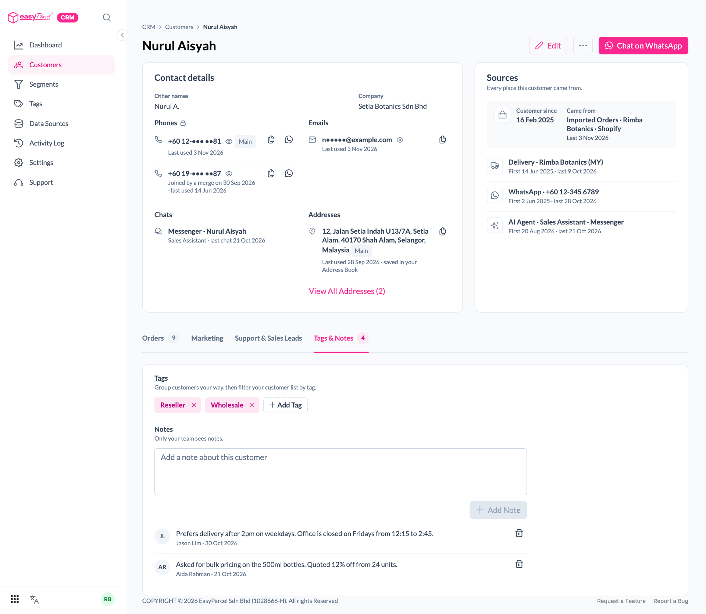

### More actions

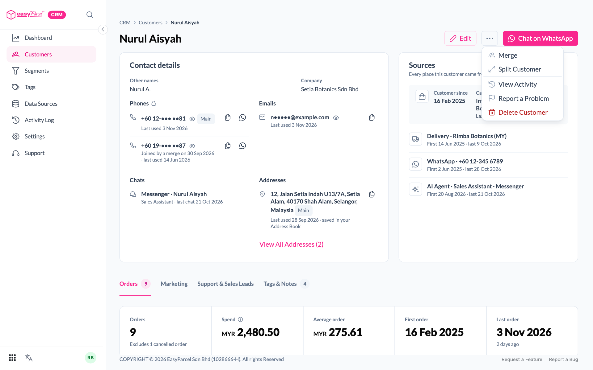

| Action | What it does |
|---|---|
| **Merge** | Combine this customer with others who are the same person. See [Part 6](#merge-customers). |
| **Split Customer** | Take a phone, with its orders, out into a customer of its own. Only shows when the customer has two or more phones. |
| **View Activity** | Opens the Activity Log for this customer only. |
| **Report a Problem** | Tell us the profile looks wrong (for example, two different people are mixed together). We use reports to improve how customers are matched. Sending one doesn't change the profile. |
| **Delete Customer** | Deletes the profile, with its tags and notes, for example when the customer asks you to. Their shipments, store orders and chats stay where they are. |

---

## Part 6 — Add, edit, merge and split customers

### Add a customer

1. On the **Customers** page, click **Add Customer**.
2. Enter the **Phone**. It is the only field you must fill in, and it can't be changed later.
3. Add a **Name** and **Company** if you have them.
4. Use **Emails**, **Addresses** and **Tags & Note** on the left to add more, now or later.
5. Click **Add Customer**.

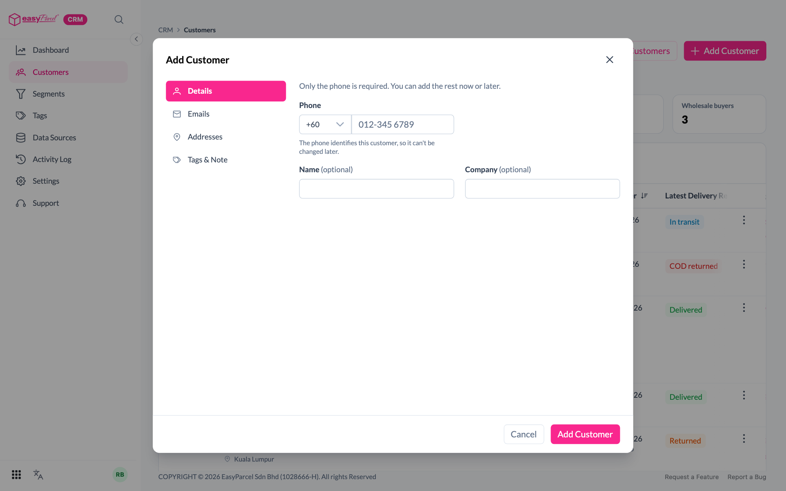

When you add an address, **Also save to Address Book** is ticked, so the address fills in when you book. Choose which shipping account's Address Book under **Save to the Address Book of**: it lists the shipping accounts whose Address Book you can edit. It needs the customer's name, address line 1, postcode, city and state. Untick it to keep the address in CRM only.

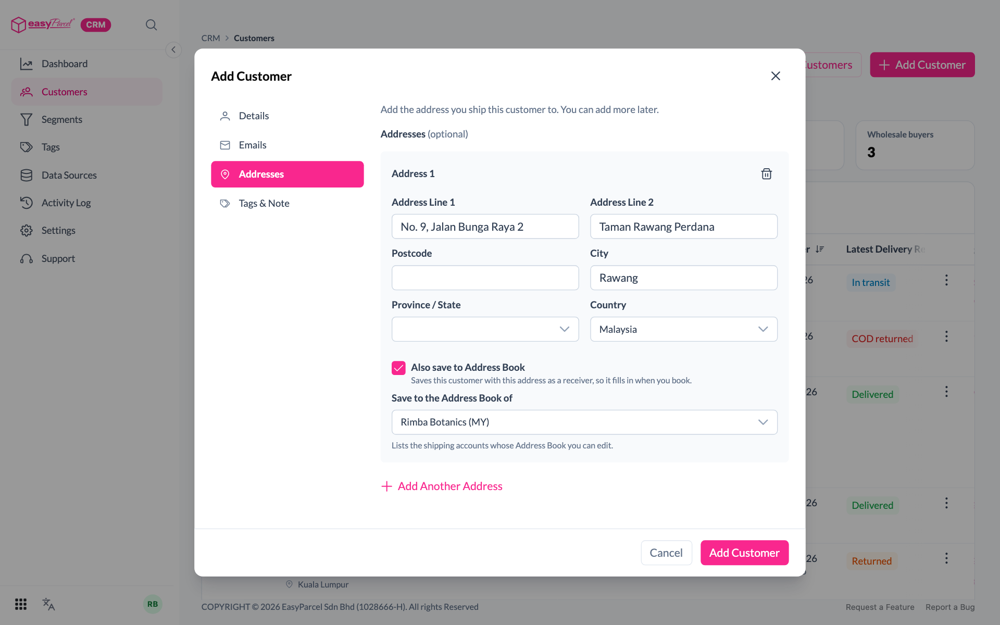

If the phone already belongs to a customer, CRM says so and links to that customer instead, because a phone can belong to only one customer.

### Edit a customer

Open the profile and click **Edit**.

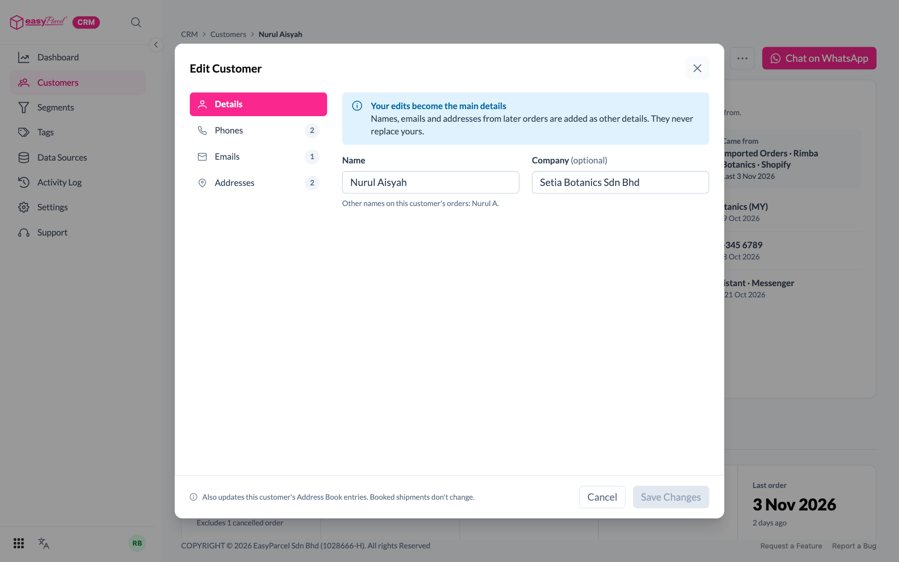

- **Your edits become the main details.** Names, emails and addresses from later orders are added as *other* details. They never replace yours.
- Editing also updates the customer's matching entries in the **Address Books** of linked shipping accounts where you can use the Address Book.
- **Shipments you've already booked never change.** New bookings use the new details.

### Merge customers

When two or more profiles are the same person, merge them. Their phones, emails, chats, orders, sources, tags and notes come together in one profile, and **new orders and chats to any of their phones land on the merged customer**.

1. Open one of the profiles and click **⋯ → Merge**. (Or tick two or more customers on the Customers page and click **Merge**, or click **Merge** on a possible duplicate.)
2. Search for the other customer and pick them.
3. Choose the **main profile**. Its name and details lead; the others' names, emails and addresses are kept as other details.
4. Optionally type a **Name after merging**.
5. Check **After merging**, then click **Merge Customers**.

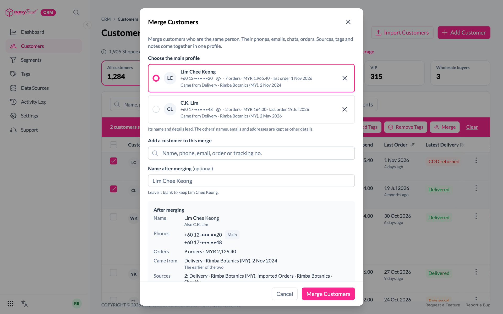

> Merged by mistake? Split a phone back out from the profile.

### Split a customer

When one profile holds two people, split one of them out.

1. Open the profile and click **⋯ → Split Customer**.
2. Choose the **phone, email or chat to take out**.
3. Check what **stays** and what **becomes a new customer**, then click **Split Customer**.

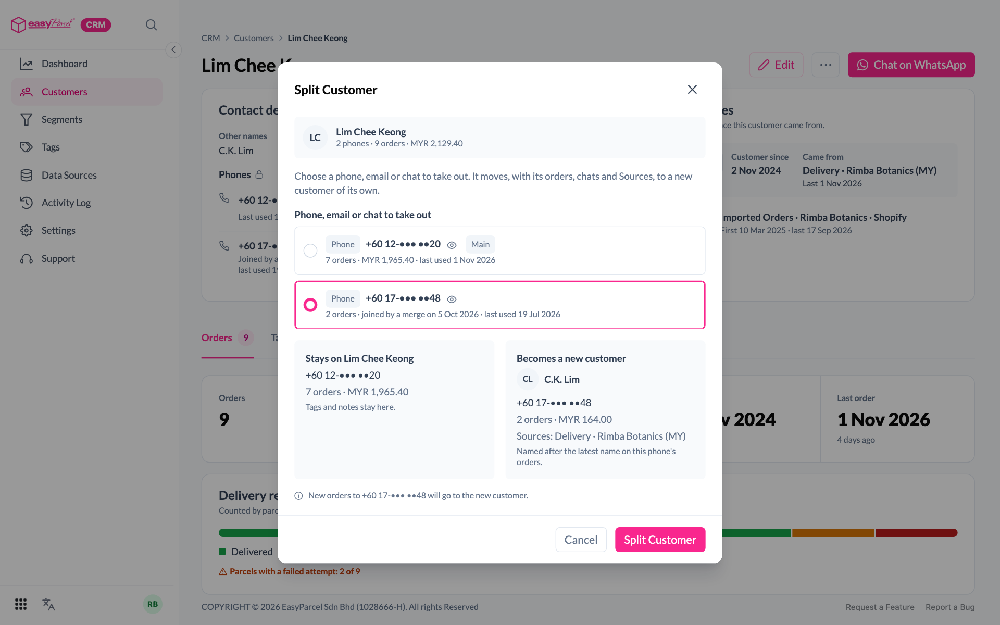

It moves, with its orders, chats and sources, to a new customer named after the latest name on its orders. Tags and notes stay on the original profile. New orders to that phone go to the new customer.

### Move one order to another customer

If a single order belongs to someone else:

1. Open the profile's **Orders** tab.
2. Click **⋮** on the order and choose **Move Order**.
3. Pick the customer to move it to, check **After the move**, and click **Move Order**.

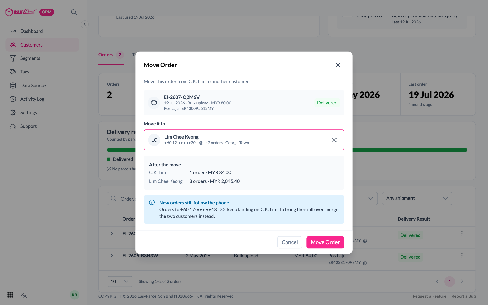

> New orders still follow the phone. To bring all of one phone's orders over, merge the two customers instead.

### Delete a customer

Open the profile, click **⋯ → Delete Customer**, choose a reason and confirm. Only people who manage CRM (the organization owner and admins) can.

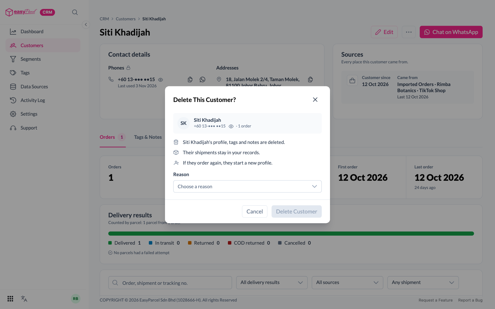

- The customer's profile, tags and notes are deleted.
- Their shipments, store orders and chats stay where they are.
- CRM keeps only their phone, email and chat id, marked as deleted, so the next sync doesn't bring the profile back. If they order or message you again, they start a new profile.

### Report a problem with a profile

If a profile looks wrong, click **⋯ → Report a Problem**, choose what looks wrong, add a comment if you like, and click **Send Report**.

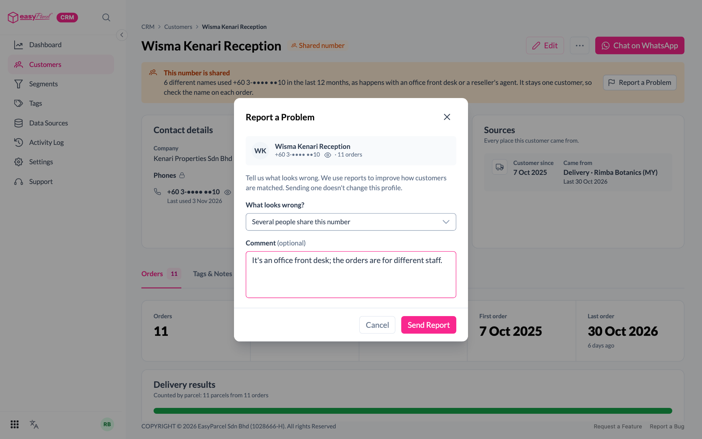

---

## Part 7 — Segments and tags

### Segments

A segment is a saved set of conditions, like *Wholesale buyers who ordered in the last 90 days*, that everyone in your organization opens in one click.

The **Segments** page lists every saved segment, with its conditions and how many customers match it now. Click **View Customers** to open one in your list.

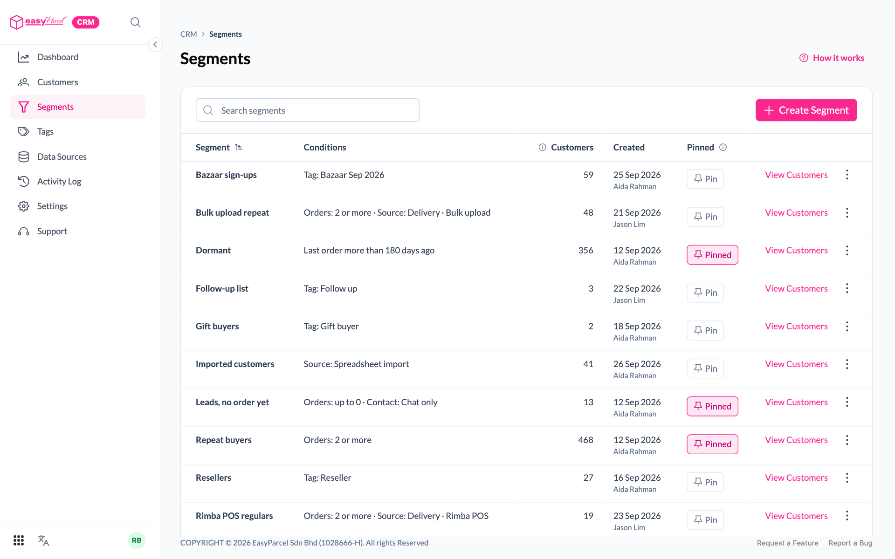

**Create a segment**

1. Click **Create Segment**.
2. Give it a **Name**.
3. Pick a **Preset**, or **None** to start with no conditions. A preset fills in the conditions for you.
4. Add or change **Conditions**: source, orders, spend, tags or location. Customers must match every condition. You see how many match as you go.
5. Click **Save Segment**.

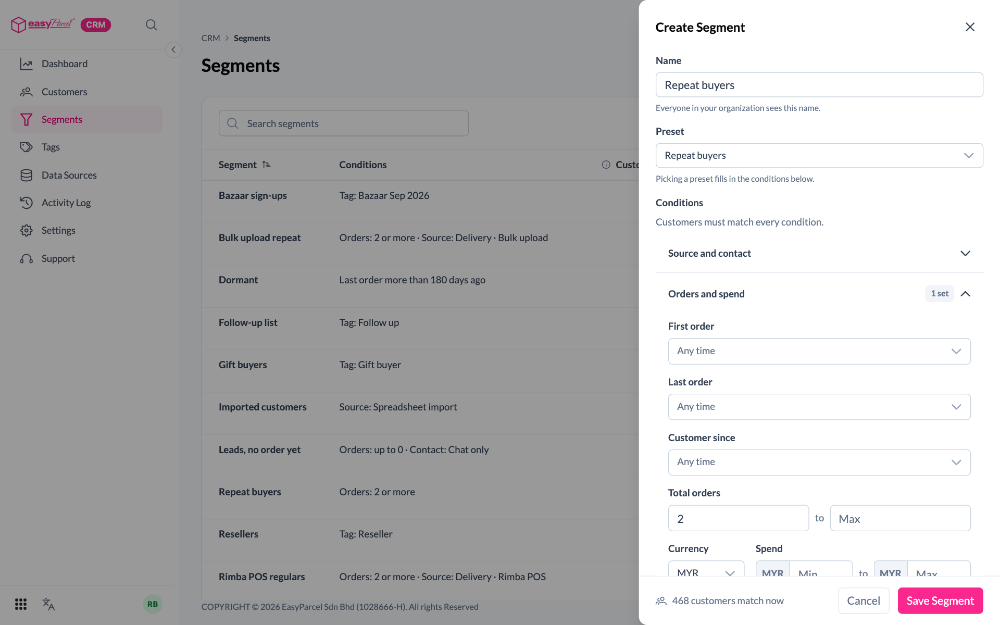

| Preset | Starts with |
|---|---|
| **Repeat buyers** | 2 or more orders |
| **One-time buyers** | Exactly 1 order |
| **VIP** | Top 25% by spend |
| **Dormant** | No order for more than 180 days |
| **New** | Customer since: in the last 30 days |
| **Last 30 days orders** | Ordered in the last 30 days |
| **Leads, no order yet** | From AI Agent, no orders yet |
| **Country**, **State** | Pick one or more countries or states |
| **By source**, **By store**, **By tag** | Pick one or more sources, stores or tags |

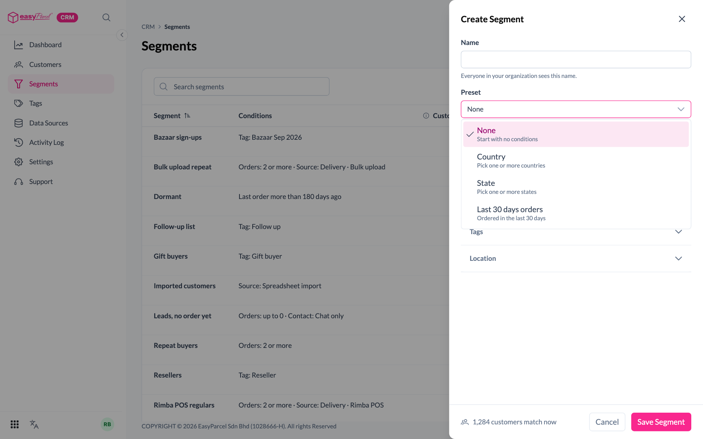

**Pin a segment** with **Pin to Customers**. Pinned segments show as cards above the Customers list, for everyone in your organization. **Unpin** takes the card away; the segment stays.

Use **Edit** to change a segment's name or conditions, and **Delete** to remove it for everyone. Deleting a segment doesn't change any customer.

### Tags

A tag is a name you give customers yourself, such as *Wholesale* or *Follow up*, so you can find them again.

On the **Tags** page you can **Create Tag**, see how many customers have each tag, click **View Customers**, and use **⋮** to **Rename** or **Delete** a tag. Deleting a tag takes it off every customer; the customers stay.

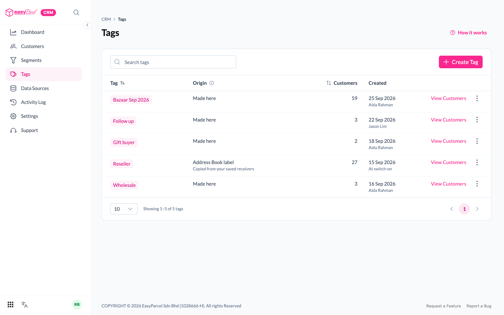

| Origin | Meaning |
|---|---|
| **Made here** | A tag someone in your organization created in CRM |
| **Address Book label** | Copied from the labels on your saved receivers, when the source came in and whenever a saved receiver gets a new label. Renaming or removing it in CRM doesn't change your Address Book. |

---

## Part 8 — Import customers

Import customers from a **CSV or Excel** file, such as a list you keep in a spreadsheet or one exported from another system. Only people who manage CRM (the organization owner and admins) can import.

> Import opens when your customer list is ready, because it checks each phone against the customers you already have.

### Step 1: Upload your file

On the **Customers** page, click **Import Customers**. Drag your file in, or click **Choose File**.

- `.csv`, `.xlsx` or `.xls`, up to **50,000 rows** and **50 MB**.
- Row 1 holds the column names, and **every row needs a phone**.
- Not sure how to lay it out? Click **Download Template**.
- An Excel file with several sheets asks which sheet holds your customers.

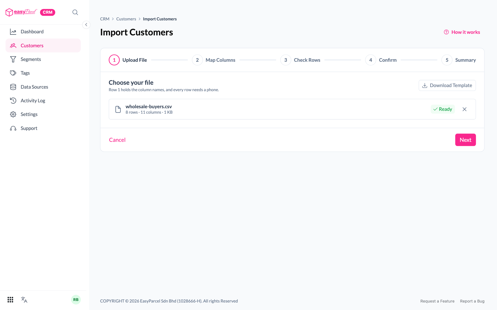

Click **Next**.

### Step 2: Map your columns

CRM matches your columns by their names. Check each one under **Imports As**, and change it if needed.

- **Phone** is required.
- Numbers without a country code get your organization's country code.
- Several tags in one cell? Separate them with commas. Tags you don't have yet are created.
- Set a column to **Don't import** to leave it out.

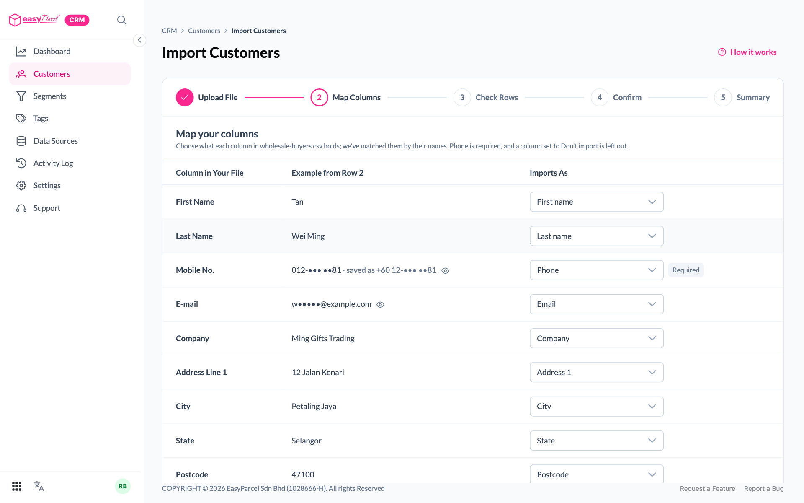

Click **Check Rows**.

### Step 3: Check the rows

CRM checks every row before anything is saved:

| Box | Meaning |
|---|---|
| **Will be added** | New customers |
| **Will be updated** | Customers you already have, matched by phone, or by email for a customer CRM knew only by email: blanks are filled in and tags are added. **Nothing is overwritten.** |
| **Will be skipped** | Rows with errors, listed below with the reason, such as a missing or invalid phone |

Click **Download Error Rows** to get the skipped rows in a file, fix them, and import them later.

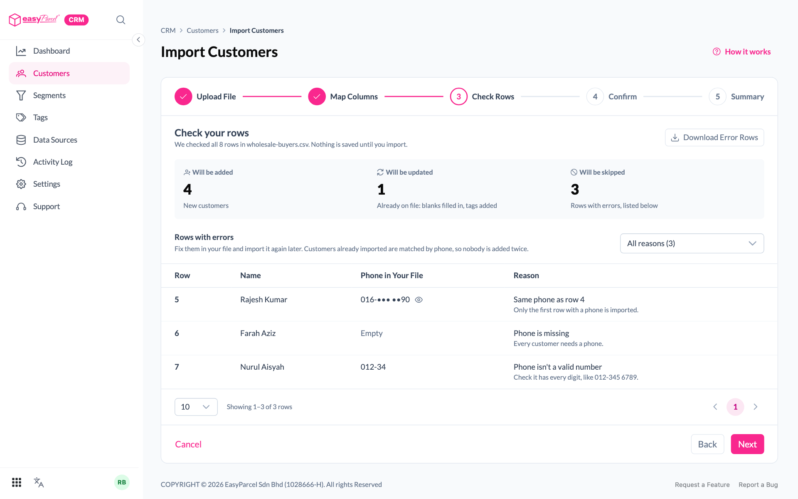

Click **Next**.

### Step 4: Confirm

1. Optionally, **Tag everyone in this import**, for example `Bazaar Oct 2026`, so you can find them later.
2. Tick **Also save to Address Book** if you want new customers with a complete address saved as receivers. It is off for imports.
3. Tick **I confirm I'm allowed to use the data in this file**.
4. Click **Import … Customers**.

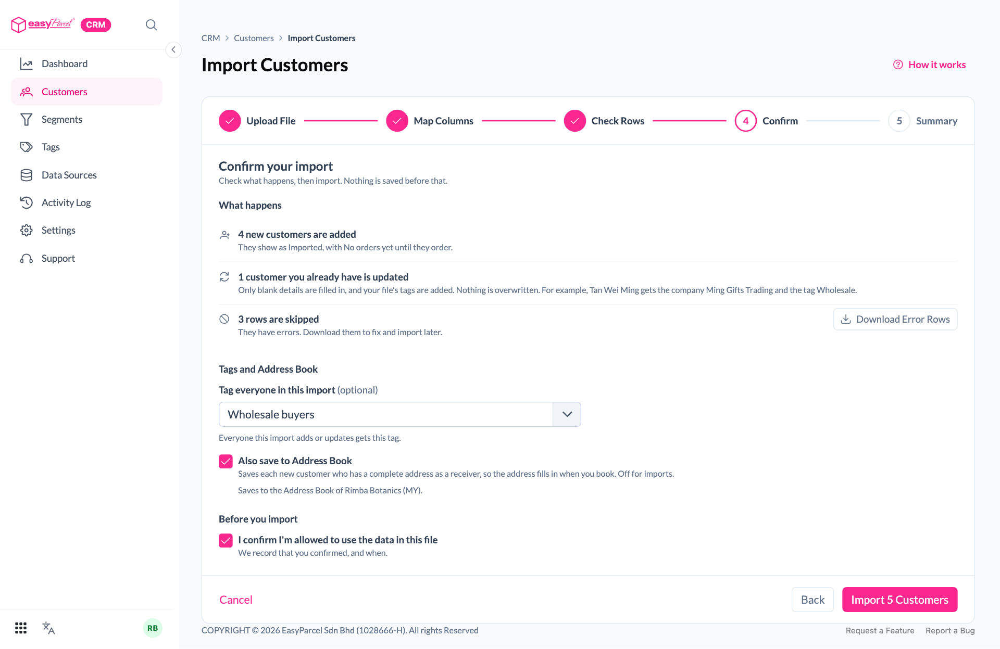

Rows are saved in batches. **Keep the page open until it finishes.** If you leave, the import stops, and the rows already imported stay saved.

### Step 5: Summary

The summary shows how many customers were **added**, **updated**, **skipped** and **failed**. Click **View Imported Customers** to see them in your list. Each import is also a source: its customers show **Spreadsheet import** with the file name and date.

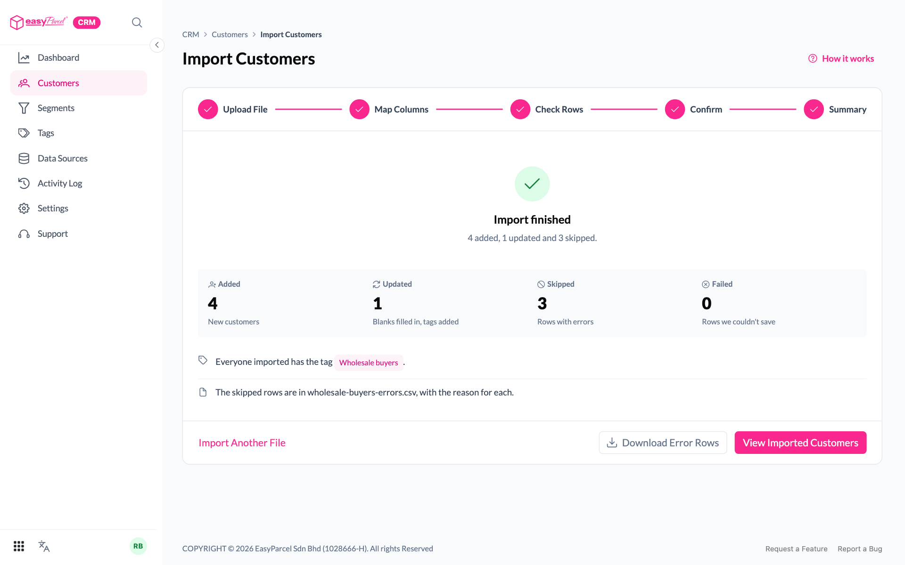

> You can import the same file again after fixing it. Phones already on file are matched, so nobody is added twice.

---

## Part 9 — Activity Log and Settings

### Activity Log

The **Activity Log** shows who changed what in your CRM, and when: adding, editing, merging, splitting, moving, importing and deleting customers, tags, notes, segments, data sources and settings.

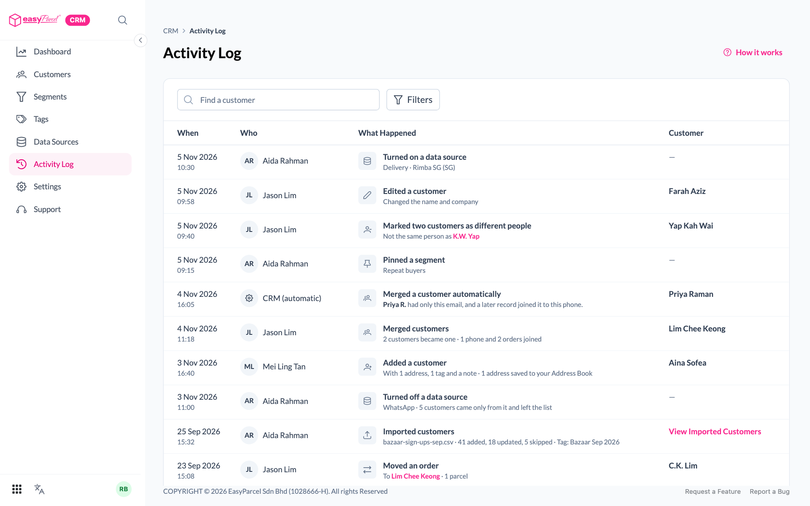

- The **organization owner and admins** see everyone's activity. **Members** see only their own.
- Use **Find a customer** to see one customer's activity, or **Filters** to narrow by action, person and date.
- EasyParcel Support can open your CRM only as a member of your organization, with that member's access. What they do is recorded and shown as **EasyParcel Support**.

### Settings

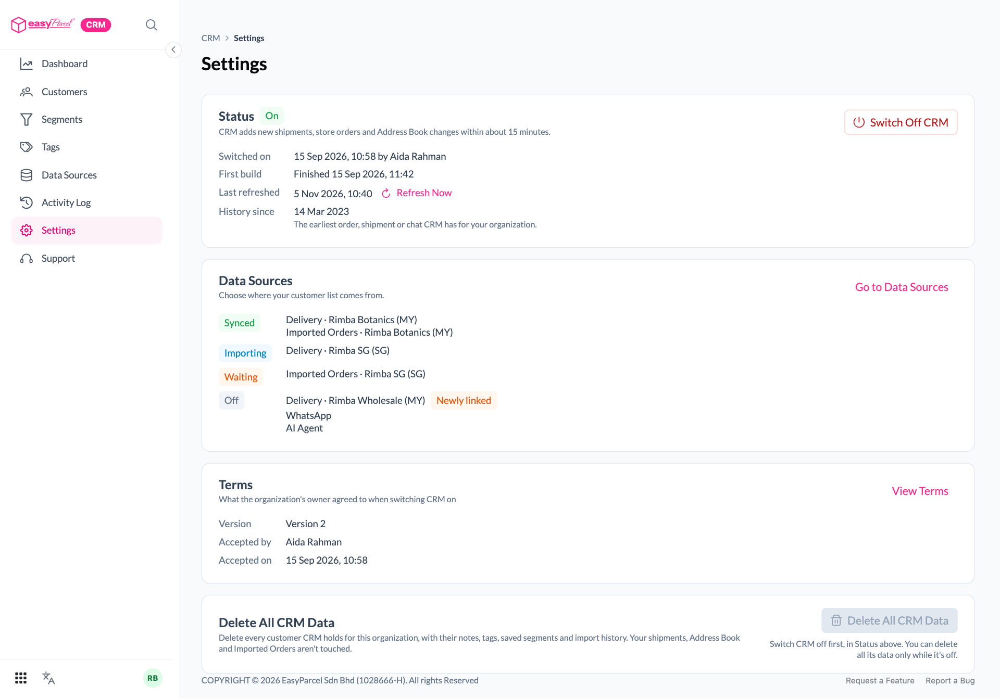

| Section | What it does |
|---|---|
| **Status** | Shows whether CRM is **On** or **Off**, when it was switched on, when the first build finished and the **Last refreshed** time. |
| **Refresh Now** | Fetches new shipments, orders and chats now, instead of waiting for the next update (about every 15 minutes). |
| **Data Sources** | Opens [Data Sources](#part-2--data-sources). |
| **Switch Off CRM** | Your data sources stop bringing in new orders, shipments and chats, and no new customers are added. Your customers stay, with their tags and notes, and the data sources keep their switches. To switch CRM on again, you accept the terms again, and it catches up on everything since. Organization owner only. |
| **Terms** | Which version of the terms the organization's owner accepted, by whom and when. Click **View Terms** to read them. |
| **Delete All CRM Data** | Deletes every customer CRM holds for this organization, with their notes, tags, saved segments and import history. Your shipments, Address Book and Imported Orders aren't touched, and the Activity Log stays. Only while CRM is off: switch it off first, then type the word shown to confirm. Organization owner only. **This can't be undone.** |

Only the organization owner and admins can change Settings.

---

## Where your customers come from

Every customer has one or more **sources**. The first one is where they **came from**; **Customer since** is that source's earliest date.

| Source | What it adds |
|---|---|
| **Delivery** · *shipping account* | The account's bookings with no store order, their shipments, delivery results and failed attempts, and its Address Book, with names, phones, emails, addresses and labels. A saved receiver who hasn't ordered yet is marked **No orders yet**. |
| **Imported Orders** · *store* | Orders from the stores connected under that account in Imported Orders, such as Shopify or Shopee, with each order's grand total and the parcels that ship it. |
| **WhatsApp** · *business number* | Everyone who chatted with your WhatsApp business numbers: name, phone, chat dates and whether they asked not to get messages. Never the messages. |
| **AI Agent** · *agent and channel* | Everyone who chatted with your AI agents, on WhatsApp, WhatsApp Web, Messenger, Instagram, Telegram, Lark or your website, and the leads the agents collected. Never the messages. Anonymous website visitors are left out. |
| **Added by hand** | Customers someone in your organization added. |
| **Spreadsheet import** · *file and date* | Customers from an import. |

**How customers are matched**

- One customer per **phone**. A person with no phone is matched by **email**, and a person with neither by their **chat id**: a **chat-only customer**.
- A customer who shows up in two shipping accounts, or in a shop and a chat, is **one customer** with several sources.
- CRM joins two customers on its own only when a new order or chat proves they're one person. It never merges on a guess: lookalikes go under **Possible duplicates** for you to decide.

**How the numbers are counted**

- **Orders:** one order is one sale. A store order counts once however many parcels it took. A booking with no store order is one order.
- **Spend:** a store order adds its **grand total**. A booking adds the **declared parcel value as entered**. Spend is kept **per currency** and never converted, so a customer who bought in MYR and SGD shows both.
- **Delivery results** count **parcels**, not orders.
- A **cancelled** order, whether a store order or a booking, stays in the customer's history marked **Cancelled**, but isn't counted in orders or spend. Someone whose only booking was cancelled is still in your list, with **Cancelled** as their latest delivery result.
- Chats, imports and customers added by hand have no orders of their own until the customer orders.

---

## Who can do what

What a person can do in CRM comes from their **role in your organization**, set in EasyAccount.

| Action | Owner | Admin | Member |
|---|---|---|---|
| View the Dashboard, customers, profiles and segments; search, filter, sort | ✅ | ✅ | ✅ |
| Reveal masked phones and emails, Chat on WhatsApp | ✅ | ✅ | ✅ |
| Refresh Now | ✅ | ✅ | ✅ |
| Add, edit, merge and split customers, move orders | ✅ | ✅ | ✅ |
| Add and remove tags, add and delete notes; create, edit and pin segments and tags | ✅ | ✅ | ✅ |
| Import customers | ✅ | ✅ | — |
| Delete a customer | ✅ | ✅ | — |
| Turn data sources on or off, change Settings | ✅ | ✅ | — |
| Activity Log | Everyone's | Everyone's | Their own |
| Switch CRM on or off, accept updated terms | ✅ | — | — |
| Delete all CRM data | ✅ | — | — |

A **Billing** role has no CRM access.

---

## Your customers' privacy

- **Your list stays in this organization.** It's built only from the sources you turn on. Other organizations, other merchants and EasyParcel's own marketing never use it.
- **Chats bring in people, never messages.** From WhatsApp and the AI Agent, CRM keeps names, phones, emails, chat ids and chat dates, never what was said. Details from WhatsApp, Messenger and Instagram are kept for your organization alone, and leave CRM when you turn the source off.
- **Phones and emails are masked on screen** until someone reveals one, one at a time. Addresses show in full.
- **Only people who manage CRM can import**, and they confirm before each import that they're allowed to use the data in the file. CRM has no export.
- **Every change is recorded** in the Activity Log, including what EasyParcel Support does.
- **You can delete a profile when a customer asks.** Their tags and notes go too; their shipments, store orders and chats stay where they are.
- You are responsible for how you use your customers' data, under Malaysia's Personal Data Protection Act 2010, Singapore's Personal Data Protection Act 2012 and Brunei's Personal Data Protection Order, 2025.

---

## Troubleshooting and FAQ

**It says "Your role doesn't include CRM".**
Your role in this organization doesn't give you CRM access. Ask your organization owner or an admin to give you access in EasyAccount.

**It says "CRM isn't available for … yet".**
CRM is open to invited organizations only. Switch to an organization that has CRM, or contact EasyParcel support.

**It says "You're not a member of this organization".**
Switch to an organization you belong to, or ask its owner to invite you in EasyAccount.

**It says "Ask your organization owner to switch on CRM".**
Only the organization owner can switch CRM on. You can use it as soon as they do.

**It says "Accept the updated terms to keep using CRM".**
The CRM terms have changed. CRM is paused until the organization owner opens CRM and accepts them. Nothing is lost meanwhile: CRM keeps bringing in customers from your data sources.

**It says "CRM access has ended for …".**
Your customer list, tags and notes are kept. Contact EasyParcel support if you'd like to keep using CRM.

**My list is empty.**
No data source is on yet. Turn one on in **Data Sources**.

**A shipping account is missing from Data Sources.**
It isn't linked to your organization, or it isn't shared with organization products. The organization's owner links and shares shipping accounts in EasyAccount.

**Some of my Shopee, Lazada, TikTok Shop or Amazon orders are missing.**
These platforms hide the buyer's phone on most orders, and CRM joins orders to customers by phone. Those orders are left out and counted. Click the coverage line on the Customers page to see how many for each store. An order that does carry a full phone is matched like any other.

**A new order or chat isn't showing yet.**
New shipments, store orders and chats appear within about 15 minutes. Click **Refresh Now** in **Settings** to fetch them now.

**One profile holds two different people.**
Split it: **⋯ → Split Customer**. If they share one phone, it stays one customer marked **Shared number**; check the name on each order.

**One person has two profiles.**
Merge them: **⋯ → Merge**. CRM lists the pairs it suspects under **Possible duplicates**.

**I turned a source off. Where did some customers go?**
Customers who came only from that source leave CRM, with their tags and notes. Customers another source also holds stay. Turn the source on again to bring its customers back; the tags and notes of those who left don't come back.

**I cancelled a booking. Why is it still on the customer's profile?**
A cancelled booking stays in their history, marked **Cancelled**, so you can see it happened. It isn't counted in their orders or spend. To see only those, pick **Cancelled** in the Orders tab's **Delivery result** filter.

**Someone I ship to also sends parcels with me. Are they a customer?**
Yes. Everyone you ship to or chat with is a customer. Only your organization's own phones and emails, the saved sender, pickup and return addresses of your linked shipping accounts, and your team members' phones are left out.

**The spend doesn't match my store.**
For a booking, CRM adds the declared parcel value as you entered it, which may be a placeholder. For a store order it adds the grand total. Spend is shown per currency and never converted.

**Why can't I see the full phone number?**
Phones and emails are masked on screen. Click the **eye** icon beside one to show it.

**Does editing a customer change my shipments?**
No. Shipments you've already booked never change. Edits also update the customer's matching Address Book entries, so new bookings use the new details.

**Does deleting a customer delete their shipments or chats?**
No. Only the CRM profile, tags and notes are deleted.

**Can I download my customer list?**
No. CRM has no export, so your customers' phones and emails stay inside EasyParcel.

**My import stopped partway.**
The rows already imported stay saved. Import the file again: phones already on file are matched, so nobody is added twice.

**Will my customer list keep updating if I switch CRM off?**
No. Switching off stops new customers being added, but your existing customers stay until you delete them. Switch it on again and it catches up on everything since.

---

## Need help?

Click **Support** in CRM's left menu, or WhatsApp us at **+604-2023160**.
