# 👯 Bulk Fulfillment Guide: Ship Many Orders at Once

> **TL;DR:** Tick your orders → **Fulfill Orders** → fix anything in red → **Create orders**. All your AWBs, ready in about 2 minutes. 🖨️

Got a mountain of orders? 🏔️ Don't ship them one by one like it's 2005. Bulk fulfilment lets you check every parcel and its courier on one page, fix what's missing, and book them all in one click. Perfect for busy days and big sales like 11.11 and 12.12. 🛍️

⏱️ **Time needed:** A few minutes, no matter how many orders
📍 **Where:** EasyParcel app in Shopify → **Orders**

---

## ✅ Before You Start

- 🔌 Your store is **integrated** ([Integration Guide](Integration-Guide.md))
- 📍 Your **Sender Details** and **courier zones** are set up ([Settings Guide](Settings-Guide.md))
- 🏠 Each order has a **shipping address** (orders without one are left unfulfilled)
- 💰 You have **enough credit** to cover *all* the orders (bulk adds up fast! 💸)

> 🆕 **First time shipping?** Try the [Single Fulfillment Guide](single-fulfillment.md) once first. Bulk works the same way, just with more orders.

> 📞 **Orders often missing a phone number?** Go to **Setting** → **Default Receiver Phone Setting** → **Activate**, and your sender phone is used whenever the receiver has none.

---

## ☑️ Step 1: Select Your Orders

1. Go to **Orders** and click the **Unfulfilled** tab.
2. Tick the **checkbox** next to each order you want to ship.
3. Click **Fulfill Orders**.

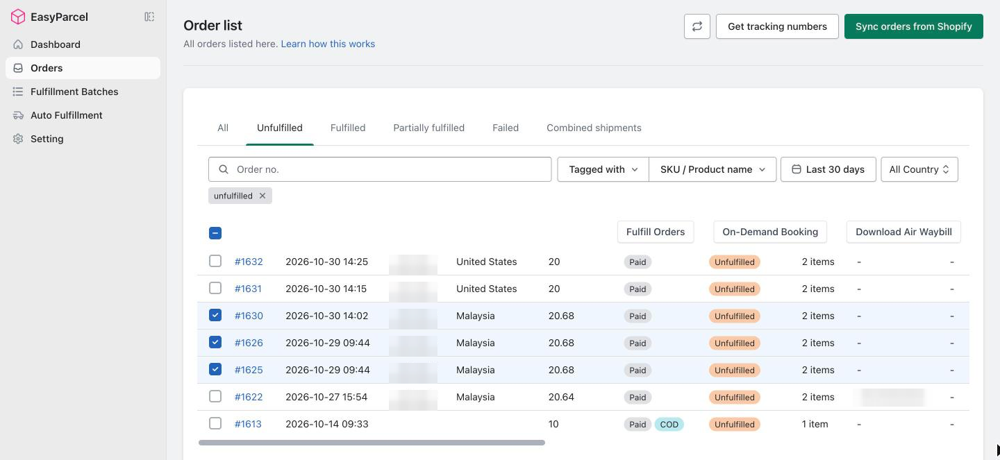

> 💡 **Tip:** Use the search bar and the filters (tags, SKU or product name, date, country) to find the orders you want faster.

---

## 🔍 Step 2: Meet the Bulk Fulfillment Page

Each order becomes a **parcel** row. The page fetches courier prices for every parcel as it opens. You'll see **Quoting couriers…** for a few seconds. ⏳

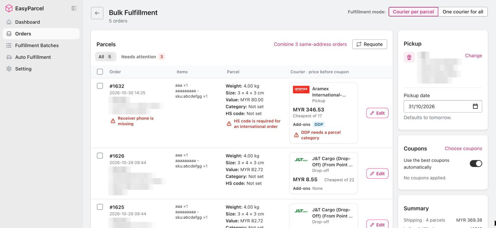

| Column | What you see |
|---|---|
| **Order** | Order number, date, receiver and address, plus any problem in red 🔴 |
| **Items** | The products and quantities in the parcel, with their SKU |
| **Parcel** | Weight, size, declared value, parcel category and HS code |
| **Courier** | The courier picked for this parcel, its price before coupons, and its add-ons |
| **Edit** | Opens the parcel so you can change it (**Step 5**) |

### 🏷️ Why this courier?

Every courier card tells you why it was picked:

| Label | Meaning |
|---|---|
| 💗 **Customer's choice** | The shipping option your customer chose at checkout |
| ⭐ **Preferred courier** | The courier you set in **Auto Fulfillment** → **Preferred courier**, even if another one is cheaper |
| 💸 **Cheapest of 22** | The cheapest of all the couriers for this parcel |
| 1️⃣ **Only courier available** | No other courier can take this parcel |

### 📋 The cards on the right

| Card | What to do |
|---|---|
| 🏠 **Pickup** | Your default sender address. Click **Change** to use another one |
| 📅 **Pickup date** | Defaults to **tomorrow**. Click it to pick another date |
| 🎟️ **Coupons** | See **Step 8** |
| 🧾 **Summary** | Number of parcels, the estimated total and the **Create orders** button |

> 🔄 **Prices feeling stale?** Click **Requote** above the parcel list to fetch fresh prices for every parcel.

---

## 🚚 Step 3: One Courier per Parcel, or One for All?

Pick your **Fulfillment mode** at the top right:

| Mode | Best for |
|---|---|
| **Courier per parcel** | Orders going to different places, or needing different couriers. Every parcel gets its own courier and price |
| **One courier for all** | Everything going out with the same courier. Pick it once in the **Courier** card on the right |

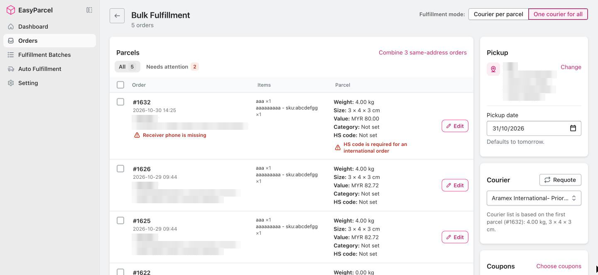

> ⚖️ **Heads up:** In **One courier for all**, the courier list is based on the **first parcel**. Edited a parcel or combined orders? Click **Requote** to refresh the courier options.

The app remembers the mode you used last. 🧠

Switching mode after you've made changes? The app checks with you first, because the page starts over: combined orders, parcel edits, courier choices and coupons are reset.

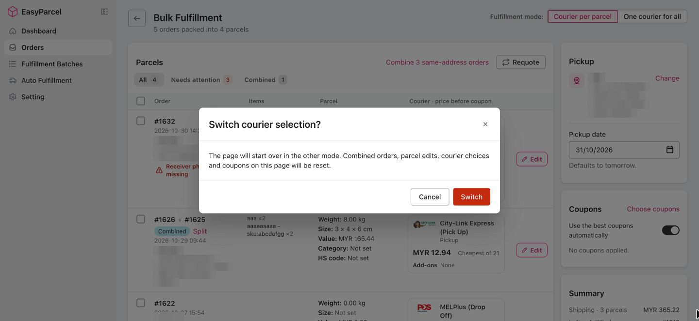

> 💡 **Tip:** Pick your mode **first**, then start editing.

---

## 🚨 Step 4: Fix Parcels That Need Attention

A parcel that can't be booked yet shows the reason **in red**. Click the **Needs attention** tab to see only those parcels. 🕵️

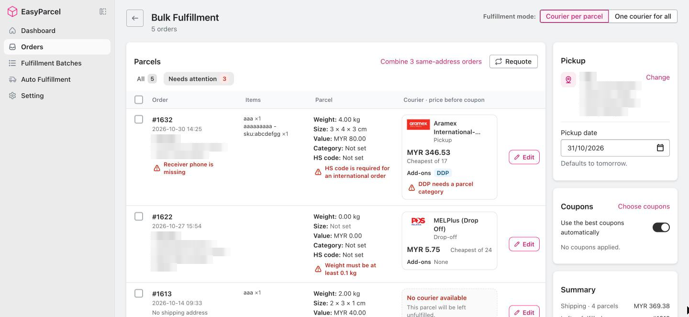

The **Summary** also tells you how many parcels need fixing. Click **Show** there to jump straight to them.

| Message | How to fix it |
|---|---|
| **Receiver phone is missing** | **Edit** → **Receiver details** → add a phone number |
| **HS code is required for an international order** | **Edit** → **Parcel details** → choose an HS code |
| **DDP needs a parcel category** | **Edit** → **Parcel details** → choose a **Parcel category** |
| **Weight must be at least 0.1 kg** | **Edit** → **Parcel details** → enter the weight |
| **No shipping address** | Add an address to the order in Shopify. Until then, it's left unfulfilled |
| **No courier available** | Check the weight, size and address, then click **Requote**. Still nothing? It's left unfulfilled |

> 🔒 **Create orders** stays greyed out until every parcel with a courier is ready. Parcels with **no address** or **no courier** don't hold up the rest. They're listed as **Left unfulfilled** in the Summary and stay in your Unfulfilled orders.

---

## ✏️ Step 5: Edit a Parcel

Click **Edit** on any parcel. The editor has four sections, and a **red dot** 🔴 marks the ones that need fixing.

> 📝 **Good to know:** Your changes apply to **this shipment only**, not to the order in Shopify. The exception is **Parcel category** and **HS code**, which are saved to the order once it's fulfilled successfully.

### 🏠 Receiver details

Name, phone, email, company and address. **Phone** is required, and tracking emails go to the **Email** address. 📧

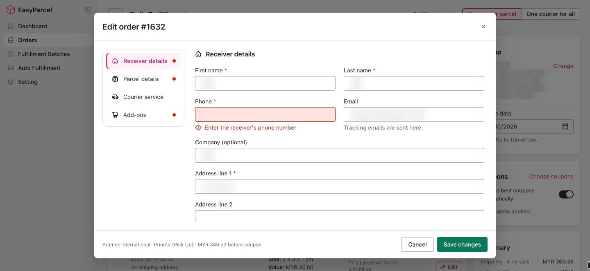

> 🏚️ **No shipping address?** The editor only shows *"This order has no shipping address. Add one on the order's page."* Add it in Shopify, then start the bulk fulfillment again.

### 📦 Parcel details

Weight, size, **Parcel category** and **HS code**. Click **Edit items** to change which items, and how many, go in the parcel.

- **Parcel category** is a must when **DDP** is on.
- **HS code** is a must for parcels going **overseas** 🌏, or when **EasyCover** is on. Type to search, then pick a code from the results.

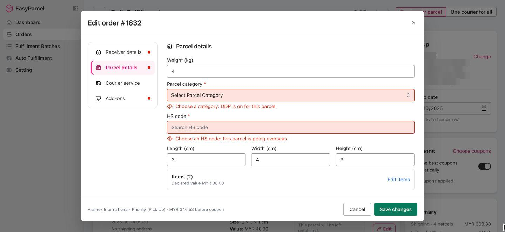

### 🚚 Courier service

Every courier that can take this parcel, with its price before coupons. Click one to pick it.

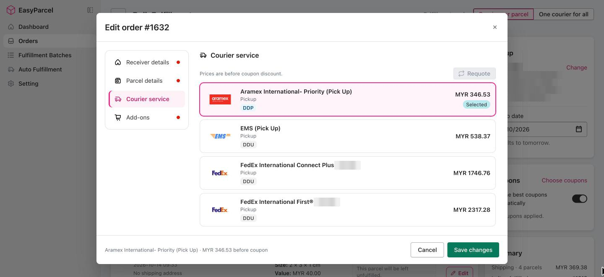

Changed the weight, size, items or address? The prices shown are from **before** your change, and a blue note says so. Either:

- click **Requote** to see the new prices now, or
- just click **Save changes**. The parcel is priced again when you save. 👌

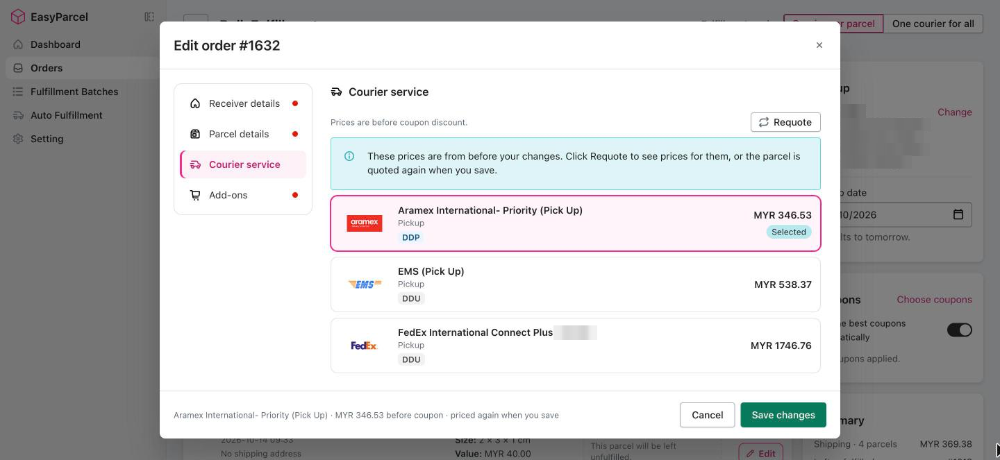

### 🛒 Add-ons

| Add-on | What it does |
|---|---|
| 📲 **Tracking notifications** | Keep your customer updated by **SMS**, **Email** or **WhatsApp** |
| 🛡️ **Parcel protection** | The courier's basic coverage, or **EasyCover** where offered |
| 🌏 **Delivered Duty Paid (DDP)** | You pay the import duties and taxes for overseas parcels, where the courier offers it |
| 💵 **Cash on delivery (COD)** | For orders paid by COD |

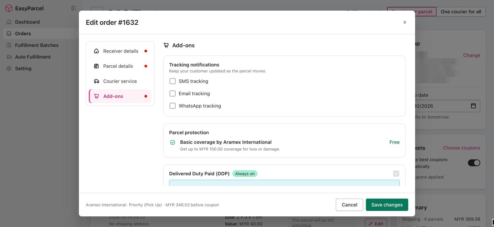

All done? Click **Save changes**, or **Cancel** to throw your changes away.

---

## ⚡ Step 6: Change Many Parcels at Once

Tick two or more parcels and three buttons appear above the list:

| Button | What it does |
|---|---|
| 📦 **Combine selected** | Ships the ticked orders as one parcel (**Step 7**) |
| 🚚 **Change courier** | Picks one courier for all the ticked parcels |
| 🛒 **Add-ons** | Turns tracking notifications on or off for all the ticked parcels |

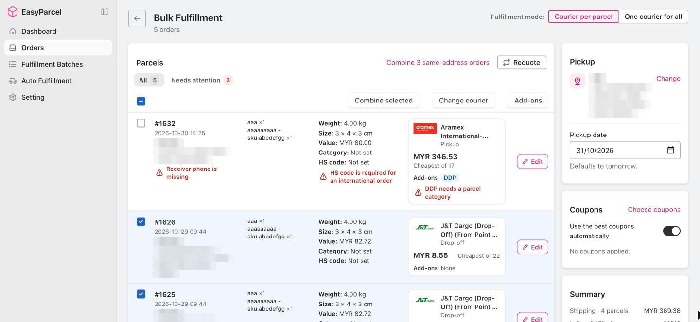

### 🛒 Add-ons for many parcels

Tick the notifications you want and click **Apply**. The ticked parcels are priced again with the new add-ons.

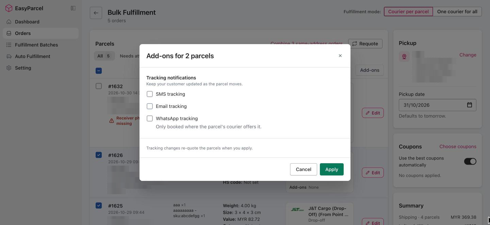

- 📧 **Email tracking** is skipped for parcels with **no email address**, and the pop-up tells you how many. Add an email under **Edit** → **Receiver details** first if you want them in.
- 💬 **WhatsApp tracking** is only added where the parcel's courier offers it.

### 🚚 Change courier for many parcels

The list shows every courier offered for at least one of the ticked parcels. The ones that can take **all** of them come first. 🥇 Prices are the lowest per courier, before coupons.

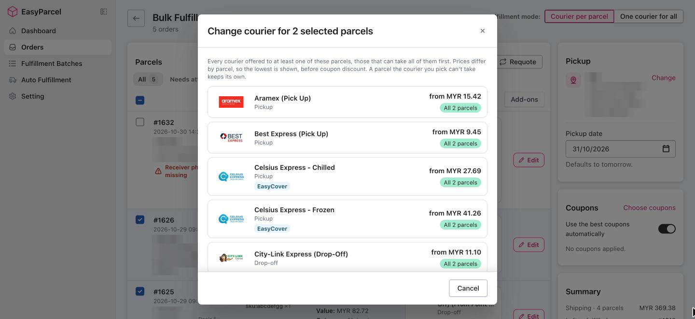

> 🧩 A parcel the courier you pick can't take simply keeps its own courier.

> ⏳ **Change courier** and **Add-ons** wait until prices are in. If you see **Quoting couriers…**, give it a few seconds.

---

## 📦 Step 7: Combine Orders Going to the Same Address

Shipping to the same customer more than once? The app spots it for you! 🕵️ Send them as **one parcel with one tracking number**.

- Click **Combine N same-address orders** above the list to combine every match, **or**
- tick specific rows and click **Combine selected**.

The combined parcel shows all its order numbers (e.g. **#1626 + #1625**) with a **Combined** label. Weights are added up, every item is included, and it's priced again as one parcel.

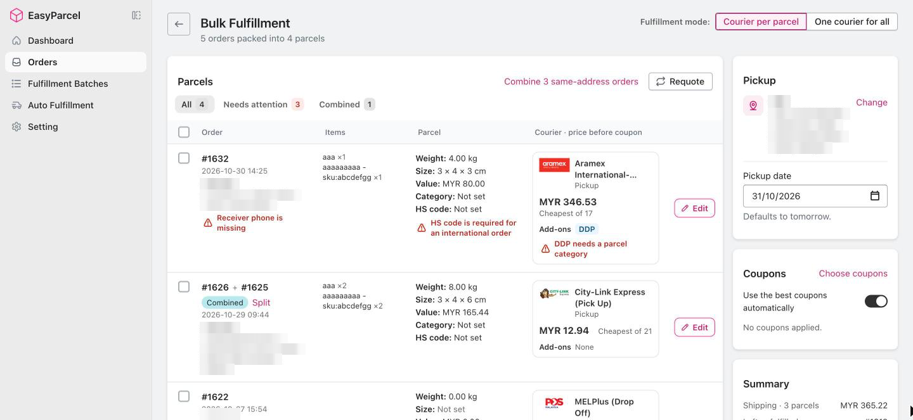

| Good to know | |
|---|---|
| 🏠 Same address only | Only orders going to the **same receiver address** can be combined |
| 🔢 Up to 20 | One parcel can hold up to **20 orders** |
| ✂️ Changed your mind? | Click **Split** to ship them separately again |
| 🗂️ Find them fast | The **Combined** tab shows only combined parcels |
| 💵 COD + prepaid | The parcel only collects what the COD orders still owe |

> 💸 **Why combine?** One parcel instead of several means fewer AWBs to print, less packing, and often lower shipping costs.

---

## 🎟️ Step 8: Coupons

The **Coupons** card wakes up once every parcel has a courier.

- **Use the best coupons automatically** (on by default) applies the best coupons you have.
- Click **Choose coupons** to see which coupons work for this batch and pick your own.

Your discount comes off the **Estimated total** in the Summary. 🤑

---

## 🚀 Step 9: Create Orders

Check the **Summary** one last time:

| Line | What it means |
|---|---|
| **Shipping** | The number of parcels and their price |
| **Left unfulfilled** | Orders that won't ship this time (no address or no courier) |
| **Estimated total** | What you'll pay, after coupons |

Everything looks good? Click **Create N orders**. 🎉

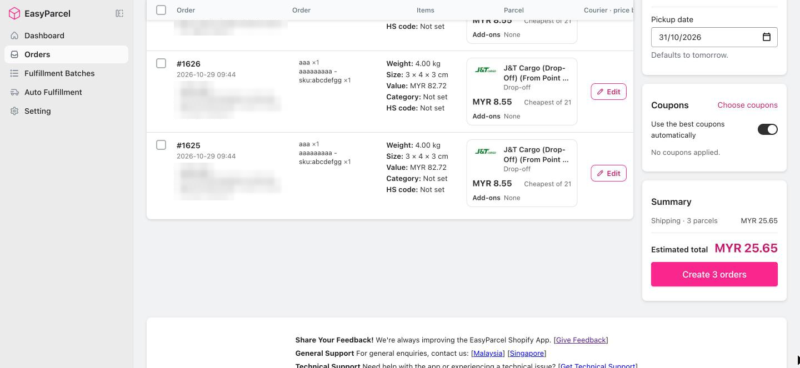

You'll see *"Orders are being processed. You will be redirected shortly."*, then the app takes you to the batch page.

---

## ⏳ Step 10: Grab Your AWBs

Your batch is now processing in the background.

| Timing | What happens |
|---|---|
| ⏱️ **~2 minutes** | Your **AWBs are ready** to download |
| ⏱️ **Up to 10 minutes** | Order statuses fully update in Shopify |

Grab a kopi ☕, then click **Reload page** and hit **Download AWB**. 🖨️

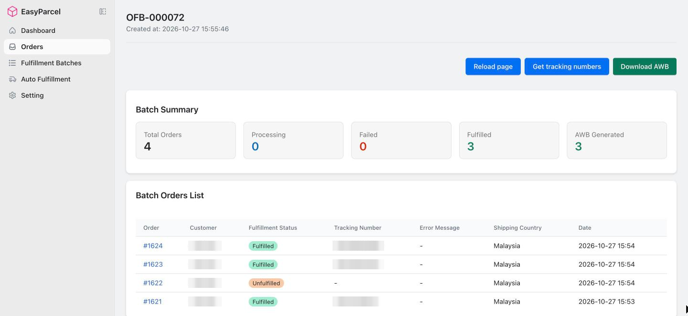

### 📊 Reading the batch page

| Section | What it shows |
|---|---|
| **Batch Summary** | Total orders, and how many are Processing, Failed, Fulfilled, and have AWBs generated |
| **Batch Orders List** | Each order's status, tracking number and any error message |

> 🔢 **Tracking numbers not showing yet?** Click **Get tracking numbers** to fetch the latest ones.

> 🛍️ **Orders not marked fulfilled in Shopify?** Turn on **Order Status Update Settings** on the **Setting** page so fulfilled orders are updated in Shopify with their tracking number.

### ❌ Something failed?

The **Error Message** column tells you why, e.g. **Insufficient Credit**. Fix the cause, then ship the order again from the **Failed** tab in **Orders**.

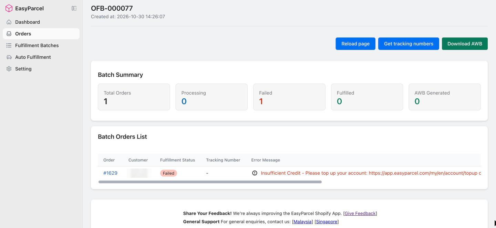

---

## 📋 Finding Your Batch Later

Every bulk shipment is saved as a **batch** with its own ID (e.g. **OFB-000072**).

1. Click **Fulfillment Batches** in the EasyParcel menu.
2. Click the **Batch ID** to open it.

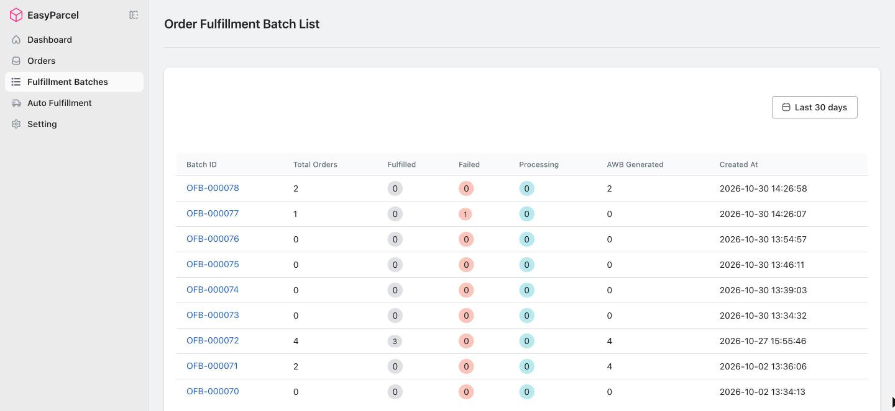

> 💡 **Handy for:** "Wait, did I already print labels for this morning's orders?" Just check your latest batch. 🧐

---

## 🛠️ Troubleshooting

| Problem | Try this |
|---|---|
| **Create orders** is greyed out | A parcel still needs fixing. Click **Show** in the Summary or the **Needs attention** tab (**Step 4**) |
| A parcel says **No courier available** | Check its weight, size and address under **Edit**, then click **Requote**. If no courier can take it, the rest of the batch still ships |
| Prices in the editor look out of date | Click **Requote**, or just save. The parcel is priced again when you save |
| Email tracking wasn't added to some parcels | Those orders have no email. Add one under **Edit** → **Receiver details**, then turn **Email tracking** on |
| Can't combine two orders | They must go to the same receiver address, and one parcel holds up to 20 orders |
| Lost my changes after switching mode | Switching mode starts the page over. Pick the mode first, then edit |
| An order is stuck on **Processing** | Big batches can take a few minutes. Click **Reload page**. Still stuck after 10 minutes? Contact us 👇 |
| **Insufficient Credit** | Top up your EasyParcel credit, then ship the order again from the **Failed** tab |

---

## 🤖 Want Even Less Work?

If you're bulk shipping every day, it might be time to let the app do it for you.

### 👉 [Try Auto Fulfillment](auto-fulfillment.md)

---

## 🙋 Need Help?

We're real humans, and we like helping. 💗

- 🇲🇾 **Malaysia:** [EasyParcel Malaysia Help Centre](https://app.easyparcel.com/my/en/contact-us)
- 🇸🇬 **Singapore:** [EasyParcel Singapore Help Centre](https://app.easyparcel.com/sg/en/contact-us)

---

  <b>Happy shipping! 📦✨</b> 
  <i>EasyParcel — Delivery Made Easy</i>

