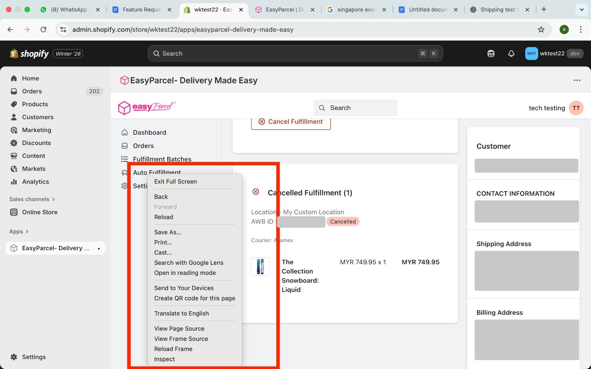
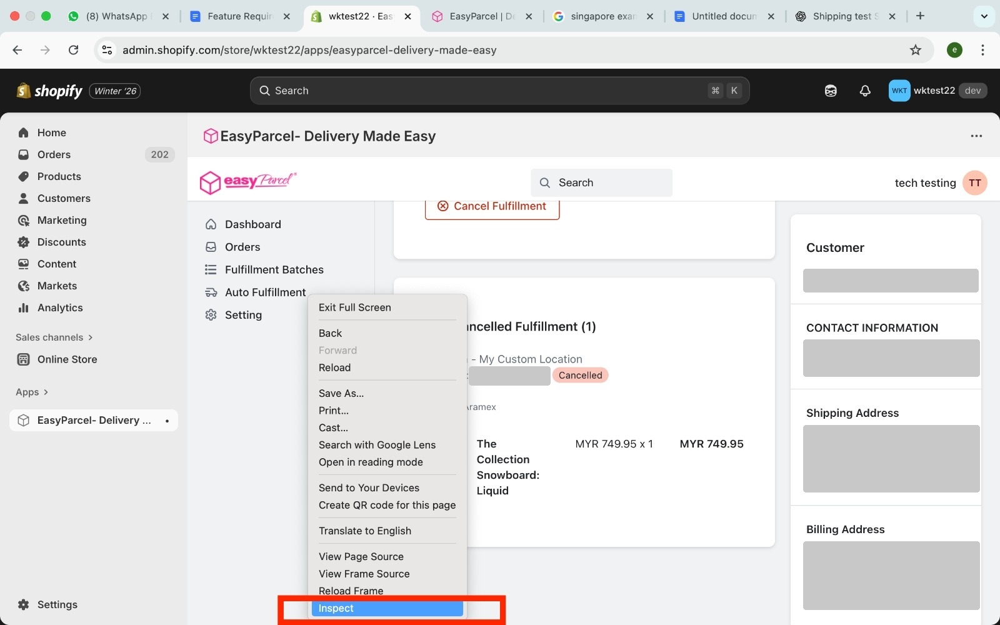
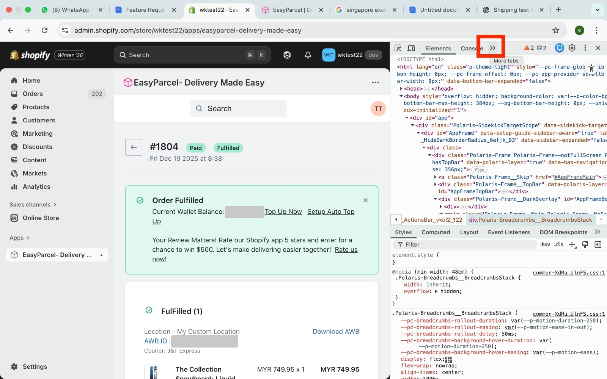
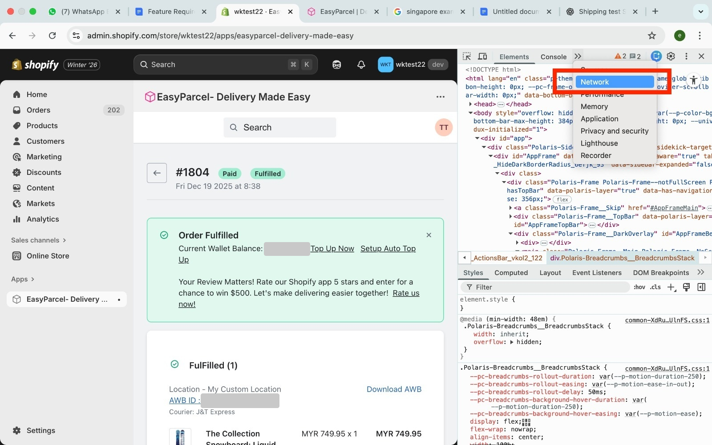
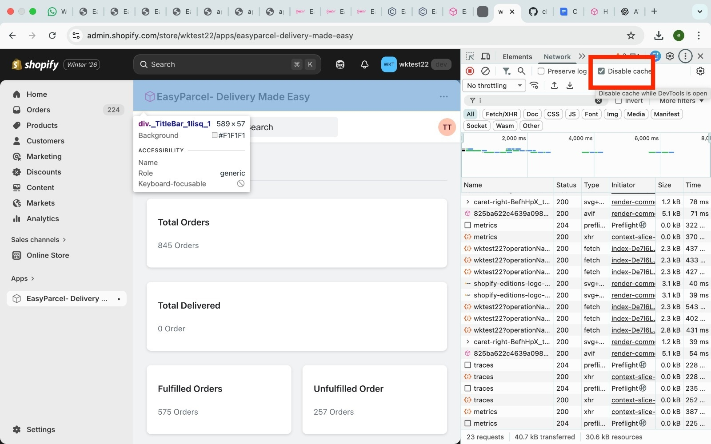
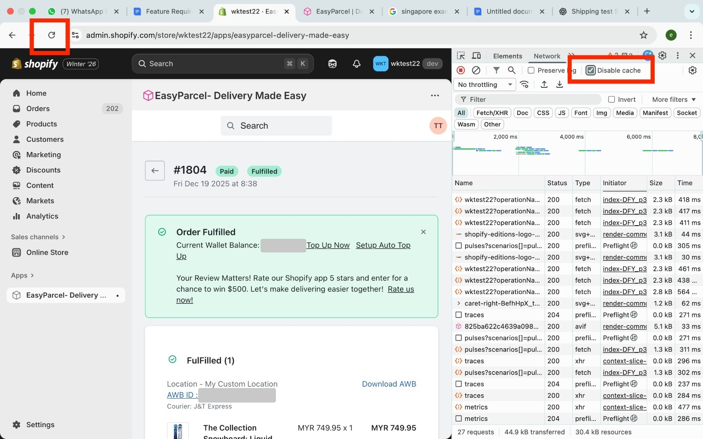

# Shopify: EasyParcel app shows a blank page

If the EasyParcel - Delivery Made Easy app opens as a blank page in your Shopify admin, your browser may be loading an old cached copy of the app. Clear it with the steps below (Google Chrome).

#### Step 1: Right-click on the EasyParcel app page (on a Mac, hold 'Control' and click). A menu will appear.

#### Step 2: Click 'Inspect'.

#### Step 3: The developer tools panel opens. Click the '>>' arrow button at the top of the panel.

#### Step 4: A menu will appear. Click 'Network'.

#### Step 5: At the top right of the Network tab, tick the 'Disable cache' box.

#### Step 6: **Keep the developer tools panel open** and refresh the page. The app should now load.

**Note:** 'Disable cache' only works while the developer tools panel is open. Once the app loads, you can close the panel.
